# ISC DHCP Server on a Debian 12 Router (LAN and DMZ)

## 📌 Objective / Overview

This lab configures a **DHCP server** on the Debian 12 router built in [Lab 01 – Debian 12 Router with LAN/DMZ Segmentation and NAT](../01-router-lan-dmz-nat/README.md). The server automatically manages IP addressing for two internal segments:

| Segment | Dynamic pool | Static reservations (by MAC address) |
|---|---|---|
| **LAN** (10.104.39.0/24) | 180 dynamic addresses | 3 administration hosts (*admin01–admin03*) |
| **DMZ** (10.104.9.0/24) | 20 dynamic addresses | 3 hosts (*dmz03–dmz05*) |

### What is DHCP?

The Dynamic Host Configuration Protocol (DHCP) automatically assigns IP addresses to the hosts of a network, which simplifies configuration and administration. Besides the IP address, it also delivers the subnet mask, default gateway and DNS servers. Its main drawback is that hosts cannot obtain an address if the DHCP server fails.

Two allocation methods are used in this lab:

- **Dynamic allocation:** the server picks a free address from a defined range.
- **Static reservation:** the server always gives the same address to a given MAC address.

Every lease has a limited duration (*lease time*), which defines how long a client may use an address before it has to renew it.

**Skills demonstrated:** ISC DHCP server installation and configuration, address pool design, MAC-based reservations, lease-time tuning, configuration backup and syntax validation, client-side verification.

---

## 🛠️ Environment & Tools

| Component | Details |
|---|---|
| Hypervisor | Oracle VirtualBox |
| Operating system | Debian 12 (router and clients) |
| DHCP software | `isc-dhcp-server` 4.4.3-P1 |
| Network configuration | `ifupdown` via **/etc/network/interfaces** (NetworkManager disabled on all machines) |
| Router interfaces | *enp0s3* (uplink), *enp0s8* (DMZ), *enp0s9* (LAN) |
| Diagnostics | `systemctl`, `dhcpd -t`, `ip a`, `cat /etc/resolv.conf`, `tree` |

> **Prerequisite:** the router, *lan01* and *dmz01* from [Lab 01](../01-router-lan-dmz-nat/README.md) are already configured, and NetworkManager is disabled.

---

## 🗺️ Network Topology / Architecture

The topology is the same as in Lab 01, with two additions: the DHCP server running on the router and one extra client in each internal segment.

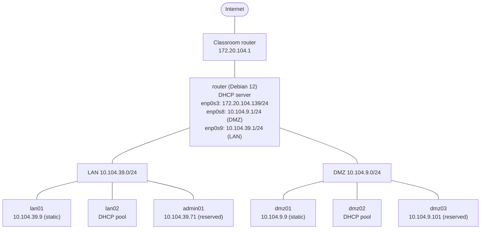

### DHCP design

| Parameter | LAN (10.104.39.0/24) | DMZ (10.104.9.0/24) |
|---|---|---|
| Gateway (router) | 10.104.39.1 | 10.104.9.1 |
| DNS server | 1.1.1.1 | 8.8.8.8 |
| Dynamic pool | 10.104.39.10 – 10.104.39.70<br/>10.104.39.74 – 10.104.39.192<br/>(61 + 119 = **180** addresses) | 10.104.9.50 – 10.104.9.69<br/>(**20** addresses) |
| Default / max lease (pool) | 20 hours (72000 s) / 24 hours (86400 s) | 2 weeks (1209600 s) / 4 weeks (2419200 s) |
| Static reservations | *admin01* 08:00:27:91:70:B1 → 10.104.39.71<br/>*admin02* 08:00:27:91:70:B2 → 10.104.39.72<br/>*admin03* 08:00:27:91:70:B3 → 10.104.39.73 | *dmz03* 08:00:27:91:70:C1 → 10.104.9.101<br/>*dmz04* 08:00:27:91:70:C2 → 10.104.9.102<br/>*dmz05* 08:00:27:91:70:C3 → 10.104.9.103 |
| Reservation lease (default / max) | 1 week (604800 s) / 2 weeks (1209600 s) | Same as the DMZ pool |

> The LAN pool is split in two ranges so that the reserved addresses (.71 – .73) fall **outside** the dynamic pool and can never be handed out to another client.

---

## 🚀 Step-by-Step Configuration

> All commands are executed as **root** (or prefixed with `sudo`) on the router unless stated otherwise.

### Part 1 – DHCP for the LAN

#### Step 1 – Install the DHCP server

```bash
apt install isc-dhcp-server
```

This package provides the DHCP service for the LAN.

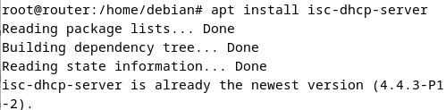

#### Step 2 – Back up the original configuration file

Before modifying the main configuration file, a backup of the original version is created. It can be restored if an error occurs.

```bash
mkdir -p /home/debian/Backup
cp /etc/dhcp/dhcpd.conf /home/debian/Backup/dhcpd.conf.backup
```

Optionally, check that the backup exists:

```bash
tree /home
```

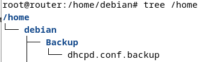

#### Step 3 – Configure the DHCP server

Edit the main configuration file and replace its contents (delete everything with `CTRL+K` in *nano*):

```bash
nano /etc/dhcp/dhcpd.conf
```

Contents of **/etc/dhcp/dhcpd.conf**:

```text
# Declare this server as the authoritative DHCP server of the network
authoritative;

# Each client may hold only one lease at a time
one-lease-per-client on;

# ---------------------------------------------------------------------------
# LAN DHCP
# Subnet definition and the options sent to clients:
# subnet mask, broadcast address, gateway and DNS server
# ---------------------------------------------------------------------------
subnet 10.104.39.0 netmask 255.255.255.0 {
    option subnet-mask 255.255.255.0;
    option broadcast-address 10.104.39.255;
    option routers 10.104.39.1;
    option domain-name-servers 1.1.1.1;

    # Default lease time: 20 hours
    default-lease-time 72000;
    # Maximum lease time: 1 day
    max-lease-time 86400;

    # Dynamic pool for 180 hosts (two ranges, leaving .71 - .73 free
    # for the static reservations below)
    range 10.104.39.10 10.104.39.70;
    range 10.104.39.74 10.104.39.192;
}

# ---------------------------------------------------------------------------
# Static reservations: three administration hosts, identified by MAC address.
# Each host always receives the same IP address (.71, .72, .73) and a
# longer lease time than the dynamic clients.
# ---------------------------------------------------------------------------

# admin01 PC
host admin01 {
    hardware ethernet 08:00:27:91:70:B1;
    fixed-address 10.104.39.71;
    # Default lease: 1 week / maximum lease: 2 weeks
    default-lease-time 604800;
    max-lease-time 1209600;
}

# admin02 PC
host admin02 {
    hardware ethernet 08:00:27:91:70:B2;
    fixed-address 10.104.39.72;
    default-lease-time 604800;
    max-lease-time 1209600;
}

# admin03 (laptop)
host admin03 {
    hardware ethernet 08:00:27:91:70:B3;
    fixed-address 10.104.39.73;
    default-lease-time 604800;
    max-lease-time 1209600;
}
```

**Summary of the directives used**

| Directive | Meaning |
|---|---|
| `authoritative;` | Declares this server as the main DHCP server of the network. |
| `one-lease-per-client on;` | Each client can hold only one lease at a time. |
| `subnet 10.104.39.0 netmask 255.255.255.0` | Defines the served network. |
| `range ... ;` | Dynamic pool: 180 addresses in total. |
| `default-lease-time 72000;` | Default lease duration (20 hours). |
| `max-lease-time 86400;` | Maximum lease duration (1 day). |
| `host ... { hardware ethernet ...; fixed-address ...; }` | Static reservation bound to a MAC address. |

In short, this file configures an authoritative DHCP server that hands out dynamic addresses to up to 180 hosts of the 10.104.39.0/24 subnet and guarantees fixed addresses, with longer leases, to three administration computers.

#### Step 4 – Select the service interface

Tell the DHCP service on which network interface it must listen. The LAN is attached to *enp0s9*, so only that interface is added between the quotation marks.

```bash
nano /etc/default/isc-dhcp-server
```

```text
INTERFACESv4="enp0s9"
INTERFACESv6=""
```

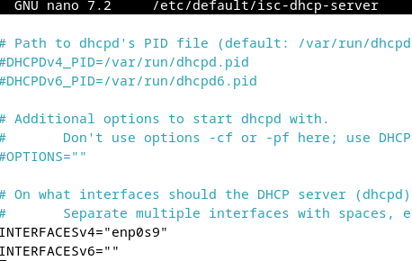

#### Step 5 – Start the service and validate the configuration

```bash
systemctl start isc-dhcp-server
systemctl enable isc-dhcp-server
systemctl status isc-dhcp-server
```

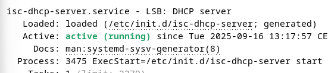

Check the syntax of the configuration file:

```bash
sudo dhcpd -t
```

If everything is correct, the command only prints the version and file locations. If there is a problem, it prints an error message with the offending line. It does not fix the error by itself, but it shows where it is.

Valid configuration:

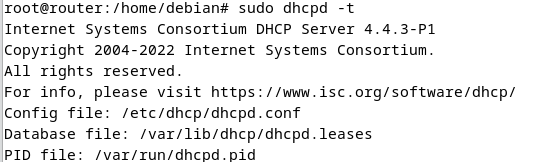

Configuration with an error (*semicolon expected* at line 17):

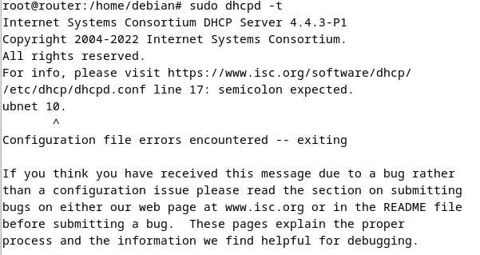

#### Step 6 – Create the *lan02* client (dynamic lease)

Create a new virtual machine named *lan02* inside the LAN network:

1. Clone the clean Debian 12 machine and attach it to the **LAN** internal network.
2. Update the hostname to *lan02*:

   ```bash
   nano /etc/hosts
   nano /etc/hostname
   ```

3. Enable the `networking` service and stop NetworkManager:

   ```bash
   systemctl enable networking
   systemctl start networking
   systemctl status networking

   systemctl stop NetworkManager
   systemctl disable NetworkManager
   systemctl status NetworkManager
   ```

4. Switch the interface to DHCP. The graphical network tool does this automatically, but the change must be made in **/etc/network/interfaces** so that it persists across restarts of the `networking` service:

   ```bash
   nano /etc/network/interfaces
   ```

   ```text
   # Bring up the network interface (enp0s3) together with the loopback
   auto lo enp0s3
   iface lo inet loopback

   # Obtain the address, gateway and DNS server from the DHCP server on the router
   iface enp0s3 inet dhcp
   ```

5. Restart the service and check the assigned address:

   ```bash
   systemctl restart networking
   ip a
   ```

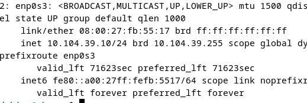

*lan02* must receive an address from the dynamic pool and **not** one of the addresses reserved for the administration hosts.

#### Step 7 – Test a static reservation (*admin01*)

To test a reservation, a client is configured with one of the reserved MAC addresses. In this test, *admin01* (08:00:27:91:70:B1) is used.

First, verify that the machine has the expected MAC address:

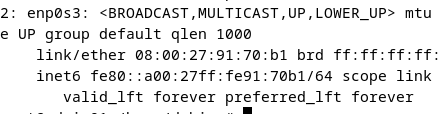

Configure the interface as DHCP (same procedure as for *lan02*) and restart the `networking` service:

```bash
systemctl restart networking
ip a
```

The client receives the reserved address 10.104.39.71:

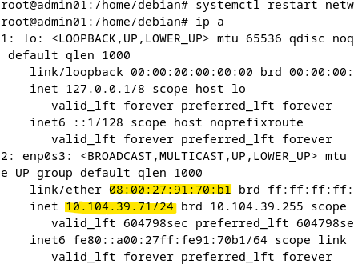

Finally, check that the client received the right DNS server:

```bash
cat /etc/resolv.conf
```

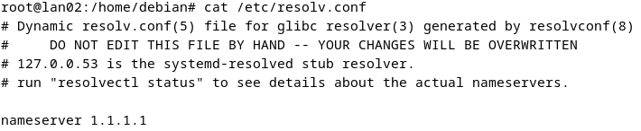

---

### Part 2 – DHCP for the DMZ

The DHCP service is extended to the DMZ. Only two files have to be edited (text is added to each), followed by a service restart.

#### Step 8 – Add the DMZ subnet to the main configuration

```bash
nano /etc/dhcp/dhcpd.conf
```

Append the following block at the end of the file:

```text
# ---------------------------------------------------------------------------
# DMZ DHCP
# ---------------------------------------------------------------------------
subnet 10.104.9.0 netmask 255.255.255.0 {
    # Dynamic pool of 20 addresses
    range 10.104.9.50 10.104.9.69;

    # Gateway: Debian router
    option routers 10.104.9.1;
    option domain-name-servers 8.8.8.8;

    # Default lease: 2 weeks
    default-lease-time 1209600;
    # Maximum lease: 4 weeks
    max-lease-time 2419200;
}

# DMZ static reservations
host dmz03 {
    hardware ethernet 08:00:27:91:70:C1;
    fixed-address 10.104.9.101;
}

host dmz04 {
    hardware ethernet 08:00:27:91:70:C2;
    fixed-address 10.104.9.102;
}

host dmz05 {
    hardware ethernet 08:00:27:91:70:C3;
    fixed-address 10.104.9.103;
}
```

This block:

- defines a dynamic range of 20 addresses (10.104.9.50 – 10.104.9.69);
- sets the gateway (10.104.9.1) and the DNS server (8.8.8.8);
- sets the lease times: default of 2 weeks and maximum of 4 weeks;
- adds static reservations for three hosts (*dmz03*, *dmz04*, *dmz05*), binding each MAC address to a fixed IP (10.104.9.101, .102 and .103).

#### Step 9 – Add the DMZ interface to the service

Edit **/etc/default/isc-dhcp-server** so that the service also listens on the DMZ interface (*enp0s8*), in addition to the LAN interface (*enp0s9*):

```bash
nano /etc/default/isc-dhcp-server
```

```text
INTERFACESv4="enp0s9 enp0s8"
INTERFACESv6=""
```

Restart the DHCP service and check its status:

```bash
systemctl restart isc-dhcp-server
systemctl status isc-dhcp-server
```

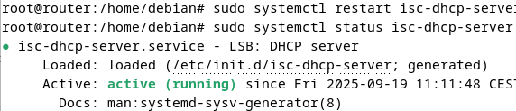

#### Step 10 – Create the *dmz02* client (dynamic lease)

To save time, the *lan01* machine is cloned.

1. Rename the clone to *dmz02* and attach its network adapter to the **DMZ** internal network.
2. Update the hostname:

   ```bash
   nano /etc/hosts
   ```

   ```text
   127.0.0.1   localhost
   127.0.1.1   dmz02
   ```

   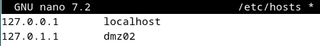

3. Switch the interface to DHCP:

   ```bash
   nano /etc/network/interfaces
   ```

   ```text
   auto lo enp0s3
   iface lo inet loopback

   iface enp0s3 inet dhcp
   ```

4. Restart the network and check the address:

   ```bash
   systemctl restart networking
   ip a
   ```

---

## 🧪 Verification & Testing

| ID | Test | Command | Expected result | Evidence |
|---|---|---|---|---|
| V1 | Configuration syntax | `sudo dhcpd -t` | No errors reported | [Screenshot](images/06-dhcpd-syntax-ok.png) |
| V2 | Error detection | `sudo dhcpd -t` (with a deliberate mistake) | Error message with the offending line | [Screenshot](images/06-dhcpd-syntax-error.png) |
| V3 | Service state | `systemctl status isc-dhcp-server` | `active (running)` | [Screenshot](images/08-service-active-lan-dmz.png) |
| V4 | Dynamic lease, LAN (*lan02*) | `ip a` | Address inside the pool; **not** .71 – .73 | [Screenshot](images/07-lan02-dynamic-lease.png) |
| V5 | Static reservation, LAN (*admin01*, MAC 08:00:27:91:70:B1) | `ip a` | 10.104.39.71 | [Screenshot](images/07-admin01-reserved-lease.png) |
| V6 | DNS on the LAN client | `cat /etc/resolv.conf` | `nameserver 1.1.1.1` | [Screenshot](images/07-lan02-resolv-conf.png) |
| V7 | Dynamic lease, DMZ (*dmz02*) | `ip a` | Address inside 10.104.9.50 – .69 | [Screenshot](images/09-dmz02-dynamic-lease.png) |
| V8 | Static reservation, DMZ (*dmz03*, MAC 08:00:27:91:70:C1) | `ip a` | 10.104.9.101 | [Screenshot](images/09-dmz03-reserved-lease.png) |
| V9 | DNS on the DMZ client | `cat /etc/resolv.conf` | `nameserver 8.8.8.8` | [Screenshot](images/09-dmz03-resolv-conf.png) |

For the DMZ reservation test, configure the *dmz03* machine in the same way as *dmz02*, with the MAC address 08:00:27:91:70:C1, and check that its address changes to the reserved one.

**Results**

- *lan02* obtained **10.104.39.10** and *dmz02* obtained **10.104.9.50**, the first free address of each pool.
- *admin01* and *dmz03* obtained their reserved addresses (**10.104.39.71** and **10.104.9.101**).
- The remaining lease time shown by `ip a` matches the configuration: about 20 hours (71623 s) on the LAN dynamic lease, 1 week (604798 s) on the *admin01* reservation and about 2 weeks (1209386 s) on the DMZ lease.
- The DNS server delivered to each client matches the one defined in its subnet block (1.1.1.1 for the LAN, 8.8.8.8 for the DMZ).

<details>
<summary><b>Screenshots – DMZ client verification</b></summary>

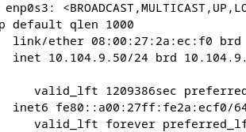
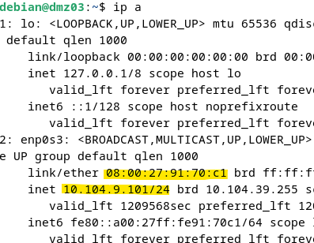
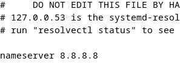

</details>

---

## 📚 References

- **Debian Wiki.** (2023). *DHCP Server.* <https://wiki.debian.org/DHCP_Server> – Official Debian guide explaining how to install and configure `isc-dhcp-server`.
- **ISC (Internet Systems Consortium).** (2022). *ISC DHCP Documentation.* <https://www.isc.org/dhcp/> – Official documentation with configuration and parameter examples.
- **The Debian Administrator's Handbook.** (2023). *Chapter 8 – Network configuration.* <https://debian-handbook.info/> – Debian network administration, including services such as DHCP.
- **Red Hat.** (2021). *Configuring DHCP servers.* <https://access.redhat.com/documentation/> – Written for Red Hat, but the DHCP concepts and directives are compatible with `isc-dhcp-server` on Debian.
