# Debian 12 Router with LAN/DMZ Segmentation and NAT

## 📌 Objective / Overview

This lab builds a segmented network around a **Debian 12 router** with three network interfaces:

- one uplink to the upstream (classroom) network, which provides Internet access;
- one internal **DMZ** segment;
- one internal **LAN** segment.

Each internal segment hosts one client machine (*dmz01* and *lan01*). The router forwards traffic between the segments and translates (NAT) internal addresses so that both clients can reach the Internet through the upstream network.

**Skills demonstrated:** static IP addressing with `ifupdown`, multi-homed Linux router configuration, IPv4 forwarding, source NAT with `iptables`, boot-time firewall script, connectivity testing and troubleshooting.

---

## 🛠️ Environment & Tools

| Component | Details |
|---|---|
| Hypervisor | Oracle VirtualBox (Intel PRO/1000 MT Desktop virtual adapters) |
| Operating system | Debian 12 (router, *lan01*, *dmz01*) |
| Network configuration | `ifupdown` via **/etc/network/interfaces** (NetworkManager disabled) |
| Routing / NAT | Kernel IPv4 forwarding + `iptables` (`MASQUERADE`) |
| Service management | `systemctl`, `update-rc.d` |
| Diagnostics | `ping`, `ip`, `systemctl status` |

---

## 🗺️ Network Topology / Architecture

The router has one interface in each network. The two internal networks are isolated VirtualBox *internal networks* named **DMZ** and **LAN**; the uplink uses a bridged adapter.

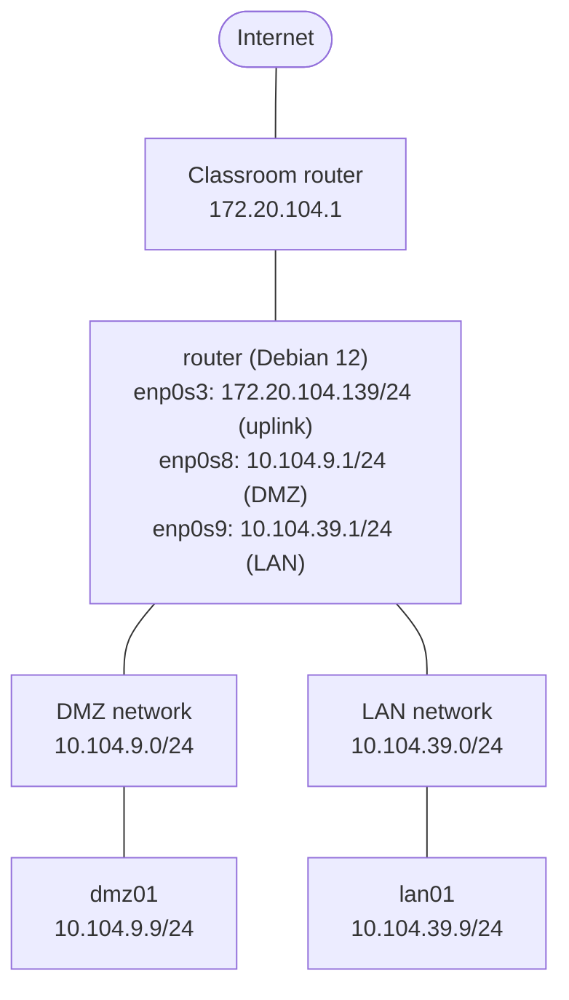

### Addressing plan

| Network | Subnet | Host | Interface | IP address | MAC address |
|---|---|---|---|---|---|
| Upstream (classroom) | 172.20.104.0/24 | Classroom router | n/a | 172.20.104.1 | n/a |
| Upstream (classroom) | 172.20.104.0/24 | router | *enp0s3* | 172.20.104.139/24 | 08:00:27:44:22:4F |
| DMZ | 10.104.9.0/24 | router | *enp0s8* | 10.104.9.1/24 | 08:00:27:F1:82:44 |
| DMZ | 10.104.9.0/24 | dmz01 | *enp0s3* | 10.104.9.9/24 | 08:00:27:C4:8B:8C |
| LAN | 10.104.39.0/24 | router | *enp0s9* | 10.104.39.1/24 | 08:00:27:09:AF:34 |
| LAN | 10.104.39.0/24 | lan01 | *enp0s3* | 10.104.39.9/24 | 08:00:27:D0:2C:E7 |

---

## 🚀 Step-by-Step Configuration

> All commands are executed as **root** (or prefixed with `sudo`).

### Step 1 – Create the router virtual machine

1. In VirtualBox, create a new VM named *router* and install **Debian 12**.
2. Assign **three network adapters**:
   - **Adapter 1:** *Bridged Adapter* (connects the router to the classroom network).
   - **Adapter 2:** *Internal Network* named **DMZ**.
   - **Adapter 3:** *Internal Network* named **LAN**.

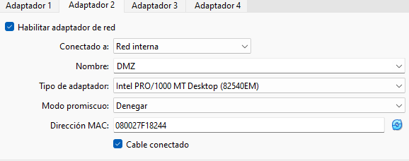
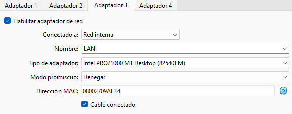

### Step 2 – Set the router hostname

Set the machine name so that it matches the lab specification.

```bash
nano /etc/hostname
```

```text
router
```

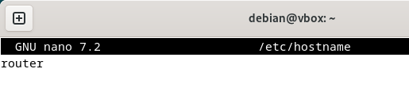

Map the new name to the loopback address in **/etc/hosts**:

```bash
nano /etc/hosts
```

```text
127.0.0.1   localhost
127.0.1.1   router
```

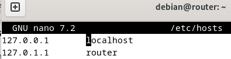

Reboot so that the new hostname is applied system-wide:

```bash
reboot
```

### Step 3 – Disable NetworkManager and DHCP, use `networking`

#### 3.1 NetworkManager

NetworkManager is disabled so that it cannot overwrite the static configuration managed by `ifupdown`.

```bash
# Stop the service now
systemctl stop NetworkManager

# Prevent it from starting at boot
systemctl disable NetworkManager

# Check the state
systemctl status NetworkManager
```

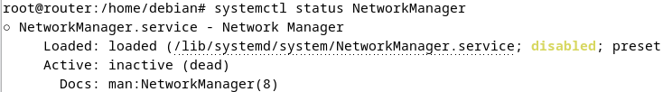

#### 3.2 DHCP server

The router must not hand out addresses yet, so the DHCP server installed in the base image is stopped and disabled.

```bash
systemctl stop isc-dhcp-server
systemctl disable isc-dhcp-server
systemctl status isc-dhcp-server
```

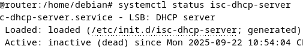

#### 3.3 Networking service

Confirm that the `networking` service is enabled and active:

```bash
systemctl status networking
```

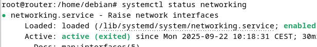

### Step 4 – Configure the router interfaces

The router has three NICs:

- ***enp0s3*** – uplink to the classroom network, with static IP, default gateway and DNS server.
- ***enp0s8*** – DMZ segment, with only IP address and netmask.
- ***enp0s9*** – LAN segment, with only IP address and netmask.

> **Why only address and netmask on the internal interfaces?** Defining DNS servers (and a gateway) on more than one interface previously caused name-resolution problems. Only the uplink interface carries them.

Edit **/etc/network/interfaces**:

```bash
nano /etc/network/interfaces
```

```text
# Upstream (classroom) network interface
auto enp0s3
iface enp0s3 inet static
    address 172.20.104.139
    netmask 255.255.255.0
    gateway 172.20.104.1
    dns-nameservers 8.8.8.8

# DMZ network interface
auto enp0s8
iface enp0s8 inet static
    address 10.104.9.1
    netmask 255.255.255.0

# LAN network interface
auto enp0s9
iface enp0s9 inet static
    address 10.104.39.1
    netmask 255.255.255.0
```

Apply the configuration and check that the service is running:

```bash
systemctl restart networking
systemctl status networking
```

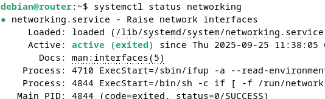

Verify that the three addresses were assigned:

```bash
ip -c a
```

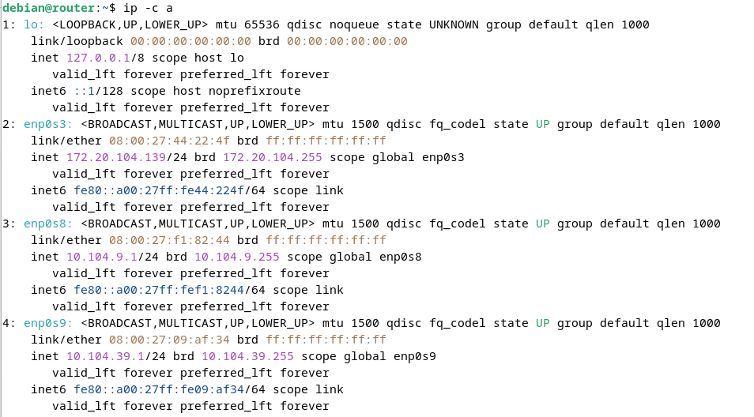

### Step 5 – Create the client virtual machines

Create two more Debian 12 machines, *dmz01* and *lan01*, following the same procedure as for the router. Each one gets **a single network adapter** attached to the corresponding internal network (**DMZ** or **LAN**).

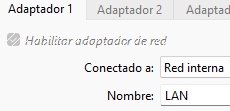
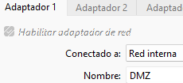

Set the hostname on each machine, using the same procedure as on the router (Step 2).

**lan01** – **/etc/hostname** and **/etc/hosts**

```text
lan01
```

```text
127.0.0.1   localhost
127.0.1.1   lan01
```

**dmz01** – **/etc/hostname** and **/etc/hosts**

```text
dmz01
```

```text
127.0.0.1   localhost
127.0.1.1   dmz01
```

### Step 6 – Verify NetworkManager and networking on the clients

Repeat the checks from Step 3 on both clients (shown here on *lan01*):

```bash
systemctl status NetworkManager
systemctl status networking
```

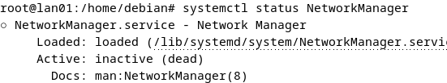
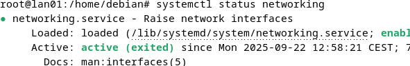

### Step 7 – Configure the client interfaces

At this stage only the **IP address and netmask** are configured. No gateway or DNS server is defined yet, so each client can only communicate with the router on its own segment. This allows isolation to be verified before routing is enabled.

**dmz01** – **/etc/network/interfaces**

```text
# DMZ network interface
auto enp0s3
iface enp0s3 inet static
    address 10.104.9.9
    netmask 255.255.255.0
```

**lan01** – **/etc/network/interfaces**

```text
# LAN network interface
auto enp0s3
iface enp0s3 inet static
    address 10.104.39.9
    netmask 255.255.255.0
```

On both machines, apply the configuration and confirm the address:

```bash
systemctl restart networking
ip a
```

### Step 8 – Connectivity tests before routing is enabled

From the **router**, all three directly connected networks must be reachable:

```bash
# Upstream (classroom) gateway
ping 172.20.104.1

# dmz01
ping 10.104.9.9

# lan01
ping 10.104.39.9
```

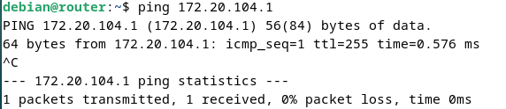
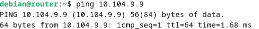
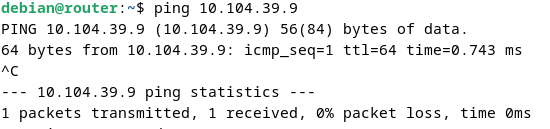

All three pings succeed, confirming that the router communicates with the upstream network, the DMZ and the LAN.

The clients, however, **must not** yet reach any other network. From *lan01* and *dmz01*:

```bash
ping 172.20.104.1
```

Both tests fail with 100% packet loss, which is the expected result because forwarding and NAT are not active yet.

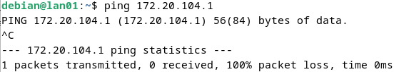
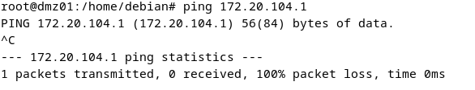

### Step 9 – Enable IP forwarding and NAT

To provide Internet access, a firewall script is created on the router and registered to run at boot.

#### 9.1 Create the script

```bash
nano /etc/init.d/fw.sh
```

Contents of **/etc/init.d/fw.sh**:

```bash
#!/bin/bash
### BEGIN INIT INFO
# Provides:          fw.sh
# Required-Start:    $all
# Required-Stop:     $all
# Default-Start:     2 3 4 5
# Default-Stop:      0 1 6
# Short-Description: Firewall
# Description:       Applies the firewall rules on this router
### END INIT INFO

# Enable packet forwarding
echo 1 > /proc/sys/net/ipv4/ip_forward

# Flush existing rules
iptables -F
iptables -t nat -F

# Enable NAT for outbound traffic from the DMZ and LAN subnets
iptables -t nat -A POSTROUTING -s 10.104.9.0/24 -o enp0s3 -j MASQUERADE
iptables -t nat -A POSTROUTING -s 10.104.39.0/24 -o enp0s3 -j MASQUERADE
```

**What the script does:**

| Command | Purpose |
|---|---|
| `echo 1 > /proc/sys/net/ipv4/ip_forward` | Enables IPv4 packet forwarding, allowing the router to pass packets from one network to another. |
| `iptables -F` and `iptables -t nat -F` | Flush all existing firewall and NAT rules to start from a clean configuration. |
| `iptables -t nat -A POSTROUTING -s 10.104.9.0/24 -o enp0s3 -j MASQUERADE` | Lets hosts in the DMZ reach the Internet by replacing their source address with the router's uplink address. |
| `iptables -t nat -A POSTROUTING -s 10.104.39.0/24 -o enp0s3 -j MASQUERADE` | Same as above, for hosts in the LAN. |

#### 9.2 Grant execute permission

```bash
chmod +x /etc/init.d/fw.sh
ls -l /etc/init.d/fw.sh
```

Without the execute bit the script cannot be run.

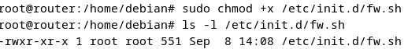

#### 9.3 Register the script at boot

```bash
update-rc.d fw.sh defaults
```

This configures the script to run automatically at system startup.

#### 9.4 Run the script

```bash
sudo /etc/init.d/fw.sh
```

This applies the configuration immediately. If the script prints nothing, it ran without errors; otherwise the shell reports the failing line.

### Step 10 – Configure the default gateway and DNS on the clients

Now that the router forwards and translates traffic, each client needs the router as its default gateway and a DNS resolver.


**dmz01** – **/etc/network/interfaces**

```text
# DMZ network interface
auto enp0s3
iface enp0s3 inet static
    address 10.104.9.9
    netmask 255.255.255.0
    gateway 10.104.9.1
    dns-nameservers 8.8.8.8
```

**lan01** – **/etc/network/interfaces**

```text
# LAN network interface
auto enp0s3
iface enp0s3 inet static
    address 10.104.39.9
    netmask 255.255.255.0
    gateway 10.104.39.1
    dns-nameservers 8.8.8.8
```

```bash
systemctl restart networking
```

---

## 🧪 Verification & Testing

Run the following tests and compare them with the expected results.

| ID | From | To | Command | Expected result |
|---|---|---|---|---|
| T01 | router | Host on the classroom network | `ping 172.20.104.109` | Reply received |
| T02 | router | Internet IP address | `ping 8.8.8.8` | Reply received |
| T03 | router | Internet domain name | `ping www.google.com` | Name resolved, reply received |
| T04 | router | dmz01 | `ping 10.104.9.9` | Reply received |
| T05 | router | lan01 | `ping 10.104.39.9` | Reply received |
| T06 | dmz01 | router | `ping 10.104.9.1` | Reply received |
| T07 | dmz01 | lan01 | `ping 10.104.39.9` | Reply received (routed via router) |
| T08 | dmz01 | Host on the classroom network | `ping 172.20.104.109` | Reply received |
| T09 | dmz01 | Internet IP address | `ping 8.8.8.8` | Reply received |
| T10 | dmz01 | Internet domain name | `ping google.com` | Name resolved, reply received |
| T11 | lan01 | router | `ping 10.104.39.1` | Reply received |
| T12 | lan01 | dmz01 | `ping 10.104.9.9` | Reply received (routed via router) |
| T13 | lan01 | Host on the classroom network | `ping 172.20.104.109` | Reply received |
| T14 | lan01 | Internet IP address | `ping 1.1.1.1` | Reply received |
| T15 | lan01 | Internet domain name | `ping google.com` | Name resolved, reply received |

All tests passed.

**Observations**

- Replies with **TTL=64** come from hosts on the same segment; **TTL=63** on the LAN ↔ DMZ tests shows the packets crossed exactly one routed hop (the Debian router).
- Replies from Internet hosts (TTL ≈ 113–114) confirm that NAT is translating the internal source addresses.
- Name resolution succeeding on all three machines confirms that DNS is configured correctly.

<details>
<summary><b>Screenshots – tests from the router</b></summary>

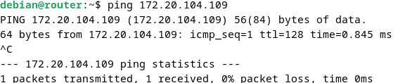
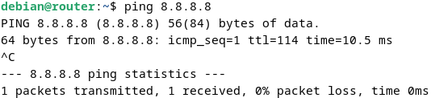
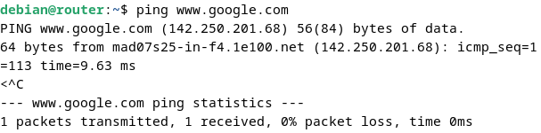

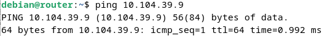

</details>

<details>
<summary><b>Screenshots – tests from dmz01</b></summary>

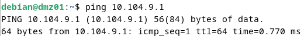
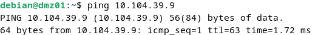
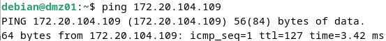
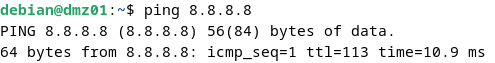
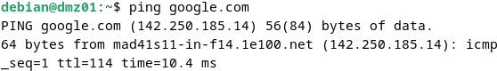

</details>

<details>
<summary><b>Screenshots – tests from lan01</b></summary>

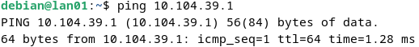
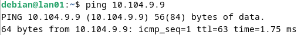
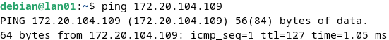
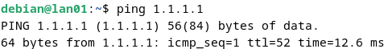
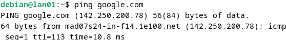

</details>

---

## 🔧 Design Notes & Possible Improvements

The lab focuses on routing and NAT, so the firewall is deliberately minimal. Once forwarding is enabled, the router passes **all** traffic between the three networks, which is why tests T07 and T12 (DMZ ↔ LAN) succeed. That is useful to prove routing, but a DMZ is normally isolated from the internal network.

| # | Observation | Why it matters | Improvement |
|---|---|---|---|
| 1 | No filtering in the `FORWARD` chain. | A compromised DMZ host could reach the LAN directly. | Set the default `FORWARD` policy to `DROP` and allow only the required flows: LAN → DMZ, LAN → Internet and DMZ → Internet. |
| 2 | Forwarding is enabled by writing to **/proc/sys/net/ipv4/ip_forward**. | The change is lost on reboot unless the script runs again. | Use `sysctl`, and optionally make it persistent in **/etc/sysctl.d/**. |
| 3 | The script has no `stop` or `status` actions and always applies the rules. | It cannot be managed like a normal service. | Add a `start / stop / restart / status` dispatcher. |
| 4 | Interface names are repeated in every rule. | Renaming a NIC requires editing several lines. | Define them once as variables (*WAN*, *DMZ*, *LAN*). |
| 5 | Debian 12 uses *nftables* as its native firewall. | `iptables` works through a compatibility layer. | Migrate the rule set to *nftables* when the lab moves to production. |

**Improved firewall script** (**/etc/init.d/fw.sh**). The script was syntax-checked and its rules were loaded in an isolated network namespace; the resulting rule set is listed below.

```bash
#!/bin/bash
### BEGIN INIT INFO
# Provides:          fw.sh
# Required-Start:    $network $remote_fs
# Required-Stop:
# Default-Start:     2 3 4 5
# Default-Stop:      0 1 6
# Short-Description: Router firewall (NAT and zone filtering)
# Description:       Enables NAT for the DMZ and LAN subnets and filters
#                    traffic between zones on this router
### END INIT INFO

WAN=enp0s3   # Upstream (classroom) network
DMZ=enp0s8   # DMZ network
LAN=enp0s9   # LAN network

start() {
    # Enable IPv4 packet forwarding
    sysctl -w net.ipv4.ip_forward=1 >/dev/null

    # Flush existing rules and delete user-defined chains
    iptables -F
    iptables -X
    iptables -t nat -F

    # Default policy: forwarded traffic is denied unless explicitly allowed
    iptables -P FORWARD DROP

    # Replies to connections that were already allowed
    iptables -A FORWARD -m conntrack --ctstate ESTABLISHED,RELATED -j ACCEPT

    # LAN -> DMZ and LAN -> Internet
    iptables -A FORWARD -i "$LAN" -o "$DMZ" -j ACCEPT
    iptables -A FORWARD -i "$LAN" -o "$WAN" -j ACCEPT

    # DMZ -> Internet only (DMZ -> LAN stays blocked)
    iptables -A FORWARD -i "$DMZ" -o "$WAN" -j ACCEPT

    # NAT for outbound traffic from the DMZ and LAN subnets
    iptables -t nat -A POSTROUTING -s 10.104.9.0/24  -o "$WAN" -j MASQUERADE
    iptables -t nat -A POSTROUTING -s 10.104.39.0/24 -o "$WAN" -j MASQUERADE
}

stop() {
    # Remove all filtering and NAT
    iptables -F
    iptables -t nat -F
    iptables -P FORWARD ACCEPT
}

case "$1" in
    start|restart|"") start ;;
    stop)             stop ;;
    status)           iptables -L -n -v; iptables -t nat -L -n -v ;;
    *) echo "Usage: $0 {start|stop|restart|status}" >&2; exit 1 ;;
esac
```

Resulting rule set:

```text
-P FORWARD DROP
-A FORWARD -m conntrack --ctstate RELATED,ESTABLISHED -j ACCEPT
-A FORWARD -i enp0s9 -o enp0s8 -j ACCEPT
-A FORWARD -i enp0s9 -o enp0s3 -j ACCEPT
-A FORWARD -i enp0s8 -o enp0s3 -j ACCEPT
-A POSTROUTING -s 10.104.9.0/24 -o enp0s3 -j MASQUERADE
-A POSTROUTING -s 10.104.39.0/24 -o enp0s3 -j MASQUERADE
```

**Expected test results with the improved script**

| Test | Result |
|---|---|
| T12 – lan01 → dmz01 | Reply received (LAN may reach the DMZ) |
| **T07 – dmz01 → lan01** | **No reply** (DMZ → LAN is blocked) |
| T02, T03, T09, T10, T14, T15 – Internet access | Reply received (unchanged) |

Because the *conntrack* rule accepts return traffic, LAN → DMZ connections still work in both directions even though DMZ-initiated connections to the LAN are refused.

---

## 📚 References

- **Debian Project.** *Chapter 5: Network setup* – Debian Reference. <https://www.debian.org/doc/manuals/debian-reference/ch05.en.html>
- **Unbitcode (YouTube).** *How to configure a static IP on Debian 12* (January 19, 2024). <https://www.youtube.com/watch?v=_l47oyPNREg>
- **Aprendiendo a Virtualizar.** *Configure a static IP in Debian from the console* (January 11, 2023). <https://aprendiendoavirtualizar.com/configurar-ip-estatica-en-debian-desde-la-consola/>
- **Hostinger Tutorials.** *How to change the hostname in Linux* (March 10, 2023). <https://www.hostinger.com/mx/tutoriales/cambiar-hostname-linux>
- **CIFP Coroso.** *Starting and stopping services* (GNU/Linux course material).
