# BIND9 DNS Servers for the DMZ and LAN on Debian 12

## 📌 Objective / Overview

This lab deploys **two DNS servers with BIND9** on Debian 12 and integrates them with the DHCP server built in [Lab 02](../02-dhcp-server-lan-dmz/README.md):

| Server | Network | IP address | Domain | Role |
|---|---|---|---|---|
| **dmz01** | DMZ (10.104.9.0/24) | 10.104.9.101 | *alberto.eus* | Authoritative server (forward and reverse zones). Forwards every other query to the public resolvers 1.1.1.1 and 9.9.9.9. |
| **lansrv02** | LAN (10.104.39.0/24) | 10.104.39.3 | *alberto.lan* | Authoritative server (forward and reverse zones). Forwards every other query to the DMZ DNS server. |

The DHCP server on the router is then updated so that clients automatically receive the right DNS server and search domain for their segment.

### What is DNS?

The **Domain Name System (DNS)** translates easy-to-remember names (such as *www.alberto.eus*) into the IP addresses that computers use to communicate (such as 10.104.9.103), and the other way round. Without DNS, we would have to remember IP addresses instead of names. It works like the phone book of the Internet: you look up a name and get back a number.

- **Forward resolution:** name → IP address (**A** and **CNAME** records).
- **Reverse resolution:** IP address → name (**PTR** records).

**Skills demonstrated:** BIND9 installation and configuration, authoritative forward and reverse zones, A / CNAME / MX / PTR records, resolver forwarding, access control lists, zone and configuration validation, DHCP and DNS integration, name-resolution troubleshooting.

---

## 🛠️ Environment & Tools

| Component | Details |
|---|---|
| Hypervisor | Oracle VirtualBox |
| Operating system | Debian 12 (all machines) |
| DNS software | BIND9 (Debian 12 package, service *named*) |
| DHCP software | `isc-dhcp-server` (from Lab 02) |
| Validation tools | `named-checkconf`, `named-checkzone` |
| Client tools | `nslookup`, `dig` |

> **Prerequisites:** the network from [Lab 01](../01-router-lan-dmz-nat/README.md) (router with LAN, DMZ and NAT) and the DHCP service from [Lab 02](../02-dhcp-server-lan-dmz/README.md) are already working.

---

## 🗺️ Network Topology / Architecture

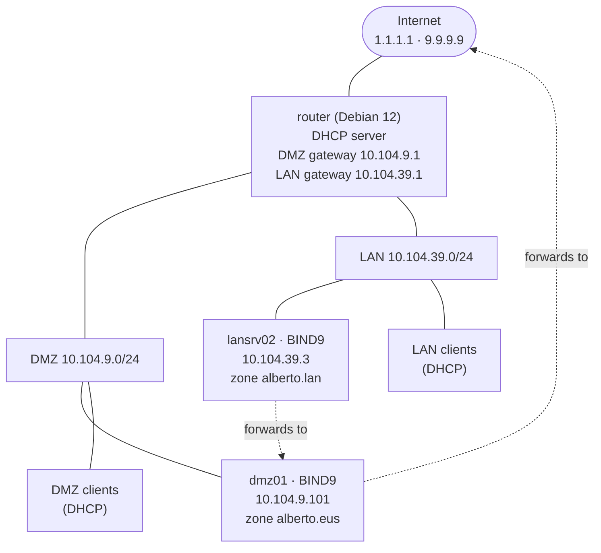

Name resolution flow:

1. A client asks its DNS server (received through DHCP).
2. If the name belongs to the server's own zone, it answers directly (authoritative answer).
3. Otherwise, **lansrv02** forwards the query to **dmz01**, and **dmz01** forwards it to the public resolvers (Cloudflare *1.1.1.1* and Quad9 *9.9.9.9*), caching the answer.

### DMZ zone *alberto.eus* (server dmz01 · 10.104.9.101)

| Name | Type | Value | Purpose |
|---|---|---|---|
| *@* (alberto.eus) | A | 10.104.9.103 | Domain apex points to the web server |
| *@* | NS | dns.alberto.eus | Name server of the zone |
| *@* | MX (priority 10) | mail.alberto.eus | Mail server |
| router | A | 10.104.9.1 | Router |
| dns | A | 10.104.9.101 | DNS server (dmz01) |
| mail | A | 10.104.9.102 | Mail server (dmz02) |
| www | A | 10.104.9.103 | Web server (dmz03) |
| dmz04 | A | 10.104.9.104 | DMZ04 server |
| dhcp, fw, proxy | CNAME | router | Aliases of the router |
| dmz01 | CNAME | dns | Alias |
| dmz02 | CNAME | mail | Alias |
| dmz03, ftp | CNAME | www | Aliases |

> The addresses *.101* to *.104* belong to the DMZ range reserved in Lab 02. In this lab only the DNS server (*dmz01*, 10.104.9.101) is actually deployed; the other records are declared for planned DMZ services, and only their name resolution is tested.

### LAN zone *alberto.lan* (server lansrv02 · 10.104.39.3)

| Name | Type | Value |
|---|---|---|
| *@* | NS | dns.alberto.lan |
| router | A | 10.104.39.1 |
| dns | A | 10.104.39.3 |
| lan01 | A | 10.104.39.10 |
| lan02 | A | 10.104.39.11 |
| lansrv02 | CNAME | dns |

### BIND9 files

| File | Function |
|---|---|
| **/etc/bind/named.conf.local** | Declares the zones the server is authoritative for. |
| **/etc/bind/named.conf.options** | Global server configuration (forwarders, access control, listening interfaces). |
| **/etc/bind/db.alberto.eus** | DMZ forward zone: names → IP addresses. |
| **/etc/bind/db.10.104.9** | DMZ reverse zone: IP addresses → names. |
| **/etc/bind/db.alberto.lan** | LAN forward zone. |
| **/etc/bind/db.10.104.39.rev** | LAN reverse zone. |

---

## 🚀 Step-by-Step Configuration

> All commands are executed as **root** (or prefixed with `sudo`).

## Part 1 – DNS server for the DMZ (dmz01, domain *alberto.eus*)

### Step 1 – Install BIND9

Update the package index and install BIND, the most widely used DNS server software on Linux:

```bash
apt update && apt upgrade
apt install bind9 -y
```

The `-y` option answers "yes" to every prompt so that the installation does not ask for confirmation. Check that the service is running (`active (running)` means the DNS service is up):

```bash
systemctl status bind9
```

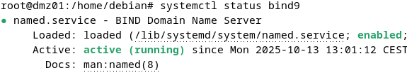

### Step 2 – Declare the zones (**/etc/bind/named.conf.local**)

This file tells BIND which domains (zones) it manages.

```bash
nano /etc/bind/named.conf.local
```

```text
// Forward zone: domain managed by this server
zone "alberto.eus" {
    // This server is the master (authority) for the domain
    type master;
    // File containing the DNS records of the zone
    file "/etc/bind/db.alberto.eus";
};

// Reverse zone (in-addr.arpa): used for reverse resolution (IP -> name)
zone "9.104.10.in-addr.arpa" {
    type master;
    file "/etc/bind/db.10.104.9";
};
```

The reverse zone name is the network address written backwards (10.104.**9**.0/24 → *9.104.10*) followed by *in-addr.arpa*.

### Step 3 – Configure the server options (**/etc/bind/named.conf.options**)

This file defines the global behaviour of BIND9: where it stores temporary data, which external DNS servers it uses, which clients it serves and on which interfaces it listens.

```bash
nano /etc/bind/named.conf.options
```

```text
options {
    directory "/var/cache/bind";

    // Forwarders: public DNS servers used for queries this server
    // cannot resolve by itself (for example google.com)
    forwarders {
        1.1.1.1;
        9.9.9.9;
    };

    dnssec-validation no;

    allow-query     { 10.104.9.0/24; };
    allow-recursion { 10.104.9.0/24; };

    listen-on    { any; };
    listen-on-v6 { none; };
};
```

| Directive | Purpose |
|---|---|
| `directory "/var/cache/bind";` | Working directory and DNS cache. When the server receives a query for a name outside its zones, it looks it up on the Internet and keeps the answer here to reply faster next time. |
| `forwarders { 1.1.1.1; 9.9.9.9; };` | Servers that receive the queries BIND cannot answer on its own: *1.1.1.1* is Cloudflare (fast and secure) and *9.9.9.9* is Quad9 (privacy-oriented). A query for *mail.alberto.eus* is answered locally, whereas one for *youtube.com* is forwarded. |
| `dnssec-validation no;` | Disables DNSSEC validation. It is not needed in this lab because no zone is signed. In production, the recommended value is `auto`. |
| `allow-query { 10.104.9.0/24; };` | Only hosts of the DMZ subnet may query the server. Clients outside this network receive `REFUSED`, so the server is not exposed publicly. |
| `allow-recursion { 10.104.9.0/24; };` | Only hosts of the DMZ subnet may request recursive resolution (the server asking other servers on behalf of the client). |
| `listen-on { any; };` | Listens on every IPv4 interface, so other hosts of the network can reach the DNS service. |
| `listen-on-v6 { none; };` | Disables IPv6 for the DNS service, since the network does not use it. |

### Step 4 – Create the forward zone (**/etc/bind/db.alberto.eus**)

The forward zone defines how names inside the domain resolve to IP addresses.

```bash
nano /etc/bind/db.alberto.eus
```

```text
; Zone file: alberto.eus
; Defines the names and IP addresses of the DMZ hosts
$TTL 604800
@   IN  SOA alberto.eus. dns.alberto.eus. (
            2025100601  ; Serial (increase on every change)
            28800       ; Refresh: how often secondary servers check for changes (8 hours)
            3600        ; Retry: wait before retrying a failed refresh (1 hour)
            604800      ; Expire: secondary stops answering if the master is unreachable (7 days)
            38400 )     ; Negative cache TTL (about 10.7 hours)

; ------------------------------
; Name server and mail server
; ------------------------------
@       IN  NS      dns.alberto.eus.        ; Main DNS server
@       IN  A       10.104.9.103            ; Domain apex -> web server
@       IN  MX  10  mail.alberto.eus.       ; Mail server (priority 10)

; ------------------------------
; A records: name -> IP address
; ------------------------------
router  IN  A       10.104.9.1              ; Main router
dns     IN  A       10.104.9.101            ; DNS server (dmz01)
mail    IN  A       10.104.9.102            ; Mail server (dmz02)
www     IN  A       10.104.9.103            ; Web server (dmz03)
dmz04   IN  A       10.104.9.104            ; DMZ04 server

; ------------------------------
; CNAME records: aliases
; ------------------------------
dhcp    IN  CNAME   router
fw      IN  CNAME   router
proxy   IN  CNAME   router
dmz01   IN  CNAME   dns
dmz02   IN  CNAME   mail
dmz03   IN  CNAME   www
ftp     IN  CNAME   www
```

**Record reference**

| Element | Explanation |
|---|---|
| `$TTL 604800` | Default cache lifetime of the records: 604800 s = 7 days. Clients keep an answer for that time before asking again. |
| `SOA` (Start Of Authority) | Mandatory record that identifies the zone authority and the synchronization parameters between master and secondary servers. Names must end with a dot (absolute names). |
| Serial, Refresh, Retry, Expire, Negative TTL | Zone version, secondary check interval (8 h), retry interval (1 h), expiry (7 days) and negative-answer caching time (38400 s ≈ 10.7 h). |
| `NS` | Name server of the domain. Any host looking for *alberto.eus* will query this server. |
| `MX 10` | Mail exchanger of the domain. The number is the priority, useful when there are several mail servers. |
| `A` | Binds a name to an IPv4 address. For example, *www IN A 10.104.9.103* makes *www.alberto.eus* resolve to 10.104.9.103. |
| `CNAME` | Defines an alias: *dmz01 IN CNAME dns* makes *dmz01.alberto.eus* an alias of *dns.alberto.eus*. Several names can point to the same host without duplicating the address. |

**CNAME rules**

- A name that has a CNAME cannot have any other record type (A, MX, NS...).
- The target of a CNAME must exist and normally has an A record.
- A CNAME cannot be placed at the zone apex (*@*).
- Never define a CNAME and an A record for the same name (this triggers a *CNAME and other data* error).

### Step 5 – Create the reverse zone (**/etc/bind/db.10.104.9**)

The reverse zone translates IP addresses into names using **PTR** (pointer) records instead of A records. It is essential for network diagnostics, mail servers and for verifying that an IP really belongs to a name.

```bash
nano /etc/bind/db.10.104.9
```

```text
$TTL 604800
@   IN  SOA alberto.eus. dns.alberto.eus. (
            2025100601  ; Serial
            28800       ; Refresh
            3600        ; Retry
            604800      ; Expire
            38400 )     ; Negative cache TTL

@   IN  NS  dns.alberto.eus.

; PTR records (pointer): last octet of the IP -> host name
1   IN  PTR router.alberto.eus.
2   IN  PTR fw.alberto.eus.
3   IN  PTR proxy.alberto.eus.
100 IN  PTR dhcp.alberto.eus.
101 IN  PTR dns.alberto.eus.
102 IN  PTR mail.alberto.eus.
103 IN  PTR www.alberto.eus.
104 IN  PTR ftp.alberto.eus.
```

The record name (1, 2, 100...) is the **last octet** of the address inside the 10.104.9.0/24 network. For example, `1 IN PTR router.alberto.eus.` means that a query for 10.104.9.1 returns *router.alberto.eus*.

| PTR | IP address | Name | Role |
|---|---|---|---|
| 1 | 10.104.9.1 | router.alberto.eus | Router |
| 2 | 10.104.9.2 | fw.alberto.eus | DMZ firewall |
| 3 | 10.104.9.3 | proxy.alberto.eus | Proxy server |
| 100 | 10.104.9.100 | dhcp.alberto.eus | DMZ DHCP server |
| 101 | 10.104.9.101 | dns.alberto.eus | Main DNS server (dmz01) |
| 102 | 10.104.9.102 | mail.alberto.eus | Mail server |
| 103 | 10.104.9.103 | www.alberto.eus | Main web server |
| 104 | 10.104.9.104 | ftp.alberto.eus | FTP server |

> Every PTR target ends with a dot (a fully qualified name). Without the trailing dot, BIND appends the zone name to the target and returns a wrong answer.

### Step 6 – Validate the configuration

Check the syntax of the main configuration and of both zone files. `named-checkconf` prints nothing when everything is correct; `named-checkzone` must answer `OK` for each zone.

```bash
named-checkconf
named-checkzone alberto.eus /etc/bind/db.alberto.eus
named-checkzone 9.104.10.in-addr.arpa /etc/bind/db.10.104.9
```

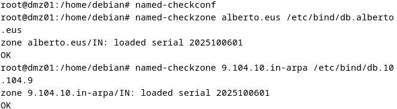

When there is an error, the command reports the line and the reason. The most common mistakes involve misplaced CNAME records.

### Step 7 – Set the local resolver and enable the service

On **dmz01**, point the system resolver to the new DNS server and search domain:

```bash
nano /etc/resolv.conf
```

```text
nameserver 10.104.9.101
search alberto.eus
```

Restart the service and enable it at boot:

```bash
systemctl restart bind9
systemctl enable named
```

> *named* is used for `enable` because *bind9* is only an alias of the real unit, and `systemctl enable bind9` reports an error.

Run the first resolution tests:

```bash
nslookup dns.alberto.eus
nslookup 10.104.9.102
```

The first command must return the address of the DNS server (10.104.9.101) and the second one must return *mail.alberto.eus*.

---

## Part 2 – Delivering the DMZ DNS server through DHCP

Until now, DMZ clients received their addresses from the router's DHCP service but had to be told manually which DNS server to use. In this part, the DHCP service distributes the DNS server and search domain automatically, so that clients resolve internal names (*www.alberto.eus*, *ftp.alberto.eus*...) without any manual configuration.

### Step 8 – Confirm the DNS server address

On **dmz01**, check which address the DNS server answers on:

```bash
nslookup dns
```

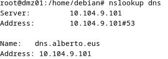

The DNS server (dmz01) has the address **10.104.9.101**, which is the address DHCP must hand out. DMZ clients must use this internal DNS server instead of an external one, so that internal names resolve correctly.

### Step 9 – Update the DHCP configuration for the DMZ

Edit the DHCP configuration on the **router**:

```bash
nano /etc/dhcp/dhcpd.conf
```

Each network is defined in a `subnet { ... }` block. The DMZ block (10.104.9.0/24) becomes:

```text
# DHCP for the DMZ network
subnet 10.104.9.0 netmask 255.255.255.0 {
    # Dynamic pool of 20 addresses
    range 10.104.9.50 10.104.9.69;

    # Gateway: Debian router
    option routers 10.104.9.1;

    # Our own DNS server and search domain
    option domain-name "alberto.eus";
    option domain-name-servers 10.104.9.101;

    # Default lease: 2 weeks
    default-lease-time 1209600;
    # Maximum lease: 4 weeks
    max-lease-time 2419200;
}
```

The two new lines are `option domain-name` and `option domain-name-servers`, which replace the public DNS server used in Lab 02.

### Step 10 – Restart the DHCP service

```bash
systemctl restart isc-dhcp-server
systemctl status isc-dhcp-server
```

The status must be `active (running)`, which confirms that the server accepted the new options.

### Step 11 – Verify on a DMZ client

On a DMZ client (*dmz02*), force a new lease request:

```bash
sudo dhclient -v
```

Check the DNS configuration received:

```bash
cat /etc/resolv.conf
```

The file must show the DMZ DNS server and the search domain:

```text
nameserver 10.104.9.101
search alberto.eus
```

Resolve an internal name:

```bash
dig www.alberto.eus
```

The answer must be the address configured in the zone (10.104.9.103). Finally, check that external names still resolve through the forwarders and that reverse resolution of a public address works:

```bash
nslookup www.google.com
nslookup 1.1.1.1
```

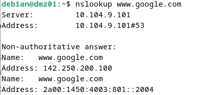
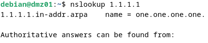

---

## Part 3 – DNS server for the LAN (lansrv02, domain *alberto.lan*)

A second DNS server is built on the LAN for the domain *alberto.lan*. It answers forward and reverse queries for its own zone and uses the DMZ DNS server (10.104.9.101) as its **forwarder** for everything else.

### Step 12 – Prepare the machine and install BIND9

Create a Debian 12 virtual machine named **lansrv02**, attach it to the **LAN** internal network and install BIND9 following [Step 1](#step-1--install-bind9). The same four configuration files are used as in the DMZ, with different names and contents.

### Step 13 – Declare the zones (**/etc/bind/named.conf.local**)

```bash
nano /etc/bind/named.conf.local
```

```text
zone "alberto.lan" {
    type master;
    file "/etc/bind/db.alberto.lan";
};

zone "39.104.10.in-addr.arpa" {
    type master;
    file "/etc/bind/db.10.104.39.rev";
};
```

- The first `file` points to the zone file that holds all the DNS records of the domain (A, CNAME, MX...). It must exist and is usually created by copying a template.
- The second `file` points to the file that stores the PTR records (IP → name).

### Step 14 – Configure the server options (**/etc/bind/named.conf.options**)

This server must always ask the DMZ DNS server for anything outside its own zone, so the options differ slightly from the DMZ ones:

```bash
nano /etc/bind/named.conf.options
```

```text
options {
    directory "/var/cache/bind";

    // Queries this server cannot resolve are sent to the DMZ DNS server
    forwarders {
        10.104.9.101;
    };

    recursion yes;
    allow-query { any; };
    listen-on-v6 { none; };
    listen-on { 10.104.39.3; };
};
```

| Directive | Purpose |
|---|---|
| `forwarders { 10.104.9.101; };` | Unknown names (for example, anything outside the local network) are asked to the DMZ DNS server. This speeds up answers and avoids depending on the root servers. |
| `recursion yes;` | The server resolves on behalf of the client when the answer is not in its cache or zones, following the server chain until it finds the answer. |
| `allow-query { any; };` | Any host may query the server. To restrict it to one network, use for example `{ 10.104.39.0/24; };`. |
| `listen-on { 10.104.39.3; };` | The server only listens on the address 10.104.39.3. |

### Step 15 – Create the forward zone (**/etc/bind/db.alberto.lan**)

No aliases are needed here apart from one, so the file only lists the host names.

```bash
nano /etc/bind/db.alberto.lan
```

```text
$TTL 604800
@   IN  SOA dns.alberto.lan. admin.alberto.lan. (
            2025101501  ; Serial
            28800       ; Refresh
            3600        ; Retry
            604800      ; Expire
            38400 )     ; Negative cache TTL

@        IN  NS     dns.alberto.lan.

router   IN  A      10.104.39.1     ; router.alberto.lan
dns      IN  A      10.104.39.3     ; Main DNS server
lan01    IN  A      10.104.39.10    ; lan01.alberto.lan
lan02    IN  A      10.104.39.11    ; lan02.alberto.lan
lansrv02 IN  CNAME  dns             ; Alias of dns.alberto.lan
```

The CNAME gives the DNS server a second, more descriptive name (*lansrv02.alberto.lan*) without duplicating its address.

### Step 16 – Create the reverse zone (**/etc/bind/db.10.104.39.rev**)

```bash
nano /etc/bind/db.10.104.39.rev
```

```text
$TTL 604800
@   IN  SOA dns.alberto.lan. admin.alberto.lan. (
            2025101501  ; Serial
            28800       ; Refresh
            3600        ; Retry
            604800      ; Expire
            38400 )     ; Negative cache TTL

@   IN  NS   dns.alberto.lan.

1   IN  PTR  router.alberto.lan.    ; 10.104.39.1
3   IN  PTR  dns.alberto.lan.       ; 10.104.39.3
10  IN  PTR  lan01.alberto.lan.     ; 10.104.39.10
11  IN  PTR  lan02.alberto.lan.     ; 10.104.39.11
```

Validate and restart the service:

```bash
named-checkconf
named-checkzone alberto.lan /etc/bind/db.alberto.lan
named-checkzone 39.104.10.in-addr.arpa /etc/bind/db.10.104.39.rev
systemctl restart bind9
```

### Step 17 – Allow the LAN resolver on the DMZ DNS server

Queries from **lansrv02** reach the DMZ DNS server from the address 10.104.39.3, which is outside the DMZ subnet. The access control lists of **dmz01** must therefore also accept that single host:

```bash
nano /etc/bind/named.conf.options    # on dmz01
```

```text
    allow-query     { 10.104.9.0/24; 10.104.39.3; };
    allow-recursion { 10.104.9.0/24; 10.104.39.3; };
```

```bash
systemctl restart bind9              # on dmz01
```

### Step 18 – Update the DHCP configuration for the LAN

On the **router**, the LAN subnet block of **/etc/dhcp/dhcpd.conf** is changed so that LAN clients receive the LAN DNS server and the *alberto.lan* search domain:

```bash
nano /etc/dhcp/dhcpd.conf
```

```text
authoritative;
one-lease-per-client on;

# DHCP for the LAN network
subnet 10.104.39.0 netmask 255.255.255.0 {
    option subnet-mask 255.255.255.0;
    option broadcast-address 10.104.39.255;
    option routers 10.104.39.1;
    option domain-name-servers 10.104.39.3;
    option domain-name "alberto.lan";
    # Lease times and address ranges remain as configured in Lab 02
}
```

The DNS server itself must always get the same address, because every client points to it. Add a **reservation** for *lansrv02* below the last reserved host in the file:

```text
host lansrv02 {
    hardware ethernet 08:00:27:DB:3A:CE;
    fixed-address 10.104.39.3;
}
```

Restart the DHCP service:

```bash
systemctl restart isc-dhcp-server
```

---

## 🧪 Verification & Testing

### 1. DMZ server – forward resolution (from dmz01)

| # | Command | Expected result |
|---|---|---|
| 1 | `nslookup router.alberto.eus` | 10.104.9.1 |
| 2 | `nslookup dhcp.alberto.eus` | CNAME of *router.alberto.eus* → 10.104.9.1 |
| 3 | `nslookup fw.alberto.eus` | CNAME of *router.alberto.eus* → 10.104.9.1 |
| 4 | `nslookup proxy.alberto.eus` | CNAME of *router.alberto.eus* → 10.104.9.1 |
| 5 | `nslookup dns.alberto.eus` | 10.104.9.101 |
| 6 | `nslookup dmz01.alberto.eus` | CNAME of *dns.alberto.eus* → 10.104.9.101 |
| 7 | `nslookup dmz02.alberto.eus` | CNAME of *mail.alberto.eus* → 10.104.9.102 |
| 8 | `nslookup www.alberto.eus` | 10.104.9.103 |
| 9 | `nslookup dmz03.alberto.eus` | CNAME of *www.alberto.eus* → 10.104.9.103 |
| 10 | `nslookup ftp.alberto.eus` | CNAME of *www.alberto.eus* → 10.104.9.103 |
| 11 | `nslookup dmz04.alberto.eus` | 10.104.9.104 |
| 12 | `dig alberto.eus MX` | `10 mail.alberto.eus.` with its A record 10.104.9.102 |

The mail server of the domain is discovered automatically through the MX record (test 12).

<details>
<summary><b>Screenshots – DMZ forward resolution</b></summary>

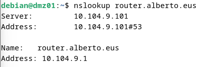
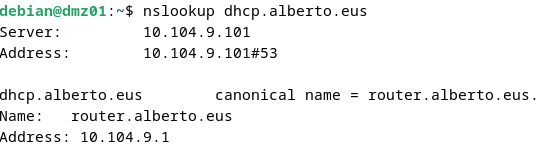
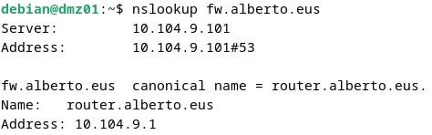
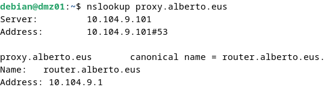
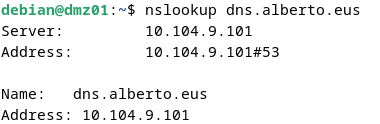
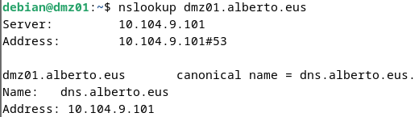
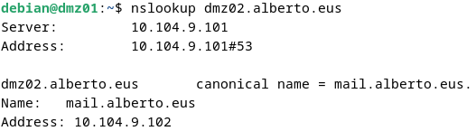
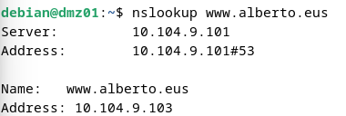
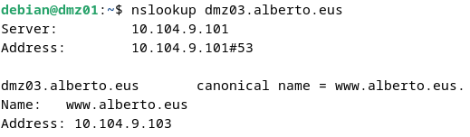
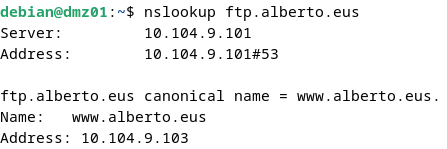
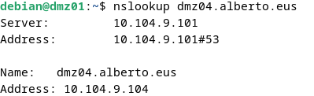
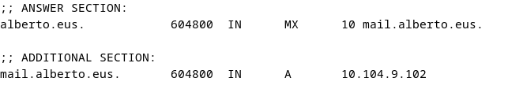

</details>

### 2. DMZ server – reverse resolution

<

Run `nslookup` in interactive mode and query each address:

| IP address | Expected name |
|---|---|
| 10.104.9.1 | router.alberto.eus |
| 10.104.9.101 | dns.alberto.eus |
| 10.104.9.102 | mail.alberto.eus |
| 10.104.9.103 | www.alberto.eus |
| 10.104.9.104 | ftp.alberto.eus |

### 3. DMZ clients – DHCP and DNS integration

| Check | Command | Expected result |
|---|---|---|
| DNS received through DHCP | `cat /etc/resolv.conf` | `nameserver 10.104.9.101` and `search alberto.eus` |
| Internal name | `dig www.alberto.eus` | 10.104.9.103 |
| External name (forwarders) | `nslookup www.google.com` | Non-authoritative answer from *10.104.9.101* |
| Reverse lookup of a public IP | `nslookup 1.1.1.1` | *one.one.one.one* |

### 4. LAN clients – DHCP and DNS integration

Tests were run on a client with a DHCP reservation and on a dynamic client (*lan07*). The DHCP service must deliver the DNS data correctly to both.

```bash
cat /etc/resolv.conf
```

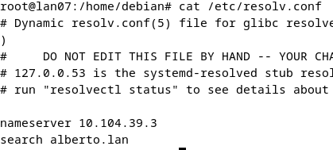

The dynamic client uses *10.104.39.3* as its DNS server and *alberto.lan* as its search domain.

**Forward lookups** (short names are completed with the search domain):

| Name | Expected result |
|---|---|
| `router` | router.alberto.lan → 10.104.39.1 |
| `dns` | dns.alberto.lan → 10.104.39.3 |
| `lan01` | lan01.alberto.lan → 10.104.39.10 |
| `lan02` | lan02.alberto.lan → 10.104.39.11 |
| `lansrv02` | CNAME of *dns.alberto.lan* → 10.104.39.3 |
| `www.google.com` | Non-authoritative answer (resolved through the forwarder chain) |

<details>
<summary><b>Screenshots – LAN forward resolution</b></summary>

*Client with a DHCP reservation:*

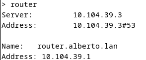
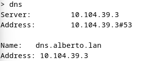
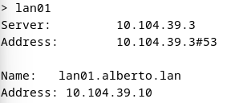
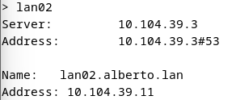
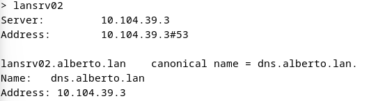

*Dynamic client (lan07):*

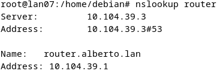
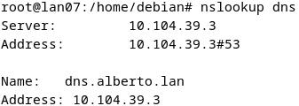
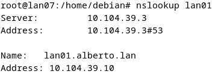
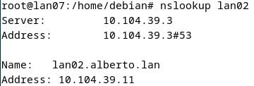
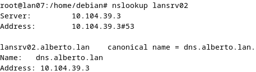
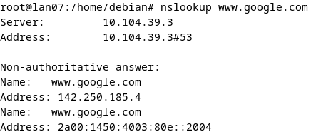

</details>

**Reverse lookups:**

| IP address | Expected name |
|---|---|
| 10.104.39.1 | router.alberto.lan |
| 10.104.39.3 | dns.alberto.lan |
| 10.104.39.10 | lan01.alberto.lan |
| 10.104.39.11 | lan02.alberto.lan |
| 1.1.1.1 | one.one.one.one |

<details>
<summary><b>Screenshots – LAN reverse resolution</b></summary>

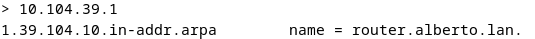
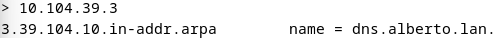
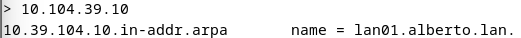
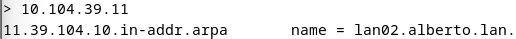
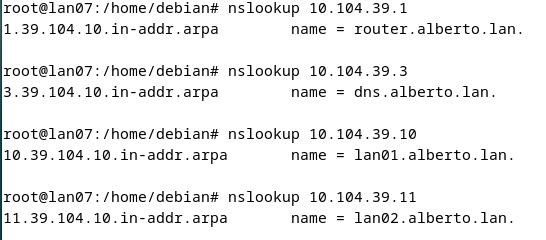
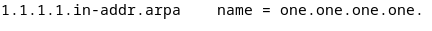

</details>

All tests passed: both servers answer authoritatively for their own zones, external queries travel through the chain *LAN DNS → DMZ DNS → public resolvers*, and DHCP delivers the correct DNS server and search domain to every client.

---

## 🔧 Design Notes & Possible Improvements

The lab was built to practise record types, zone files and resolver chaining, so several choices favour simplicity over production quality. After reviewing the finished work, these are the points I would change in a real deployment. The corrected zone files and options below were checked with `named-checkzone` and `named-checkconf`.

| # | Observation | Why it matters | Improvement |
|---|---|---|---|
| 1 | The SOA record of *alberto.eus* lists the domain apex as primary server. | The first SOA field should be the primary name server, and the second the administrator mailbox. | Use `dns.alberto.eus. admin.alberto.eus.` (as already done in *alberto.lan*). |
| 2 | The PTR for 10.104.9.104 points to *ftp*, which is a CNAME of *www* (10.104.9.103). | Forward and reverse DNS disagree, and a PTR should point to the canonical (A-record) name. | Point 10.104.9.104 to *dmz04.alberto.eus.*, the name that owns that address. |
| 3 | PTR records exist for 10.104.9.2, .3 and .100 (*fw*, *proxy*, *dhcp*), but those names are aliases of the router (10.104.9.1). | Aliases share the router's address, so those reverse records describe addresses that no forward record uses. | Keep a single PTR for the canonical name (*router*) and remove the other three. |
| 4 | *dnssec-validation* is disabled. | Resolvers lose protection against forged answers. | Use `dnssec-validation auto;`, which works out of the box with Internet access. |
| 5 | *allow-query* and *allow-recursion* only cover the DMZ subnet, while the LAN DNS server forwards its queries here. | The LAN server would be refused. | Add that single host (10.104.39.3), as shown in Step 17, instead of opening the server to everyone. |
| 6 | Zone transfers are not restricted. | Any host could request a copy of the whole zone. | Add `allow-transfer { none; };`, since there is no secondary server. |
| 7 | *lan01* and *lan02* have static A records on addresses taken from the DHCP pool. | If a lease changes, the record becomes wrong. | Create DHCP reservations for them, or use dynamic DNS updates between DHCP and BIND. |
| 8 | In Lab 02, address 10.104.9.101 was reserved for a different host (*dmz03*). | Two machines could claim the same address. | Plan the address space up front: keep servers in one dedicated range and DHCP reservations in another. |

**Improved DMZ forward zone** (**/etc/bind/db.alberto.eus**, points 1 and serial update):

```text
$TTL 604800
@   IN  SOA dns.alberto.eus. admin.alberto.eus. (
            2025100602  ; Serial
            28800       ; Refresh
            3600        ; Retry
            604800      ; Expire
            38400 )     ; Negative cache TTL
; ... records unchanged ...
```

**Improved DMZ reverse zone** (**/etc/bind/db.10.104.9**, points 1 to 3):

```text
$TTL 604800
@   IN  SOA dns.alberto.eus. admin.alberto.eus. (
            2025100602  ; Serial
            28800       ; Refresh
            3600        ; Retry
            604800      ; Expire
            38400 )     ; Negative cache TTL

@   IN  NS   dns.alberto.eus.

1   IN  PTR  router.alberto.eus.
101 IN  PTR  dns.alberto.eus.
102 IN  PTR  mail.alberto.eus.
103 IN  PTR  www.alberto.eus.
104 IN  PTR  dmz04.alberto.eus.
```

**Hardened server options** (**/etc/bind/named.conf.options** on *dmz01*, points 4 to 6):

```text
options {
    directory "/var/cache/bind";

    forwarders {
        1.1.1.1;
        9.9.9.9;
    };

    dnssec-validation auto;

    allow-query     { 10.104.9.0/24; 10.104.39.3; };
    allow-recursion { 10.104.9.0/24; 10.104.39.3; };
    allow-transfer  { none; };

    listen-on    { 10.104.9.101; };
    listen-on-v6 { none; };
};
```

After any change, increase the serial, validate and reload:

```bash
named-checkconf
named-checkzone alberto.eus /etc/bind/db.alberto.eus
named-checkzone 9.104.10.in-addr.arpa /etc/bind/db.10.104.9
systemctl reload bind9
```

---

## 📚 References

- **Zatiel.** (August 27, 2023). *How to configure DNS on Linux* [Video]. YouTube. <https://www.youtube.com/watch?v=sNX8QOGlUww>
- **De Luz, S.** (October 1, 2025). *Configure a DNS server using BIND9 on your Linux server.* RedesZone. <https://www.redeszone.net/tutoriales/servidores/configurar-servidor-dns-bind-linux/>
- **WebEbre.** (n.d.). *Installing and configuring a DNS server.* <https://www.webebre.net/instalacion-y-configuracion-de-un-servidor-dns/>
- **Iglesias, J.** (December 7, 2009). *Views in a DNS server, or how to resolve depending on the client.* Cerebro en la Sombra. <https://blog.osusnet.com/2009/12/07/vistas-en-un-servidor-dns-o-como-resolver-en-funcion-del-cliente/>
- **Guarino, L.** (November 14, 2017). *DNS server II: secondary DNS on Debian 9.* LuigiSir. <https://luigiasir.wordpress.com/2017/11/14/servidor-dns-ii-dns-secundario-en-debian-9/>
- **Domingo, J.** (December 2017). *Views in the BIND9 DNS server.* Pledin. <https://www.josedomingo.org/pledin/2017/12/vistas-views-en-el-servidor-dns-bind9/>
- **BigDinosaur Blog.** (n.d.). *Running BIND9 and ISC DHCP.* <https://blog.bigdinosaur.org/running-bind9-and-isc-dhcp/>
- **Sánchez G., M.** (May 25, 2020). *Install and configure a DDNS, DHCP and DNS server.* Medium. <https://medium.com/marcsanchezg/instalar-y-configurar-un-servidor-ddns-dhcp-dns-790cbc34e53d>
