# FTP Server for Multi-Site Web Hosting with vsftpd on Debian 12

> Part 1 of 2 of the *Web Hosting in the DMZ* project. The web server side (Apache2 virtual hosts and HTTPS) is documented in the [HTTP lab](../05-http-server-apache/README.md).

## 📌 Objective / Overview

This lab sets up an **FTP server (vsftpd)** on the DMZ server *dmz03* so that the customers of a small hosting and web-design company can manage their own websites remotely.

### Business requirement (lab scenario)

A small hosting company runs two customer websites on one DMZ server:

- ***www.alberto.eus*** – an online magazine.
- ***www.esperientziak.org*** – a website about travel and experiences.

Each customer must be able to upload and edit the files of their own site, but must not be able to see anyone else's files. The company also wants to publish the images of the travel site for public download, and needs one administrator account that can manage every site.

| # | Requirement | Implementation |
|---|---|---|
| R1 | Each customer manages **only** their own site | Local accounts, jailed (*chroot*) into their site directory |
| R2 | Public, read-only access to the travel site images | Anonymous FTP, restricted to the **/irudiak** directory, no write operations |
| R3 | One administrator manages **all** sites | *adminweb* account, excluded from the chroot |
| R4 | Identify the service and protect resources | Custom welcome banner, connection and bandwidth limits, timeouts |
| R5 | Optional graphical access for non-technical users | FileZilla client |

**Skills demonstrated:** vsftpd installation and hardening basics, per-user chroot with dynamic home directories, anonymous read-only access, chroot exception list, connection limits, FTP client testing (CLI and GUI), least-privilege review.

---

## 🛠️ Environment & Tools

| Component | Details |
|---|---|
| Server | *dmz03* – Debian 12, 10.104.9.103/24 (DMZ), shared with Apache2 |
| Clients | *admin01* – Debian with GNOME desktop, LAN network (10.104.39.0/24) |
| FTP server software | `vsftpd` (Debian 12 package) |
| FTP clients | `ftp` (command line), FileZilla |
| Name resolution | BIND9 on *dmz01* (10.104.9.101), see [DNS lab](../03-dns-bind9-dmz-lan/README.md) |
| Hypervisor | Oracle VirtualBox |

> **Prerequisites:** the network, DHCP and DNS labs ([Lab 01](../01-router-lan-dmz-nat/README.md), [Lab 02](../02-dhcp-server-lan-dmz/README.md), [Lab 03](../03-dns-bind9-dmz-lan/README.md)) are working, and the names below resolve to *dmz03*. The *esperientziak.org* zone is documented in [HTTP lab](../05-http-server-apache/README.md).

| DNS name | Type | Resolves to |
|---|---|---|
| *www.alberto.eus* | A | 10.104.9.103 |
| *www.esperientziak.org* | A | 10.104.9.103 |
| *ftp.esperientziak.org* | CNAME of *www* | 10.104.9.103 |

---

## 🗺️ Network Topology / Architecture

The FTP and HTTP services both run on *dmz03*. Clients in the LAN reach it through the router; the DNS server in the DMZ resolves the names.

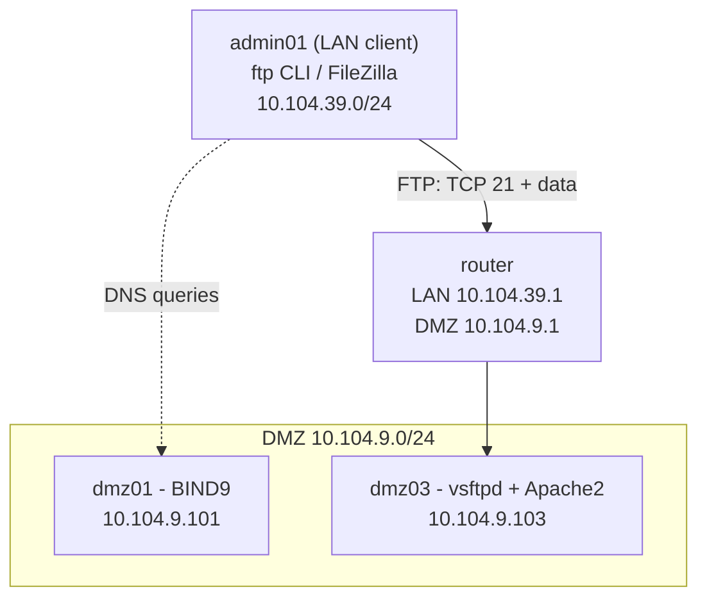

### Account and directory model

| Account | Authentication | Starts in (chroot) | Access |
|---|---|---|---|
| *alberto* | Password | **/var/www/www.alberto** (jailed) | Read/write on the magazine site only |
| *esperientziak* | Password | **/var/www/www.esperientziak** (jailed) | Read/write on the travel site only |
| *adminweb* | Password | Not jailed | Whole file system (administrator) |
| *anonymous* | None | **/var/www/www.esperientziak/irudiak** (jailed) | Read-only |

The jail is built from a naming convention: the token *$USER* in the configuration is replaced at login by the account name, so *alberto* is sent to **/var/www/www.alberto** and *esperientziak* to **/var/www/www.esperientziak**.

---

## 🚀 Step-by-Step Configuration

> All commands are executed as **root** on *dmz03* (or prefixed with `sudo`), unless stated otherwise.

### Step 1 – Create the site accounts and directories

One account per website, plus the administrator account. (These accounts and directories are shared with the web server lab.)

```bash
adduser alberto
adduser esperientziak
adduser adminweb

mkdir -p /var/www/www.alberto /var/www/www.esperientziak
chown alberto:alberto /var/www/www.alberto
chown esperientziak:esperientziak /var/www/www.esperientziak

# Directories readable by everyone, writable only by the owner
chmod -R 755 /var/www/
```

Each customer is now the owner of their own site directory.

<!-- REVIEW: the original document mixes two naming schemes: it creates /var/www/www.alberto.eus and /var/www/www.esperientziak.org, but Apache's DocumentRoot, the vsftpd local_root pattern and every screenshot use /var/www/www.alberto and /var/www/www.esperientziak. I used the short names everywhere because they are the ones that actually work together. Make sure the HTTP lab uses the same ones. -->

### Step 2 – Install vsftpd

```bash
apt update
apt upgrade
apt install vsftpd
```

`vsftpd` (*Very Secure FTP Daemon*) is one of the most widely used and secure FTP servers on Linux. Check that the service is running:

```bash
systemctl status vsftpd
```

`active (running)` means the FTP server is up.

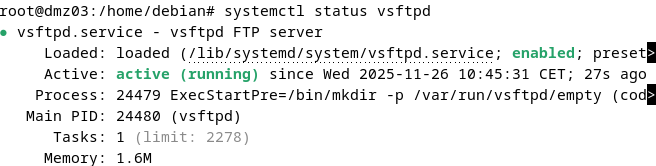

### Step 3 – Base configuration

Edit the main configuration file. It is best to search each option with `CTRL+W` in *nano* and uncomment it; if an option does not exist, add it at the end of the file.

```bash
nano /etc/vsftpd.conf
```

```text
# Listen on IPv4 (standalone mode)
listen=YES
# Do not listen on IPv6
listen_ipv6=NO

# Allow local (system) users to log in through FTP
local_enable=YES
# Allow uploading, modifying and deleting files
write_enable=YES
# Default permissions of files created by local users (rw-r--r--)
local_umask=022

# Lock every local user inside their own directory (chroot jail)
chroot_local_user=YES
# Replace $USER with the name of the user that logs in
user_sub_token=$USER
# Root directory of each user: their own website directory
local_root=/var/www/www.$USER
```

| Directive | Purpose |
|---|---|
| `listen=YES` | The daemon runs standalone and listens for IPv4 connections directly, instead of being started by another service such as *xinetd*. |
| `listen_ipv6=NO` | Disables IPv6. `listen` and `listen_ipv6` cannot both be `YES` at the same time. |
| `local_enable=YES` | Allows the local accounts defined in **/etc/passwd** (*alberto*, *esperientziak*, *adminweb*) to log in. |
| `write_enable=YES` | Allows upload, rename and delete operations. Required to manage the websites. |
| `local_umask=022` | New files are created as *rw-r--r--* and new directories as *rwxr-xr-x*, so Apache can read what customers upload. |
| `chroot_local_user=YES` | Locks every local user inside their root directory. Users cannot browse the rest of the system. |
| `user_sub_token=$USER` | Defines the token that is replaced by the user name at login. |
| `local_root=/var/www/www.$USER` | Root directory of the session. Examples: *alberto* → **/var/www/www.alberto**, *esperientziak* → **/var/www/www.esperientziak**. |

> **Note:** the directive is `local_umask`. A misspelled directive such as `local_mask` is not recognised and prevents the service from starting.

### Step 4 – Welcome banner

The banner is shown to every client **before** authentication. Create the text file:

```bash
mkdir -p /etc/vsftpd
nano /etc/vsftpd/ongietorria.txt
```

```text
█▀▀▀▀▀▀▀▀▀▀▀▀▀▀▀▀▀▀▀▀█
█░░╦─╦╔╗╦─╔╗╔╗╔╦╗╔╗░░█
█░░║║║╠─║─║─║║║║║╠─░░█
█░░╚╩╝╚╝╚╝╚╝╚╝╩─╩╚╝░░█
█▄▄▄▄▄▄▄▄▄▄▄▄▄▄▄▄▄▄▄▄█

Hello, welcome to the FTP server hosted on the www.alberto.eus machine
```

Save and close (**Ctrl+O → Enter → Ctrl+X**), then reference the file in **/etc/vsftpd.conf** (add the lines if they do not exist):

```text
banner_file=/etc/vsftpd/ongietorria.txt
ascii_upload_enable=YES
ascii_download_enable=YES
```

> The screenshots in this document were taken with the original Basque version of the banner text.

### Step 5 – Connection limits

Resource and abuse limits are added to **/etc/vsftpd.conf**:

```text
# Maximum number of simultaneous clients
max_clients=6
# Maximum connections per IP address
max_per_ip=3
# Maximum transfer rate per local user (bytes/second, about 1.2 MB/s)
local_max_rate=1200000
# Close idle sessions after 600 s (10 minutes)
idle_session_timeout=600
# Abort stalled data transfers after 420 s (7 minutes)
data_connection_timeout=420
```

| Directive | Effect |
|---|---|
| `max_clients=6` | No more than 6 users can be connected at the same time, which prevents resource exhaustion. |
| `max_per_ip=3` | One IP address cannot open more than 3 connections, which limits brute-force attempts and abuse. |
| `local_max_rate=1200000` | Caps the transfer speed at about 1.2 MB/s, so a single user cannot saturate the link. |
| `idle_session_timeout=600` | An inactive control connection is closed after 10 minutes. |
| `data_connection_timeout=420` | A data transfer with no progress for 7 minutes is dropped, cleaning up broken or very slow connections. |

### Step 6 – Read-only anonymous access

Anonymous users may download the images of *www.esperientziak.org*, but must not upload or modify anything. First create the directory:

```bash
mkdir -p /var/www/www.esperientziak/irudiak
chown esperientziak:esperientziak /var/www/www.esperientziak/irudiak
chmod -R 755 /var/www/www.esperientziak/irudiak
```

<!-- REVIEW: the original only runs "sudo mkdir -p" and "chmod -R 755" on this directory. A directory created with sudo belongs to root, yet the screenshots show the esperientziak user creating folders and uploading files inside /irudiak. I added the chown line that makes that possible. Tell me if you actually did it another way. -->

Then add to **/etc/vsftpd.conf**:

```text
# Accept anonymous users
anonymous_enable=YES
# Root directory for anonymous users (they cannot leave it)
anon_root=/var/www/www.esperientziak/irudiak
# No uploads
anon_upload_enable=NO
# No new directories
anon_mkdir_write_enable=NO
# No other write operations (rename, delete...)
anon_other_write_enable=NO
# Only world-readable files are served
anon_world_readable_only=YES
```

| Directive | Effect |
|---|---|
| `anonymous_enable=YES` | Allows login as *anonymous* without a password. |
| `anon_root=...` | Anonymous users are jailed in the images directory and cannot reach any other path. |
| `anon_upload_enable=NO` | Forbids file uploads. |
| `anon_mkdir_write_enable=NO` | Forbids creating directories. |
| `anon_other_write_enable=NO` | Forbids rename, delete and any other write operation. |
| `anon_world_readable_only=YES` | Only files readable by everyone (*o+r*) are served. vsftpd checks read permissions strictly. |

With directory mode `755` (*rwxr-xr-x*), anonymous users can list and download files but never change them.

### Step 7 – Administrator account outside the chroot

*adminweb* must be able to browse the whole file system and manage every website. With `chroot_local_user=YES`, the **exception list** contains the users that are **not** jailed.

Add to **/etc/vsftpd.conf**:

```text
# Jail every local user (users in the list below are the exception)
chroot_local_user=YES
# Allow the chroot root directory to be writable by the user
allow_writeable_chroot=YES
# Enable the list of users excluded from the chroot
chroot_list_enable=YES
chroot_list_file=/etc/vsftpd.chroot_list
# Empty, non-writable directory used internally by vsftpd
secure_chroot_dir=/var/run/vsftpd/empty
```

Create the exception list with only the administrator:

```bash
echo "adminweb" | tee /etc/vsftpd.chroot_list
```

| Directive | Effect |
|---|---|
| `chroot_local_user=YES` | Jails all local users in their root directory. |
| `allow_writeable_chroot=YES` | Allows the jail root to be writable. vsftpd refuses this by default for security reasons, but it is needed here because customers must write at the root of their site. |
| `chroot_list_enable=YES` | Enables the exception list. Because `chroot_local_user=YES`, the listed users are **not** jailed. |
| `chroot_list_file=/etc/vsftpd.chroot_list` | File with the names of the users excluded from the jail. |
| `secure_chroot_dir=/var/run/vsftpd/empty` | Empty directory vsftpd uses for privilege separation. It is created by the service at startup. |

**Result**

- Every user is jailed in their directory because of `chroot_local_user=YES`.
- Only *adminweb* appears in **/etc/vsftpd.chroot_list**, so it is not restricted and can browse **/var/www/** or even the file system root **/**.

### Step 8 – Apply and check the configuration

vsftpd has no syntax-check command: an unknown directive simply stops the service from starting. Restart it and check its state:

```bash
systemctl restart vsftpd
systemctl status vsftpd
```

The status must be `active (running)` with no error messages. If it fails, read the reason in the journal:

```bash
journalctl -u vsftpd -n 20 --no-pager
```

### Step 9 – Install a graphical client (optional)

On the LAN client *admin01*, install **FileZilla**, a file-transfer client that supports FTP, FTPS (secure) and SFTP (over SSH). Its two-pane interface shows the local files on one side and the server's on the other, with drag and drop.

```bash
apt install filezilla
```

Open FileZilla and fill in the quick-connect bar:

| Field | Value |
|---|---|
| Host | 10.104.9.103 |
| Username | *alberto*, *esperientziak* or *adminweb* |
| Password | The password set with `adduser` |
| Port | 21 (default) |

<!-- REVIEW: the original FileZilla section says the user is "aldizkaria", but the account created in Step 1 is "alberto" (and the screenshots use adminweb). I used alberto. -->

### Complete configuration

All the directives above together, as they remain in **/etc/vsftpd.conf** (the rest of the Debian default file is unchanged):

```text
# --- Basic ---
listen=YES
listen_ipv6=NO
local_enable=YES
write_enable=YES
local_umask=022
chroot_local_user=YES
user_sub_token=$USER
local_root=/var/www/www.$USER

# --- Welcome banner ---
banner_file=/etc/vsftpd/ongietorria.txt
ascii_upload_enable=YES
ascii_download_enable=YES

# --- Limits ---
max_clients=6
max_per_ip=3
local_max_rate=1200000
idle_session_timeout=600
data_connection_timeout=420

# --- Anonymous read-only access ---
anonymous_enable=YES
anon_root=/var/www/www.esperientziak/irudiak
anon_upload_enable=NO
anon_mkdir_write_enable=NO
anon_other_write_enable=NO
anon_world_readable_only=YES

# --- Administrator outside the chroot ---
allow_writeable_chroot=YES
chroot_list_enable=YES
chroot_list_file=/etc/vsftpd.chroot_list
secure_chroot_dir=/var/run/vsftpd/empty
```

---

## 🧪 Verification & Testing

All client tests were run from the LAN machine *admin01*, except the banner test, which is run on *dmz03* itself.

| ID | Test | Method | Expected result |
|---|---|---|---|
| F1 | Service state | `systemctl status vsftpd` | `active (running)` |
| F2 | Welcome banner | `ftp www.alberto.eus` | Banner shown **before** the login prompt |
| F3 | Administrator access | FileZilla as *adminweb* | Full file system access; can download, edit and replace a site page |
| F4 | Customer isolation | `ftp ftp.esperientziak.org` as *esperientziak* | Jailed in the site; can create directories and upload several files with one command |
| F5 | Anonymous access | `ftp ftp.esperientziak.org` as *anonymous* | Jailed in **/irudiak**; can download, but cannot upload |

### F1 and F2 – Service and banner

```bash
systemctl status vsftpd
ftp www.alberto.eus
```


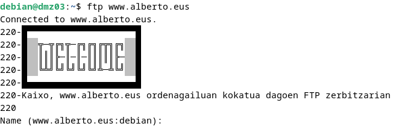

### F3 – Administrator (*adminweb*) with FileZilla

1. Connect to the FTP server as *adminweb*.
2. Show that the user can browse the whole file system.
3. Download a web page (the magazine home page, **/var/www/www.alberto/ClashRoyale-index.html**).
4. Edit the downloaded page locally.
5. Upload it and replace the original with the new version.
6. Show the change in a web browser (*www.alberto.eus*).
7. Disconnect.

<details>
<summary><b>Screenshots – F3</b></summary>

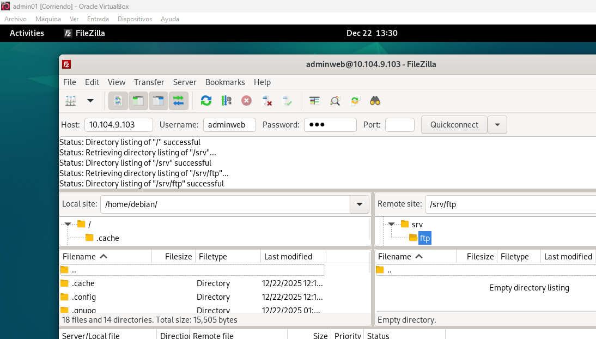
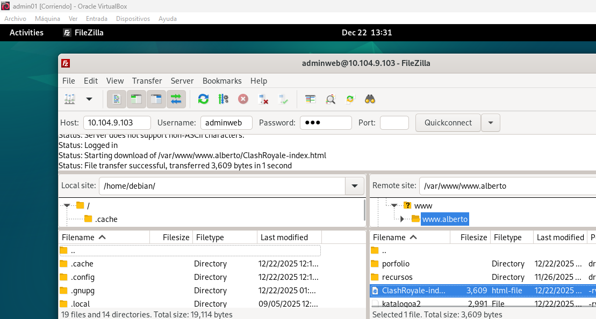
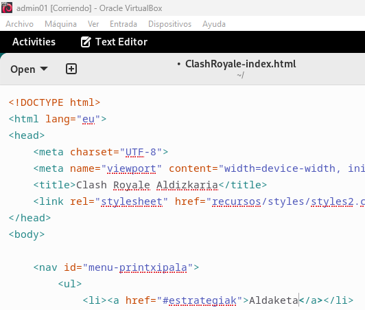
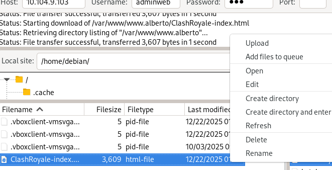
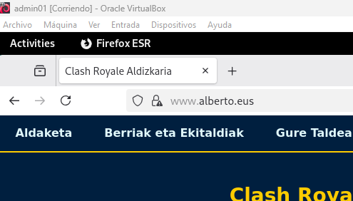

</details>

### F4 – Customer (*esperientziak*) from the terminal

1. Connect as *esperientziak*.
2. Try to leave the site: `cd /home` fails with `550 Failed to change directory`, which proves the jail.
3. Create a new directory inside the images directory.
4. Upload several images with a single command (`mput *.png`).
5. Show the result in a browser (directory listing of **/irudiak/froga**).
6. Disconnect.

```bash
ftp ftp.esperientziak.org
ftp> cd /home
ftp> cd irudiak
ftp> mkdir froga
ftp> cd froga
ftp> mput *.png
ftp> ls
ftp> quit
```

<details>
<summary><b>Screenshots – F4</b></summary>

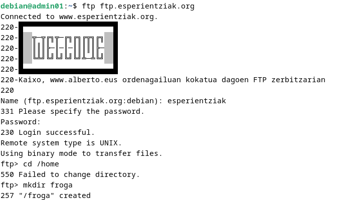
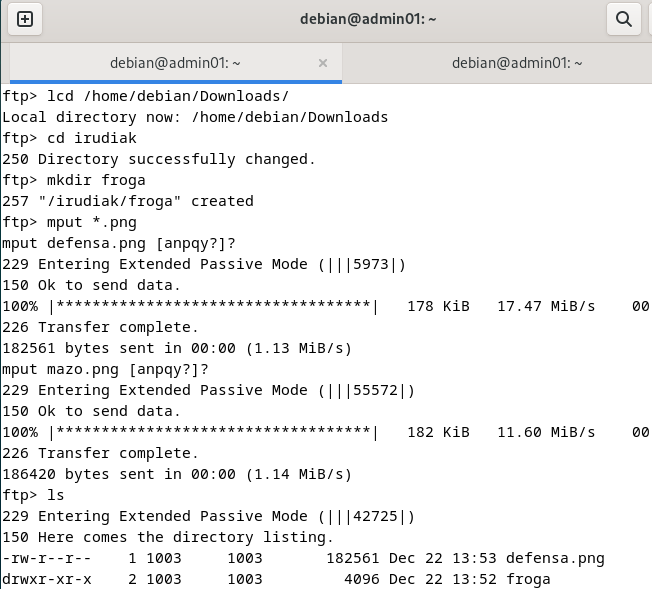
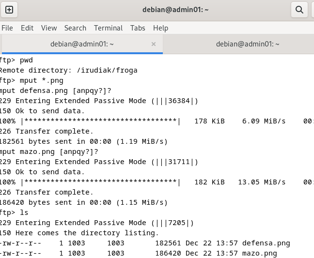
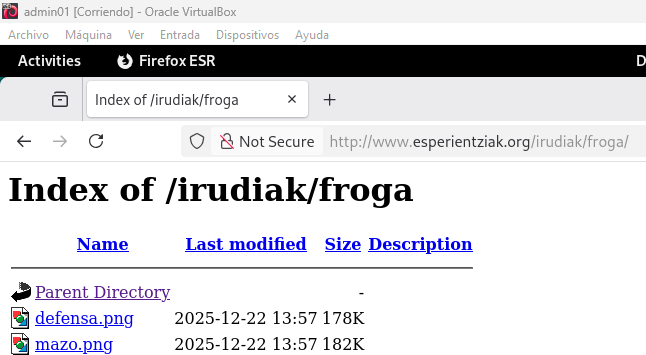
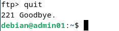

</details>

### F5 – Anonymous user from the terminal

1. Connect as *anonymous* (any text is accepted as the password).
2. Check that the user is jailed: `cd /home` fails with `550 Failed to change directory`.
3. Enter the directory created in F4 (**froga**), which is inside the images directory.
4. Download all the images with a single command (`mget *.png`).
5. Try to upload a file: it must be refused with `550 Permission denied`.
6. Disconnect.

```bash
ftp ftp.esperientziak.org
ftp> cd /home
ftp> cd froga
ftp> ls
ftp> mget *.png
ftp> mput *.png
ftp> quit
```

<details>
<summary><b>Screenshots – F5</b></summary>

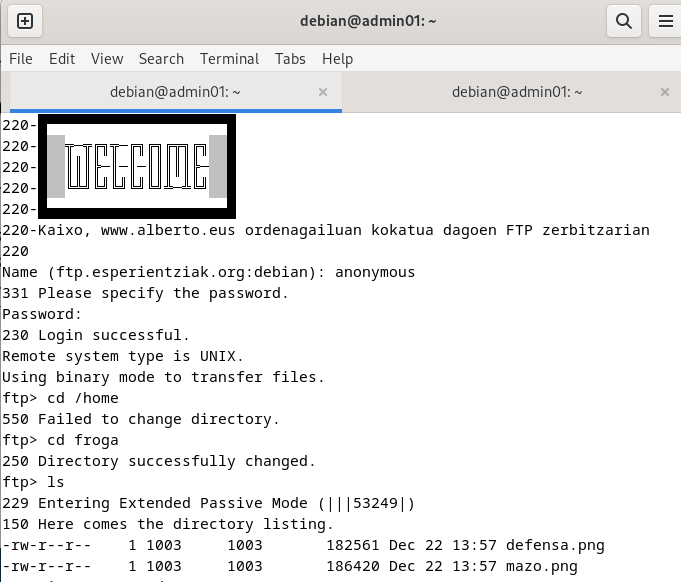
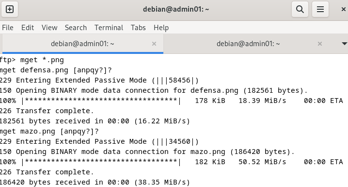
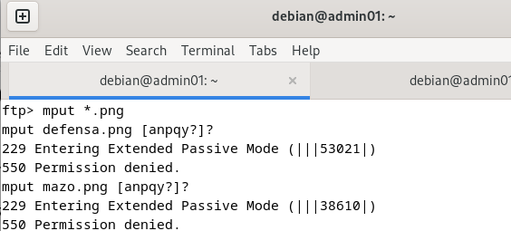
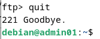

</details>

**Result:** all five requirements are met. Customers are isolated in their own site, anonymous users can only read the public images, and *adminweb* can manage every site.

---

## 🔧 Design Notes & Possible Improvements

The lab covers the functional requirements. These are the points I would change before using the design in production. The hardened configuration below was loaded on vsftpd 3.0.5 and exercised with a test client: TLS login, jail behaviour, anonymous access and the administrator restriction.

| # | Observation | Why it matters | Improvement |
|---|---|---|---|
| 1 | Plain FTP sends passwords and files unencrypted. | Anyone able to capture traffic in the network can read credentials. | Enable explicit TLS (**FTPS**) and force it for local logins. The lab CA from the HTTPS section ([HTTP lab](../05-http-server-apache/README.md)) can sign the certificate. SFTP over SSH is an alternative. |
| 2 | *adminweb* can browse the whole file system. | A compromised administrator password exposes the entire server. | Give *adminweb* its own jail at **/var/www** with a per-user configuration file. It still manages every site, but nothing else. |
| 3 | `local_root` fails silently when the directory does not exist. | *adminweb* has no **/var/www/www.adminweb**, so it falls back to its home directory instead of failing visibly. | Use the per-user file from point 2, or make sure every `local_root` target exists. |
| 4 | Passive data ports are random (the screenshots show ports such as 36384 and 55572). | A firewall between the zones cannot be configured for random ports. | Fix a range with `pasv_min_port` / `pasv_max_port` and allow only TCP 21 and that range. |
| 5 | ASCII transfer mode is enabled. | It is not needed here and can corrupt binary files if a client selects it by mistake. | Remove `ascii_upload_enable` and `ascii_download_enable` (the default is `NO`). |
| 6 | `chmod -R 755 /var/www/` also makes every file executable. | Uploaded content gets permissions it does not need. | Use `755` for directories and `644` for files. |
| 7 | FTP accounts have a normal login shell (*/bin/bash*). | The accounts are meant only for file transfer. | Set the shell to `/usr/sbin/nologin`, and list it in **/etc/shells** because vsftpd's PAM stack checks it. |
| 8 | No protection against repeated failed logins. | `max_per_ip` limits connections but not password guessing over time. | Keep the transfer log enabled and add *fail2ban* with a vsftpd jail. |

**Hardened configuration** (changes against the base configuration in the previous sections):

```text
# --- Encryption (explicit FTPS) ---
ssl_enable=YES
rsa_cert_file=/etc/ssl/certs/ftp.esperientziak.org.crt
rsa_private_key_file=/etc/ssl/private/ftp.esperientziak.org.key
force_local_logins_ssl=YES
force_local_data_ssl=YES
ssl_tlsv1=NO
ssl_sslv2=NO
ssl_sslv3=NO
require_ssl_reuse=NO

# --- Passive mode with a fixed port range ---
pasv_enable=YES
pasv_min_port=40000
pasv_max_port=40100

# --- Per-user settings (adminweb jailed in /var/www) ---
user_config_dir=/etc/vsftpd/users

# --- Logging ---
xferlog_enable=YES

# Removed: chroot_list_enable, chroot_list_file, ascii_upload_enable, ascii_download_enable
```

Create the per-user file and the test certificate:

```bash
# adminweb: jailed in /var/www (sees all the sites, nothing else)
mkdir -p /etc/vsftpd/users
echo 'local_root=/var/www' > /etc/vsftpd/users/adminweb

# Self-signed certificate for the lab (use the lab CA in production-like setups)
openssl req -x509 -newkey rsa:2048 -nodes -days 365 \
  -subj "/CN=ftp.esperientziak.org" \
  -keyout /etc/ssl/private/ftp.esperientziak.org.key \
  -out /etc/ssl/certs/ftp.esperientziak.org.crt
chmod 600 /etc/ssl/private/ftp.esperientziak.org.key

systemctl restart vsftpd
```

Permissions and shells (points 6 and 7):

```bash
find /var/www -type d -exec chmod 755 {} +
find /var/www -type f -exec chmod 644 {} +

echo /usr/sbin/nologin >> /etc/shells
usermod -s /usr/sbin/nologin alberto
usermod -s /usr/sbin/nologin esperientziak
usermod -s /usr/sbin/nologin adminweb
```

**Expected behaviour with the hardened configuration**

| Test | Result |
|---|---|
| Plain-text login as a local user | `530 Non-anonymous sessions must use encryption.` |
| Explicit-TLS login as *esperientziak* | Session negotiated with TLS 1.3, starts at **/** (the site) and sees only **irudiak** |
| *adminweb* after login | Starts at **/**, sees *html*, *www.alberto* and *www.esperientziak*; `cd /home` and `cd /etc` fail with `550` |
| Anonymous login | Still works without TLS and stays read-only |

> If traffic between the zones is filtered (see the firewall improvement in [Lab 01](../01-router-lan-dmz-nat/README.md)), allow TCP 21 and the passive range 40000–40100 towards *dmz03*. The kernel FTP connection-tracking helper cannot inspect TLS-encrypted control connections, so the fixed range is needed.

---

## 📚 References

- **vsftpd.conf(5).** *Configuration file for vsftpd* – manual page (`man vsftpd.conf`).
- **IONOS Editorial Team.** (n.d.). *FTP server on Ubuntu: installation and configuration.* IONOS Digital Guide. <https://www.ionos.es/digitalguide/servidores/configuracion/servidor-ftp-en-ubuntu-instalacion-y-configuracion/>
- **Pocket Cursor.** (n.d.). *Set up a basic FTP server (vsftpd) on Ubuntu.* <https://pocketcursor.com/guides/SetupFTP>
- **Alarcón, M.** (December 2, 2021). *Create and configure an FTP server with vsftpd on Ubuntu Server 20.04.* FlotaDigital. <https://flotadigital.com/club/tutoriales/ubuntu/crear-y-configurar-servidor-ftp-con-vsftpd-en-ubuntu-server-20-04/>
- **Moreno, M.** (July 29, 2025). *How to connect via FTP with FileZilla.* CDmon Helpdesk. <https://helpdesk.cdmon.com/portal/es/kb/articles/c%C3%B3mo-conectar-por-ftp-mediante-filezilla>
