# Multi-Site Web Hosting with Apache2 Virtual Hosts and HTTPS (Private CA) on Debian 12

> Part 2 of 2 of the *Web Hosting in the DMZ* project. The file-transfer side (vsftpd) is documented in the [FTP lab](../04-ftp-server-vsftpd/README.md).

## 📌 Objective / Overview

This lab turns the DMZ server *dmz03* into a **web hosting platform** for a small hosting and web-design company. One Apache2 instance serves two customer websites through **name-based virtual hosts**, applies **per-page access rules** based on the client network and hostname, and publishes the magazine site over **HTTPS** using certificates issued by a **private Certificate Authority** built with OpenSSL.

### Business requirement (lab scenario)

| # | Requirement | Implementation |
|---|---|---|
| R1 | Two customers share one server, each with an isolated site | Two virtual hosts, one directory and one account per site |
| R2 | Customers reach their site by name, with or without `www.` | *ServerName* + *ServerAlias*, `esperientziak.org` zone in BIND9 |
| R3 | The magazine home page is public | `Require all granted` |
| R4 | The *team* page is internal only (LAN and DMZ) | `Require ip` on `taldea.html` |
| R5 | The *catalogue* page is only for hosts inside the company domain | `Require host .alberto.eus` on `katalogoa.html` |
| R6 | The travel site shows a video page and a public image gallery | `Alias /bideoa`, `Alias /irudiak` with directory listing |
| R7 | The magazine must be served over HTTPS, and plain HTTP must redirect to it without browser warnings | Private root CA, SAN certificate, `Redirect permanent`, CA imported in Firefox |

**Skills demonstrated:** Apache2 virtual hosting, access control (`Require ip` / `Require host` / `RequireAny`), aliases and directory listing, per-site logging, DNS zone creation for a second domain, DHCP search-domain options, building a root CA and signing a server certificate with SAN, TLS configuration, browser trust store management, configuration validation (`apachectl configtest`, `named-checkzone`).

---

## 🛠️ Environment & Tools

| Component | Details |
|---|---|
| Web server | *dmz03* – Debian 12, 10.104.9.103/24 (DMZ), Apache2 2.4 |
| DNS server and **certificate authority** | *dmz01* – Debian 12, 10.104.9.101/24 (DMZ), BIND9 + OpenSSL |
| Router / DHCP | Debian 12 router, see [Lab 01](../01-router-lan-dmz-nat/README.md) and [Lab 02](../02-dhcp-server-lan-dmz/README.md) |
| Clients | *dmz01* (DMZ, Firefox), *admin01* (LAN 10.104.39.0/24, Firefox), an external Windows machine (Chrome) |
| Tools | `apache2`, `a2ensite` / `a2dissite` / `a2enmod`, `apachectl`, `openssl`, `named-checkzone`, `scp` |
| Hypervisor | Oracle VirtualBox |

> **Prerequisites:** the router, DHCP and DNS labs ([01](../01-router-lan-dmz-nat/README.md), [02](../02-dhcp-server-lan-dmz/README.md), [03](../03-dns-bind9-dmz-lan/README.md)) are working. *dmz03* exists with a static address and the *alberto.eus* zone resolves `www` to it.

---

## 🗺️ Network Topology / Architecture

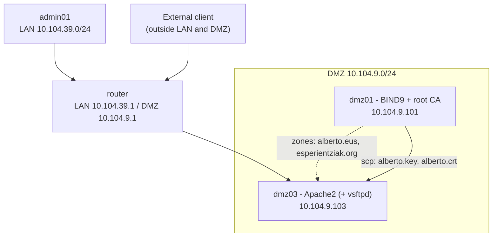

### Sites and URLs

| Virtual host | Document root | Content |
|---|---|---|
| *www.alberto.eus* (alias *alberto.eus*) | **/var/www/www.alberto** | Online magazine (home, `porfolio/taldea.html`, `porfolio/katalogoa.html`) |
| *www.esperientziak.org* (alias *esperientziak.org*) | **/var/www/www.esperientziak** | Travel site (home, `/bideoa`, `/irudiak`) |

### Access matrix (what the configuration implements)

| Resource | Rule | LAN | DMZ | Outside |
|---|---|---|---|---|
| `/` (home) | `Require all granted` | ✅ | ✅ | ✅ |
| `/porfolio/taldea.html` | `Require ip 10.104.9.0/24` **or** `10.104.39.0/24` | ✅ | ✅ | ❌ 403 |
| `/porfolio/katalogoa.html` | `Require host .alberto.eus` | ❌ 403 (*) | ✅ | ❌ 403 |

(*) `Require host` compares the **reverse DNS name** of the client. Clients in the LAN resolve to the *alberto.lan* domain, not *alberto.eus*, so they are denied. This matches the screenshots in the testing section.

---

## 🚀 Step-by-Step Configuration

### Step 1 – DHCP: search domains for the new zone (router)

Clients must be able to resolve the short names of both domains. On the router, edit **/etc/dhcp/dhcpd.conf** in each subnet declaration.

```bash
nano /etc/dhcp/dhcpd.conf
```

LAN subnet:

```text
# DNS configuration for the LAN (alberto.eus and esperientziak.org)
option domain-search "alberto.eus", "esperientziak.org";
option domain-name "alberto.eus";
option domain-name-servers 10.104.39.3;
```

DMZ subnet:

```text
# DNS configuration for the DMZ (alberto.eus and esperientziak.org)
option domain-name "alberto.eus";
option domain-name-servers 10.104.9.101;
option domain-search "alberto.eus", "esperientziak.org";
```

| Option | Purpose |
|---|---|
| `domain-search` | Suffixes the client appends to short names, so `www` can resolve in both domains |
| `domain-name` | Main domain of the subnet |
| `domain-name-servers` | DNS server handed to the clients |

Check the syntax and restart the service:

```bash
dhcpd -t -cf /etc/dhcp/dhcpd.conf
systemctl restart isc-dhcp-server
```

### Step 2 – DNS: create the *esperientziak.org* zone (*dmz01*)

Declare the zone in **/etc/bind/named.conf.local**:

```bash
nano /etc/bind/named.conf.local
```

```text
zone "esperientziak.org" {
    type master;
    file "/etc/bind/db.esperientziak.org";
    allow-transfer { 127.0.0.1; 10.104.9.0/24; };
};
```

Create the zone file **/etc/bind/db.esperientziak.org**:

```bash
nano /etc/bind/db.esperientziak.org
```

```text
$TTL 604800
@   IN  SOA esperientziak.org. admin.esperientziak.org. (
            2          ; Serial
            604800     ; Refresh
            86400      ; Retry
            2419200    ; Expire
            604800 )   ; Negative cache TTL

; Authoritative name server
@   IN  NS  dns.alberto.eus.

; A records
dns IN  A   10.104.9.101
www IN  A   10.104.9.103

; Aliases
ftp IN  CNAME www
```

No reverse zone is created for this domain: the addresses already belong to the *10.104.9.0/24* reverse zone from the [DNS lab](../03-dns-bind9-dmz-lan/README.md), and a second reverse zone for the same network would conflict with it.

Validate and apply:

```bash
named-checkconf
named-checkzone esperientziak.org /etc/bind/db.esperientziak.org
named-checkzone 9.104.10.in-addr.arpa /etc/bind/db.10.104.9
systemctl restart bind9
```

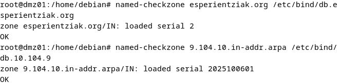

### Step 3 – Install Apache2 (*dmz03*)

```bash
apt update && apt upgrade -y
apt install apache2 -y
systemctl status apache2
```

The service must be `active (running)`.

### Step 4 – Create the site accounts and directories

One account per customer, and one directory owned by each account:

```bash
adduser alberto
adduser esperientziak

mkdir /var/www/www.alberto
chown alberto:alberto /var/www/www.alberto/

mkdir /var/www/www.esperientziak
chown esperientziak:esperientziak /var/www/www.esperientziak/
```

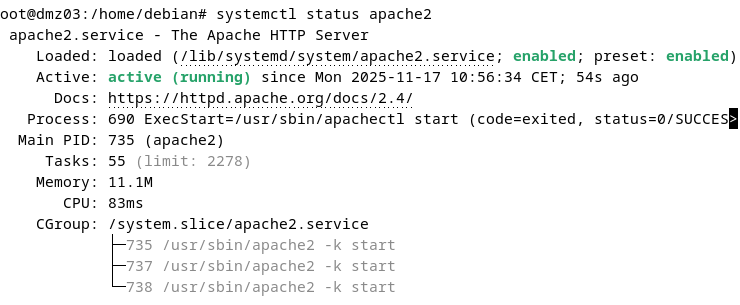

### Step 5 – Create the virtual host files

Start from the default site definition:

```bash
cp /etc/apache2/sites-available/000-default.conf /etc/apache2/sites-available/www.alberto.eus.conf
cp /etc/apache2/sites-available/000-default.conf /etc/apache2/sites-available/www.esperientziak.org.conf
```

#### 5.1 – *www.alberto.eus* (final layout: HTTP redirect + HTTPS site)

The magazine is published over HTTPS (Step 10). The final layout uses **two files**: a port 80 virtual host that only redirects, and a port 443 virtual host that carries the site and all access rules.

**/etc/apache2/sites-available/www.alberto.eus.conf** (port 80):

```apache
<VirtualHost *:80>
    ServerName www.alberto.eus
    ServerAlias alberto.eus

    # Send every plain-HTTP request to HTTPS (301)
    Redirect permanent / https://www.alberto.eus/
</VirtualHost>
```

**/etc/apache2/sites-available/www.alberto.eus-ssl.conf** (port 443):

```apache
<VirtualHost *:443>
    ServerName www.alberto.eus
    ServerAlias alberto.eus
    DocumentRoot /var/www/www.alberto

    # Home page served when the site root is requested
    DirectoryIndex ClashRoyale-index.html

    # TLS (certificate issued by the lab CA, see Step 10)
    SSLEngine on
    SSLCertificateFile    /etc/ssl/certs/alberto.crt
    SSLCertificateKeyFile /etc/ssl/private/alberto.key

    # Whole site: public
    <Directory "/var/www/www.alberto/">
        AllowOverride None
        Require all granted
    </Directory>

    # Restricted pages
    <Directory "/var/www/www.alberto/porfolio">
        # Team page: only DMZ and LAN
        <Files "taldea.html">
            <RequireAny>
                Require ip 10.104.9.0/24
                Require ip 10.104.39.0/24
            </RequireAny>
        </Files>

        # Catalogue: only clients whose reverse DNS name ends in .alberto.eus
        <Files "katalogoa.html">
            Require host .alberto.eus
        </Files>
    </Directory>

    ErrorLog  ${APACHE_LOG_DIR}/alberto_error.log
    CustomLog ${APACHE_LOG_DIR}/alberto_access.log combined
</VirtualHost>
```

| Directive | What it does |
|---|---|
| `ServerName` / `ServerAlias` | Names this virtual host answers to; Apache picks the vhost by the `Host:` header |
| `DocumentRoot` | Directory the site is served from |
| `DirectoryIndex` | File served for a directory request (here a custom home page name) |
| `<Directory>` | Scope of the rules; `AllowOverride None` disables **.htaccess**, so all rules live in the server configuration |
| `<Files>` | Narrows a rule to a single file inside the directory |
| `<RequireAny>` | Access is granted if **any** inner `Require` matches |
| `Require ip` | Match on client network |
| `Require host` | Match on the client's reverse DNS name (Apache does a reverse lookup and confirms it with a forward lookup) |
| `ErrorLog` / `CustomLog` | Per-site logs in **/var/log/apache2/**; the `combined` format records IP, user agent, time and URL |

#### 5.2 – *www.esperientziak.org*

**/etc/apache2/sites-available/www.esperientziak.org.conf**:

```apache
<VirtualHost *:80>
    ServerName www.esperientziak.org
    ServerAlias esperientziak.org
    DocumentRoot /var/www/www.esperientziak
    DirectoryIndex index.html

    # /bideoa shows the home page (changes the text in the address bar)
    Alias /bideoa /var/www/www.esperientziak/index.html

    <Directory "/var/www/www.esperientziak/">
        AllowOverride None
        Require all granted
    </Directory>

    # Public image gallery with directory listing
    Alias /irudiak /var/www/www.esperientziak/irudiak
    <Directory /var/www/www.esperientziak/irudiak>
        Require all granted
        Options +Indexes
        AllowOverride None
    </Directory>

    ErrorLog  ${APACHE_LOG_DIR}/error.log
    CustomLog ${APACHE_LOG_DIR}/access.log combined
</VirtualHost>
```

| Directive | What it does |
|---|---|
| `Alias /bideoa …/index.html` | Maps the URL `/bideoa` to a file outside the normal URL-to-path mapping |
| `Alias /irudiak …/irudiak` | Maps the URL `/irudiak` to the image directory |
| `Options +Indexes` | Generates an automatic listing when the directory has no index file |
| Default log files | This site logs to the shared **error.log** / **access.log** instead of dedicated files |

### Step 6 – Enable the sites

Disable the default site, enable the new ones and the SSL module, check the syntax and restart. The `ssl` module must be enabled **before** the `-ssl` site, otherwise `SSLEngine` is an unknown directive.

```bash
a2dissite 000-default.conf
a2enmod ssl
a2ensite www.alberto.eus.conf
a2ensite www.alberto.eus-ssl.conf
a2ensite www.esperientziak.org.conf

apachectl configtest
systemctl restart apache2
ls -l /etc/apache2/sites-enabled/
```

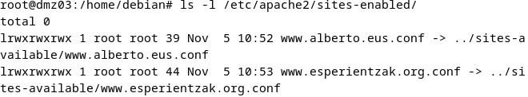

> The HTTPS site only starts once the certificate and key referenced above exist. Complete Step 10 first, or temporarily skip `a2ensite www.alberto.eus-ssl.conf`.

### Step 7 – Build the site structure

Create the content tree for the magazine (`-p` creates the parent directory too):

```bash
mkdir -p /var/www/www.alberto/recursos/{audio,image,styles,video}
mkdir -p /var/www/www.alberto/porfolio
```

```text
/var/www/www.alberto/
├── ClashRoyale-index.html      # home (DirectoryIndex)
├── porfolio/
│   ├── taldea.html             # restricted: LAN + DMZ
│   └── katalogoa.html          # restricted: *.alberto.eus
└── recursos/
    ├── audio/
    ├── image/
    ├── styles/
    │   └── styles2.css
    └── video/
```

Create the pages with `nano`:

```bash
nano /var/www/www.alberto/ClashRoyale-index.html
nano /var/www/www.alberto/recursos/styles/styles2.css
nano /var/www/www.alberto/porfolio/taldea.html
nano /var/www/www.alberto/porfolio/katalogoa.html
nano /var/www/www.esperientziak/index.html
```

Apache runs as *www-data*, which needs read access. Use `755` for directories and `644` for files:

```bash
find /var/www -type d -exec chmod 755 {} +
find /var/www -type f -exec chmod 644 {} +
```

### Step 8 – HTTPS part 1: create the private Certificate Authority (*dmz01*)

The CA lives on a **different machine** from the web server (*dmz01*), so the CA key never has to be present on *dmz03*, and the same CA can sign further certificates later.

```bash
mkdir /home/debian/alberto-ca
cd /home/debian/alberto-ca
```

Root certificate and its private key (valid for 10 years):

```bash
openssl req -x509 -nodes -days 3650 -newkey rsa:2048 \
  -keyout rootCA.key \
  -out rootCA.pem \
  -subj "/O=ALBERTO/CN=ALBERTO ROOT CA"
```

| Option | Meaning |
|---|---|
| `req -x509` | Create a **self-signed** certificate instead of a request |
| `-nodes` | Do not encrypt the private key with a passphrase |
| `-days 3650` | Validity of 10 years |
| `-newkey rsa:2048` | Generate a new 2048-bit RSA key |
| `-keyout` / `-out` | Private key file / public certificate file |
| `-subj` | Identity of the CA (organisation and common name) |

**rootCA.pem** is the public certificate that clients will trust. **rootCA.key** must never leave the CA machine.

### Step 9 – HTTPS part 2: key, CSR, SAN and signature (*dmz01*)

Server key and certificate signing request for *www.alberto.eus*:

```bash
openssl req -new -nodes -newkey rsa:2048 \
  -keyout alberto.key \
  -out alberto.csr \
  -subj "/O=ALBERTO/CN=www.alberto.eus"
```

Modern browsers ignore the common name and require a **Subject Alternative Name**. The extension file lets one certificate cover the site with and without `www`:

```bash
echo "subjectAltName=DNS:alberto.eus,DNS:www.alberto.eus" > extfile.cnf
```

Sign the request with the CA:

```bash
openssl x509 -req -days 3650 \
  -in alberto.csr \
  -CA rootCA.pem \
  -CAkey rootCA.key \
  -CAcreateserial \
  -out alberto.crt \
  -extfile extfile.cnf
```

| Option | Meaning |
|---|---|
| `x509 -req` | Sign a certificate request |
| `-in alberto.csr` | The request created above |
| `-CA` / `-CAkey` | CA certificate and CA private key used to sign |
| `-CAcreateserial` | Create the serial-number file (**rootCA.srl**) so every certificate gets a unique serial |
| `-out alberto.crt` | Signed server certificate |
| `-extfile` | Adds the SAN extension |

Check the result on *dmz01*:

```bash
openssl verify -CAfile rootCA.pem alberto.crt
openssl x509 -in alberto.crt -noout -subject -ext subjectAltName
```

Expected output: `alberto.crt: OK`, subject `O = ALBERTO, CN = www.alberto.eus` and `DNS:alberto.eus, DNS:www.alberto.eus`.

### Step 10 – HTTPS part 3: deploy the certificate on *dmz03*

Copy the server key and certificate from the CA machine (run on *dmz01*):

```bash
scp alberto.key alberto.crt debian@10.104.9.103:/home/debian/alberto-ca
```

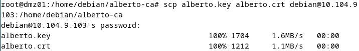

On *dmz03*, place each file in its standard location and restrict the private key:

```bash
mv /home/debian/alberto-ca/alberto.crt /etc/ssl/certs/
mv /home/debian/alberto-ca/alberto.key /etc/ssl/private/

chmod 644 /etc/ssl/certs/alberto.crt
chmod 600 /etc/ssl/private/alberto.key
```

| File | Location | Mode | Reason |
|---|---|---|---|
| **alberto.crt** (public) | **/etc/ssl/certs/** | `644` | Anyone may read a public certificate |
| **alberto.key** (private) | **/etc/ssl/private/** | `600` | Only root (Apache reads it as root at start-up) |

Then enable the HTTPS site (Step 6 commands) and restart Apache:

```bash
a2enmod ssl
a2ensite www.alberto.eus-ssl.conf
apachectl configtest
systemctl restart apache2
```

### Step 11 – Trust the CA in the browser (Firefox)

A certificate from a private CA is only trusted by clients that have the CA certificate. Copy **rootCA.pem** to the client (here it appears as **/etc/ssl/certs/ca-cert.pem**), then:

1. Open the Firefox menu → **Settings**.
2. Search for `cert` and click **View Certificates…**.
3. Open the **Authorities** tab and click **Import…**.
4. Select the CA file and tick **Trust this CA to identify websites**.
5. Confirm that the CA appears in the authorities list.
6. Open `https://www.alberto.eus` and check the padlock.

<details>
<summary>📷 Screenshots of the import</summary>

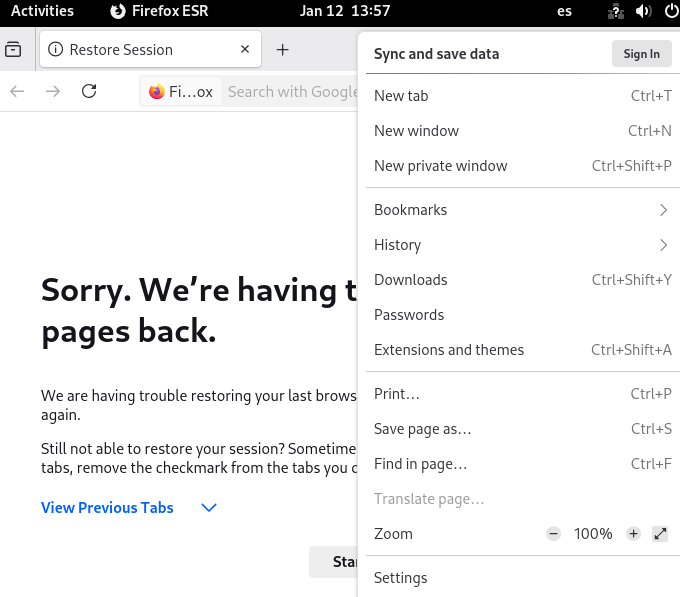
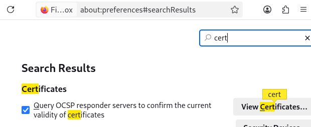
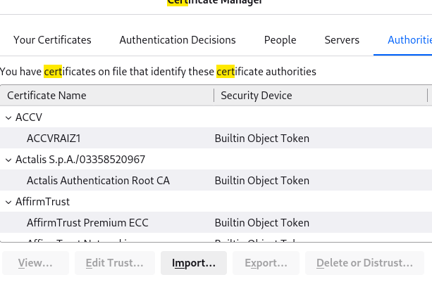
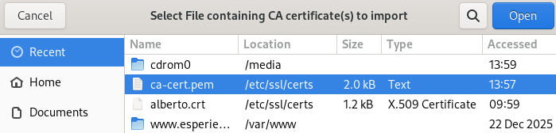
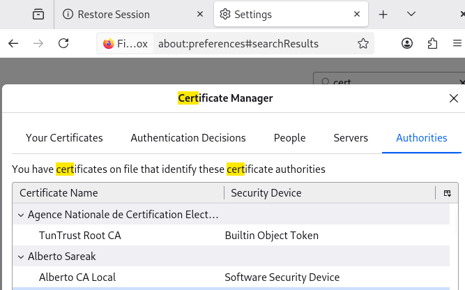
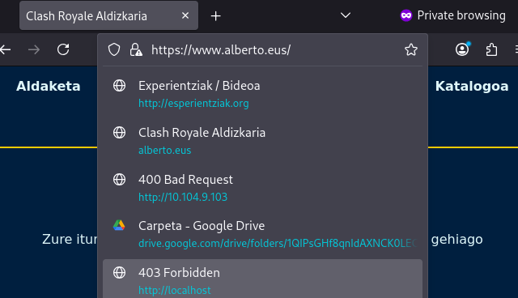

</details>

> Browsers on clients that do **not** import the CA (for example Chrome on the external Windows machine) show *"Not secure"*. This is expected for a private CA, and is exactly the situation the lab simulates.

---

## 🧪 Verification & Testing

### Configuration checks

```bash
apachectl configtest                      # Syntax OK
apache2ctl -S                             # shows how virtual hosts are matched
ls -l /etc/apache2/sites-enabled/
openssl verify -CAfile rootCA.pem alberto.crt      # on dmz01
openssl s_client -connect www.alberto.eus:443 -CAfile rootCA.pem </dev/null | grep "Verify return code"
```

### Functional tests

**From *dmz01* (DMZ)**

| Test | Expected | Result |
|---|---|---|
| Open `www.alberto.eus` | Magazine home page | ✅ |
| Open `www.alberto.eus/porfolio/taldea.html` | Team page (client is in the DMZ) | ✅ |
| Open `www.esperientziak.org` | Travel home page | ✅ |
| Open `www.esperientziak.org/bideoa` | Video page, URL shows `/bideoa` | ✅ |

<details>
<summary>📷 Screenshots</summary>

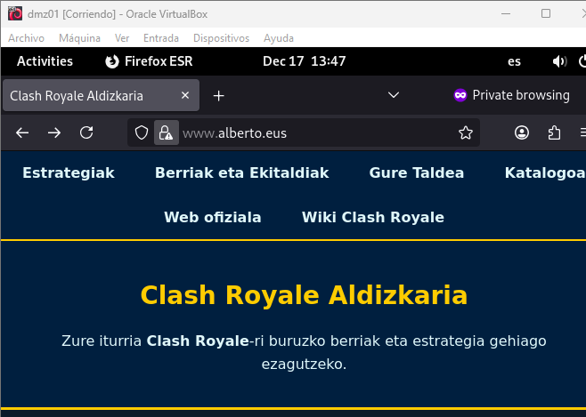
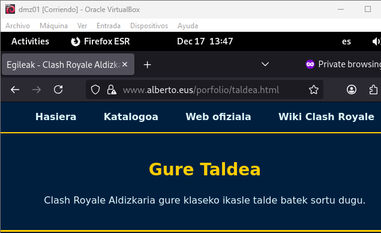
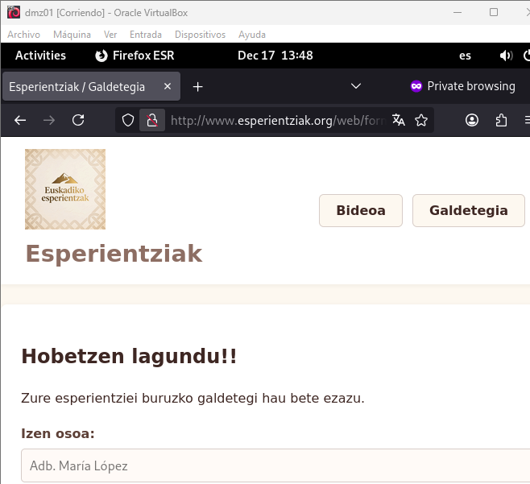
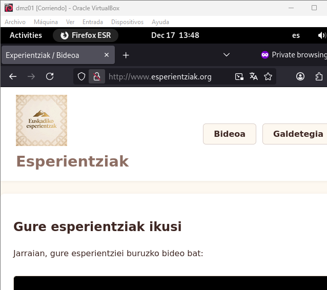
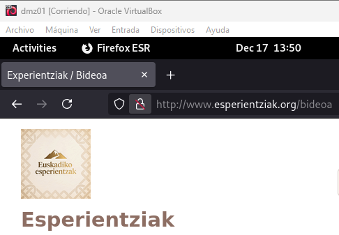

</details>

**From *admin01* (LAN)**

| Test | Expected | Result |
|---|---|---|
| `http://www.alberto.eus` | Redirected to `https://www.alberto.eus` with no warning (CA imported) | ✅ |
| Home page | Allowed | ✅ |
| `/porfolio/taldea.html` | Allowed (LAN is in the allowed networks) | ✅ |
| `/porfolio/katalogoa.html` | **403 Forbidden** (client reverse name is not *.alberto.eus*) | ✅ |

<details>
<summary>📷 Screenshots</summary>

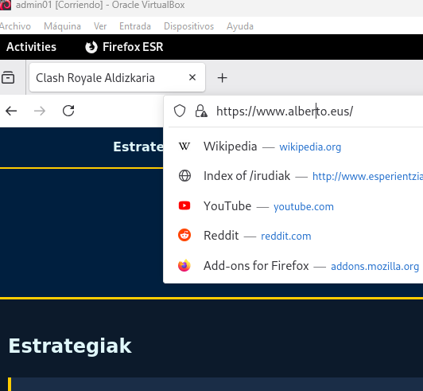
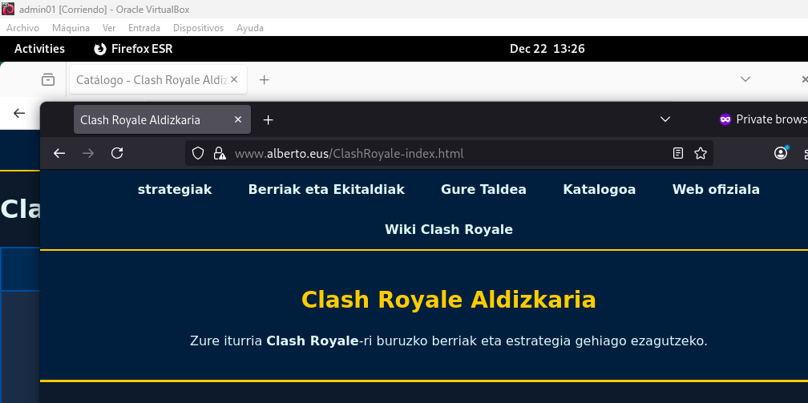
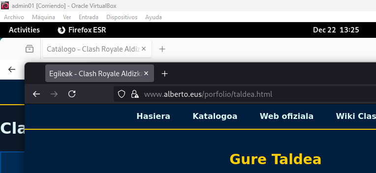
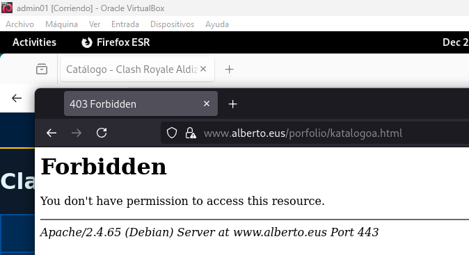

</details>

**From a machine outside the LAN and DMZ**

| Test | Expected | Result |
|---|---|---|
| Home page | Allowed (certificate shows as not trusted: CA not imported) | ✅ |
| `/porfolio/taldea.html` | **403 Forbidden** | ✅ |
| `/porfolio/katalogoa.html` | **403 Forbidden** | ✅ |

<details>
<summary>📷 Screenshots</summary>

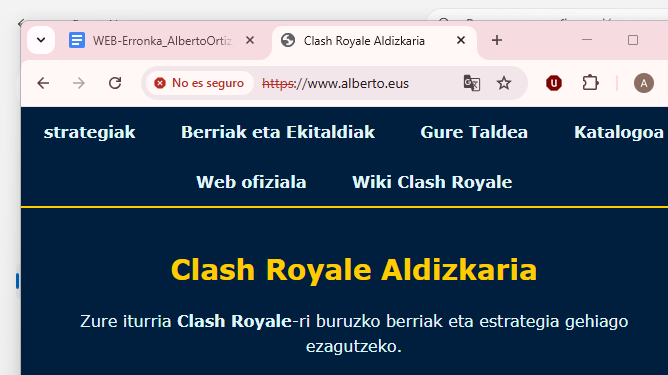
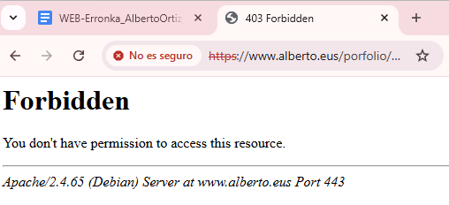
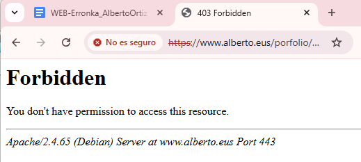

</details>

### Command-line equivalents

```bash
# Redirect (expect 301 and the Location header)
curl -sI http://www.alberto.eus/ | head -n 5

# Trusted HTTPS with the lab CA
curl --cacert rootCA.pem -s -o /dev/null -w '%{http_code}\n' https://www.alberto.eus/

# Restricted pages (run from each network and compare)
curl --cacert rootCA.pem -s -o /dev/null -w '%{http_code}\n' https://www.alberto.eus/porfolio/taldea.html
curl --cacert rootCA.pem -s -o /dev/null -w '%{http_code}\n' https://www.alberto.eus/porfolio/katalogoa.html

# Travel site
curl -s -o /dev/null -w '%{http_code}\n' http://www.esperientziak.org/bideoa
curl -s http://www.esperientziak.org/irudiak/ | grep -i "index of"
```

---

## 🔧 Design Notes & Possible Improvements

The lab meets the functional requirements. The configuration files and the OpenSSL chain were also loaded in an Apache 2.4 test instance (substitute client addresses for the networks, and a hosts entry for the reverse-DNS test); the behaviour described in the access matrix was reproduced. These are the points I would change for a production-like setup.

| # | Observation | Why it matters | Improvement |
|---|---|---|---|
| 1 | The original summary table says `Options -Indexes` is set, but the configuration never sets it. | The Debian default for **/var/www/** allows directory listings, so a folder without an index file (such as **/recursos/**) can list its content. | Add `Options -Indexes` to the *www.alberto* `<Directory>`; keep `+Indexes` only for **/irudiak**. |
| 2 | `Require host` depends on reverse DNS. | Whoever controls a PTR record can claim a name, and clients with PTR in another domain (the LAN, *alberto.lan*) are denied, as seen in the tests. | Use `Require ip` for internal rules, or add the LAN names to the rule (`Require host .alberto.eus .alberto.lan`) if that is the intent. |
| 3 | `SSLCACertificateFile` in the original file. | It is for client-certificate authentication, not for the server chain. | Remove it. Use `SSLCertificateChainFile` / a full-chain file only when intermediate CAs exist. |
| 4 | The CA private key has no passphrase and sits in a home directory. | Anyone who copies **rootCA.key** can issue certificates trusted by every client that imported the CA. | Protect it with a passphrase (omit `-nodes`), restrict permissions (`chmod 600`), and keep it offline after signing. |
| 5 | Leaf certificate valid for 10 years. | Long-lived certificates are against current practice; public CAs and several browsers limit server certificates to about 13 months. | Issue server certificates for 365–398 days and automate renewal. |
| 6 | Only *www.alberto.eus* has HTTPS. | The travel site still sends everything in clear text. | Create a CSR and a SAN certificate for *esperientziak.org* the same way, with a second 443 virtual host. |
| 7 | No HSTS and default TLS settings. | A user can still be downgraded on the first plain-HTTP request. | Enable `mod_headers` and send `Strict-Transport-Security`; set `SSLProtocol -all +TLSv1.2 +TLSv1.3`. |
| 8 | The *esperientziak* virtual host has no `ServerName`. | Apache relies on the alias and on definition order. | Declare `ServerName` explicitly (done in this README). A catch-all default vhost is also useful: requests by IP address currently land in the first enabled site. |
| 9 | The travel site writes to the shared **error.log** / **access.log**. | Harder to troubleshoot or to report per customer. | Use dedicated log files per virtual host, as the magazine site does. |
| 10 | The CA certificate must be copied by hand to every client. | Does not scale. | On Debian clients place the `.crt` in **/usr/local/share/ca-certificates/** and run `update-ca-certificates`; distribute it with a GPO or configuration management. |

---

## 📚 References

- **Apache Software Foundation.** (2025). *Apache HTTP Server Version 2.4 Documentation.* <https://httpd.apache.org/docs/2.4/>
- **Canonical Ltd.** (2025). *Install and configure Apache2.* Ubuntu Server documentation. <https://documentation.ubuntu.com/server/how-to/web-services/install-apache2/index.html>
- **Glass, E.** (May 21, 2020). *How to Install the Apache Web Server on Ubuntu 20.04.* DigitalOcean Community Tutorials. <https://www.digitalocean.com/community/tutorials/how-to-install-the-apache-web-server-on-ubuntu-20-04-es>
- **OpenSSL Software Foundation.** (2024). *OpenSSL command-line tools.* <https://www.openssl.org/docs/manmaster/man1/>
- **CDmon.** (n.d.). *Force secure HTTPS browsing with .htaccess.* <https://helpdesk.cdmon.com/portal/es/kb/articles/forzar-la-navegaci%C3%B3n-segura-https-mediante-htaccess>
