# Corporate Mail Server with Postfix, Dovecot, Webmail and TLS on Debian 12

## 📌 Objective / Overview

This lab builds an internal **mail server** for the *alberto.eus* domain on the DMZ server *dmz02*, so that network users can send and receive e-mail with addresses of the form `user@alberto.eus`. It combines the three classic roles of a mail system, plus encryption:

| Role | Software | Job |
|---|---|---|
| **MTA** (Mail Transfer Agent) | Postfix | Receives and sends mail over SMTP (TCP 25), queues messages and decides where each one goes |
| **MDA / IMAP / POP3** | Dovecot | Lets users read their mailbox from a client (POP3 110, IMAP 143) and handles authentication |
| **Webmail** | Apache + SquirrelMail | Browser access to the mailboxes for users without a local client |
| **Encryption** | OpenSSL + private CA | TLS for SMTP, IMAP and POP3 so credentials and content do not travel in clear text |

### Business requirement (lab scenario)

A company needs its own mail system for staff and service accounts. Mailboxes are limited, mail must be reachable from any internal network, and users without a mail client must be able to use a browser.

| # | Requirement | Implementation |
|---|---|---|
| R1 | Addresses `user@alberto.eus` for all staff | Postfix with `mydomain` / `mydestination`, DNS MX record |
| R2 | Mailbox limit of 2 GB, message limit of 20 MB | `mailbox_size_limit`, `message_size_limit` |
| R3 | Staff read mail with a desktop client | Dovecot POP3 and IMAP, Thunderbird |
| R4 | Staff without a client use a browser | Apache + SquirrelMail, custom company logo |
| R5 | Eight accounts, one mailbox each | System users (`josu`, `enara`, `mantenimendua`, `alberto`, `adminweb`, `adminftp`, `user01`, `user02`) |
| R6 | Protect credentials and content | TLS certificate signed by the company CA |

**Skills demonstrated:** Postfix and Dovecot installation and configuration, SMTP/POP3/IMAP protocol testing with `telnet`, mbox mailbox handling, webmail deployment, certificate signing with a private CA, mail-client configuration, troubleshooting with the mail queue.

---

## 🛠️ Environment & Tools

| Component | Details |
|---|---|
| Mail server | *dmz02* – Debian 12, 10.104.9.102/24 (DMZ), FQDN *mail.alberto.eus* |
| DNS and certificate authority | *dmz01* – 10.104.9.101/24, BIND9 + OpenSSL |
| Clients | *dmz01* and *lan01* (terminals), a LAN PC with Thunderbird, a browser with Firefox |
| Software | `postfix`, `dovecot-pop3d`, `dovecot-imapd`, `apache2`, `squirrelmail`, `openssl`, `telnet` |
| Hypervisor | Oracle VirtualBox |

> **Prerequisites:** the network, DHCP and DNS labs are working ([01](../01-router-lan-dmz-nat/README.md), [02](../02-dhcp-server-lan-dmz/README.md), [03](../03-dns-bind9-dmz-lan/README.md)). In particular the *alberto.eus* zone must contain the **MX** record (`@ IN MX 10 mail.alberto.eus.`), the **A** record `mail → 10.104.9.102` and the matching PTR. The private CA comes from the [HTTP lab](../05-http-server-apache/README.md).

---

## 🗺️ Network Topology / Architecture

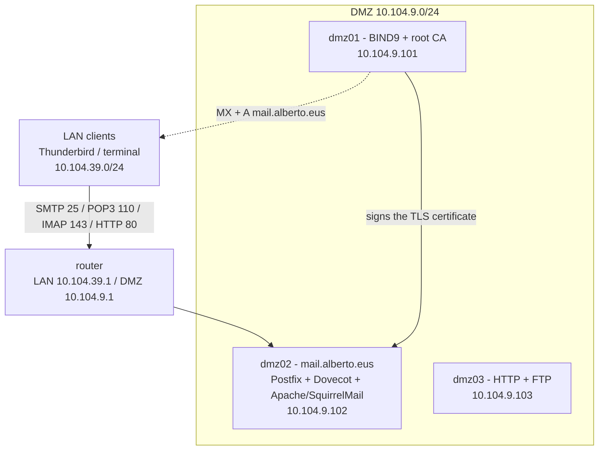

### Message flow

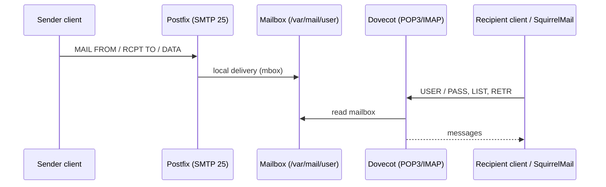

---

## 🚀 Step-by-Step Configuration

### Step 1 – Postfix

```bash
apt update && apt upgrade -y
apt install postfix
```

The installer asks two questions: the **general mail configuration type** (*Internet Site*) and the **system mail name** (the domain, *alberto.eus*).

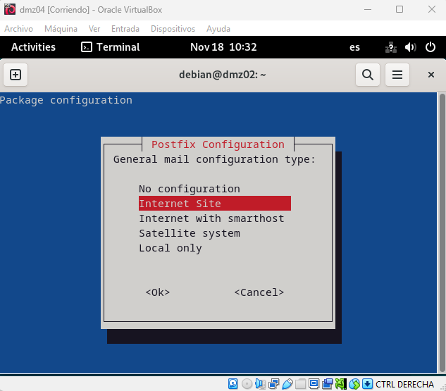
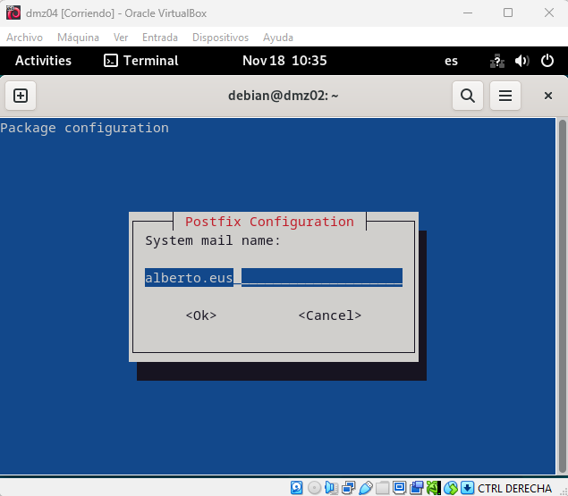

Quick check that the SMTP port answers:

```bash
telnet 10.104.9.102 25
```

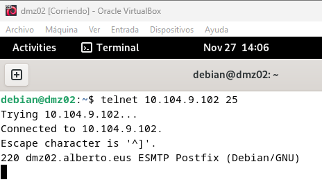

#### Main configuration – **/etc/postfix/main.cf**

```bash
nano /etc/postfix/main.cf
```

```text
# Our domain
mydomain = alberto.eus

# Mailbox limit: 2 GB
mailbox_size_limit = 2147483648

# Maximum message size: 20 MB
message_size_limit = 20971520

# Name of this host on the network
myhostname = dmz02.alberto.eus

# Domains this server delivers locally
mydestination = $myhostname, alberto.eus, dmz02, localhost.localdomain, localhost

# Listen on every interface
inet_interfaces = all

# IPv4 only
inet_protocols = ipv4
```

| Parameter | Meaning |
|---|---|
| `mydomain` | Domain name, used to build addresses and defaults |
| `myhostname` | FQDN of the server, used in the SMTP greeting and in headers |
| `mydestination` | Domains and hostnames Postfix accepts as **final destination**, so mail for `user@alberto.eus` is delivered to a local mailbox |
| `mailbox_size_limit` | Per-mailbox limit in bytes (2 GB = 2·1024³ = 2147483648) |
| `message_size_limit` | Per-message limit in bytes (20 MB = 20·1024² = 20971520) |
| `inet_interfaces = all` | Accept connections on all interfaces; with `loopback-only` no other host could send mail |
| `inet_protocols = ipv4` | Avoids IPv6 problems on a network that does not use it |

Apply and check:

```bash
systemctl restart postfix
systemctl status postfix
mailq
```

On Debian the `postfix.service` unit is only a wrapper, so `active (exited)` is the normal state; the real daemon runs under `postfix@-.service`. `mailq` prints the mail queue and is the first tool to diagnose stuck mail (here: `Mail queue is empty`).

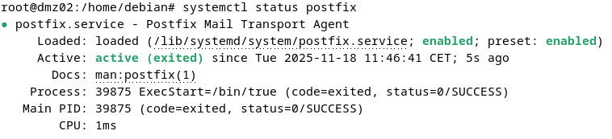
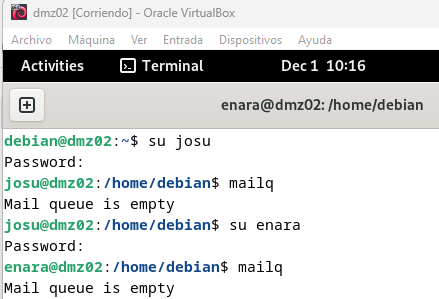

### Step 2 – Dovecot (POP3 and IMAP)

```bash
apt install dovecot-pop3d dovecot-imapd
```

Two settings are changed:

| File | Setting |
|---|---|
| **/etc/dovecot/conf.d/10-auth.conf** | `disable_plaintext_auth = no` |
| **/etc/dovecot/conf.d/10-mail.conf** | `mail_location = mbox:~/mail:INBOX=/var/mail/%u` |

```bash
nano /etc/dovecot/conf.d/10-auth.conf     # disable_plaintext_auth = no
nano /etc/dovecot/conf.d/10-mail.conf     # mail_location = mbox:~/mail:INBOX=/var/mail/%u
systemctl restart dovecot
systemctl status dovecot
```

| Setting | Meaning |
|---|---|
| `disable_plaintext_auth = no` | Allows password logins without encryption. Needed here to test with `telnet`; see the TLS step and the design notes |
| `mbox:~/mail` | Mailbox storage format: mbox files, with the folders under the user's home |
| `INBOX=/var/mail/%u` | The inbox is the mbox file `/var/mail/<user>`, which is where Postfix delivers |

Protocol checks from another host:

```bash
telnet 10.104.9.102 110      # POP3
telnet 10.104.9.102 143      # IMAP
```

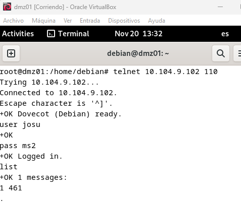
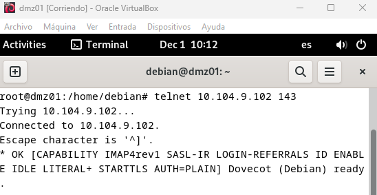

### Step 3 – Create the mail users

Dovecot authenticates against the system accounts, so each mail user is a Linux user.

```bash
for u in josu enara mantenimendua alberto adminweb adminftp user01 user02; do
  adduser "$u"            # interactive: sets the password
done
```

The mailbox file appears once the first message arrives (or when the user first logs in):

```bash
cat /var/mail/josu
```

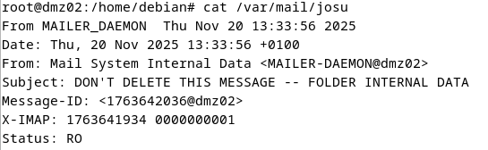

The first entry, *DON'T DELETE THIS MESSAGE -- FOLDER INTERNAL DATA*, is the IMAP metadata message that Dovecot stores in mbox files.

### Step 4 – Webmail: Apache + SquirrelMail

SquirrelMail is no longer in Debian (the project is unmaintained and depends on old PHP versions), so the lab temporarily adds the archived *Jessie* repositories.

```bash
nano /etc/apt/sources.list
```

```text
deb     [trusted=yes] http://archive.debian.org/debian/          jessie main non-free contrib
deb-src [trusted=yes] http://archive.debian.org/debian/          jessie main non-free contrib
deb     [trusted=yes] http://archive.debian.org/debian-security/ jessie/updates main non-free contrib
deb-src [trusted=yes] http://archive.debian.org/debian-security/ jessie/updates main non-free contrib
```

`[trusted=yes]` tells APT to **skip signature verification**, because the archive keys have expired. This is acceptable only in a throw-away lab (see the design notes).

```bash
apt update
apt install squirrelmail -y

# Make the SquirrelMail Apache configuration part of the enabled sites
ln -s /etc/squirrelmail/apache.conf /etc/apache2/sites-enabled/squirrelmail.conf
systemctl restart apache2
systemctl status apache2
```

Instead of editing the Apache configuration, a **symbolic link** to the file shipped by the package is created in **sites-enabled**, so the package keeps owning its configuration. The webmail is then available at `http://mail.alberto.eus/squirrelmail`.

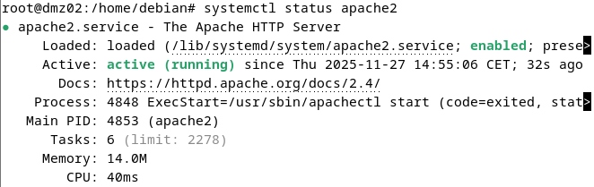

#### Custom logo

Download the company logo, then replace the original image keeping its file name, so the HTML files do not need to change:

```bash
cp /home/<user>/Downloads/<logo>.png /usr/share/squirrelmail/images/sm_logo.png
```

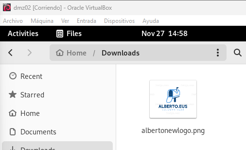
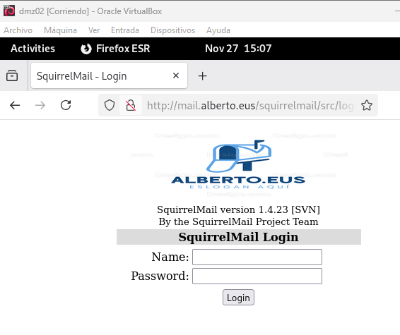

### Step 5 – TLS for Postfix and Dovecot

The server gets its own key and a certificate signed by the CA on *dmz01* (the CA from the [HTTP lab](../05-http-server-apache/README.md)).

**1. On *dmz02*: private key and certificate signing request**

```bash
openssl genrsa -out /etc/ssl/private/mail_alberto_key.pem 2048

openssl req -new -key /etc/ssl/private/mail_alberto_key.pem \
  -out /tmp/mail_alberto.csr \
  -subj "/C=ES/ST=Alaba/L=Vitoria-Gasteiz/O=Alberto Sareak/OU=IT/CN=mail.alberto.eus"
```

The common name must be the name clients use (*mail.alberto.eus*).

**2. Copy the request to *dmz01* and sign it** (run on *dmz01*)

```bash
scp debian@10.104.9.102:/tmp/mail_alberto.csr .

echo "subjectAltName=DNS:mail.alberto.eus" > ext.cnf
openssl x509 -req -in mail_alberto.csr \
  -CA rootCA.pem -CAkey rootCA.key -CAcreateserial \
  -out mail_alberto_crt.pem -days 825 -extfile ext.cnf
```

`-days` sets the validity. The `-extfile` line adds the SAN that current clients require (see the design notes). Send **mail_alberto_crt.pem** back to *dmz02*.

**3. On *dmz02*: install the certificate with the right permissions**

```bash
mv mail_alberto_crt.pem /etc/ssl/certs/
chown root:root /etc/ssl/certs/mail_alberto_crt.pem
chmod 644       /etc/ssl/certs/mail_alberto_crt.pem
chown root:root /etc/ssl/private/mail_alberto_key.pem
chmod 600       /etc/ssl/private/mail_alberto_key.pem
```

**4. Postfix** – append to **/etc/postfix/main.cf**:

```text
smtpd_tls_cert_file = /etc/ssl/certs/mail_alberto_crt.pem
smtpd_tls_key_file  = /etc/ssl/private/mail_alberto_key.pem
smtpd_use_tls       = yes
```

```bash
systemctl restart postfix
```

**5. Dovecot** – in **/etc/dovecot/conf.d/10-ssl.conf**:

```text
ssl      = required
ssl_cert = </etc/ssl/certs/mail_alberto_crt.pem
ssl_key  = </etc/ssl/private/mail_alberto_key.pem
```

```bash
systemctl restart dovecot
```

The `<` before the path makes Dovecot read the **file contents** instead of treating the path as a literal.

**6. Check**

```bash
openssl s_client -connect 10.104.9.102:993 -showcerts      # IMAPS: shows the certificate chain
openssl s_client -connect 10.104.9.102:25 -starttls smtp   # SMTP with STARTTLS
```

In Thunderbird, configure *mail.alberto.eus* with SSL/TLS, and confirm that the certificate is accepted (the CA must be in the client trust store, as in the [HTTP lab](../05-http-server-apache/README.md#step-11--trust-the-ca-in-the-browser-firefox)).

---

## 🧪 Verification & Testing

Test accounts used below: sender **A** = `josu`, recipient **B** = `enara`, **C** = `user01`, **D** = `user02`.

### Terminal tests (SMTP and POP3)

| Step | Action | Expected |
|---|---|---|
| a | Connect to Postfix: `telnet mail.alberto.eus 25` | `220 dmz02.alberto.eus ESMTP Postfix` |
| b | Send a message from A to B, subject *ariketa b* | `250` replies, message queued |
| c | Disconnect (`QUIT`) | Connection closed |
| d | Connect to Dovecot: `telnet mail.alberto.eus 110`, `USER enara`, `PASS …` | `+OK Logged in.` |
| e | `LIST` | List of received messages (3) |
| f | `RETR 3` (highest number) | The message from step b |
| g | `QUIT` | Disconnect |

SMTP dialogue used in step b:

```text
HELO mail.alberto.eus
MAIL FROM: josu@alberto.eus
RCPT TO: enara@alberto.eus
DATA
Subject: ariketa b

Kaixo, nire froga funtzionalak.
.
QUIT
```

<details>
<summary>📷 Screenshots</summary>

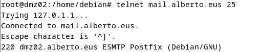
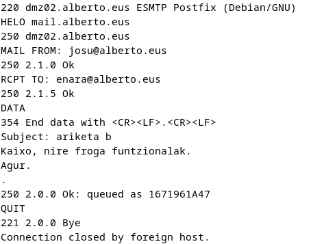
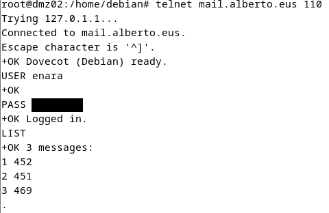
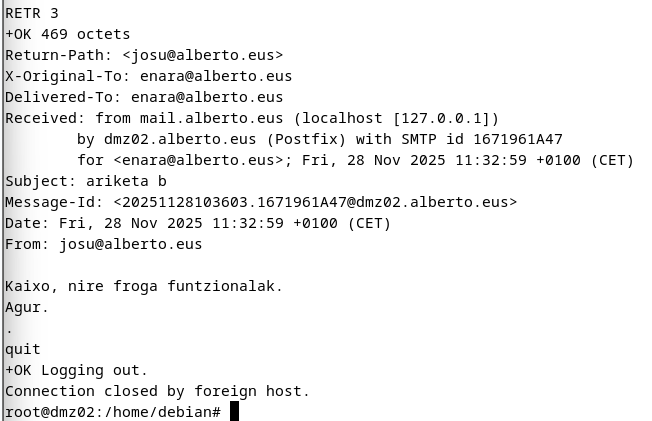

</details>

> The password typed in the `PASS` command is hidden in the screenshots.

### Thunderbird client

| Step | Action | Expected |
|---|---|---|
| h | Add the account *enara@alberto.eus* in Thunderbird | Account configured |
| i | Synchronise the inbox | The three messages appear |
| j | Open the latest message | Content of *ariketa b* |
| k | Send a message to C with subject *k ariketa* | Sent |
| l | Close Thunderbird | – |

<details>
<summary>📷 Screenshots</summary>

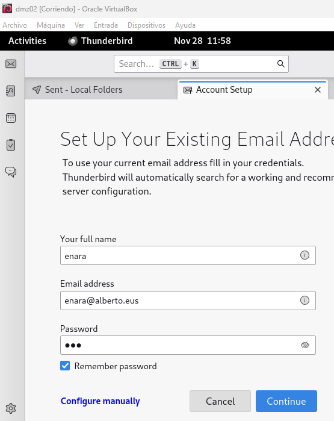
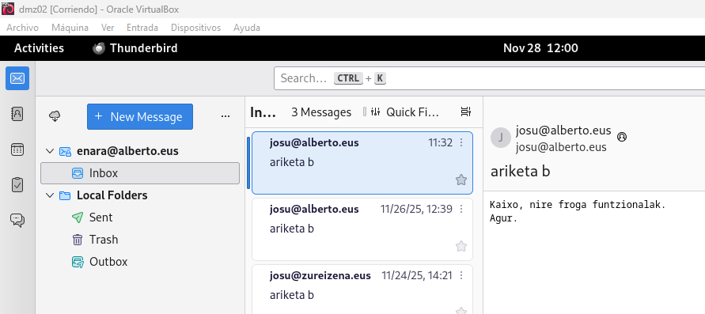
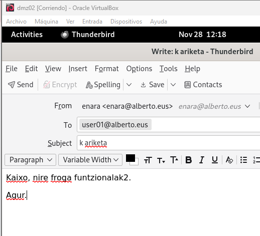

</details>

### Webmail (SquirrelMail)

| Step | Action | Expected |
|---|---|---|
| m | Open `http://mail.alberto.eus/squirrelmail` | Login page with the company logo |
| n | Log in as C and open the inbox | The message from step k |
| o | Open the latest message | Content shown |
| p | Send a message to D, subject *p ariketa* | Sent |
| q | Log out | – |
| r | On *dmz02*: `cat /var/mail/<D>` | The last message is the one from step p |

<details>
<summary>📷 Screenshots</summary>

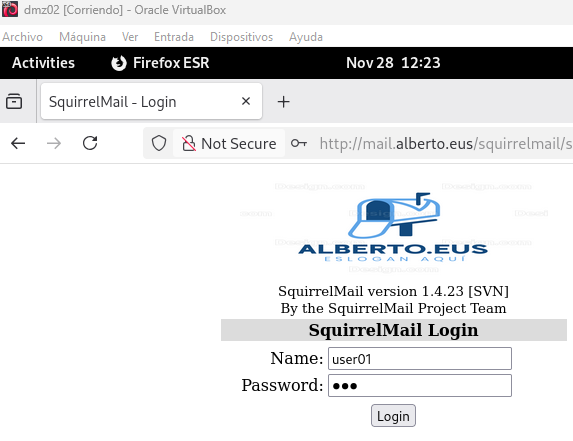
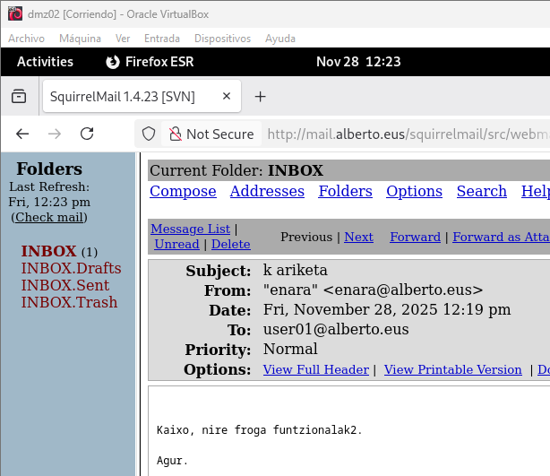
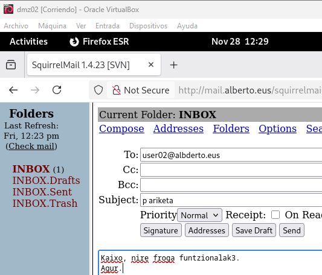
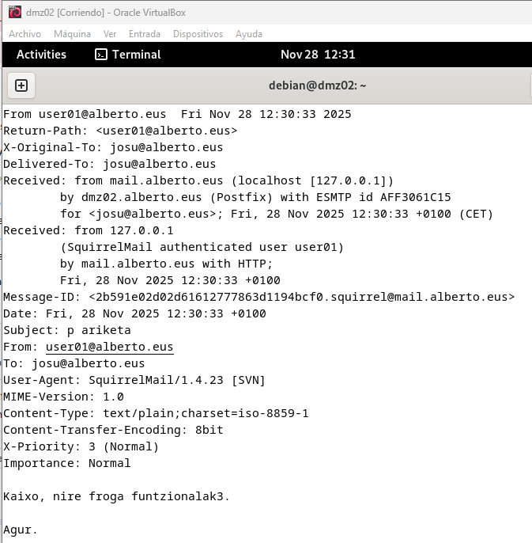

</details>

> **Note:** the compose screenshot (step p) and the mailbox screenshot (step r) do not show the same message: the second one is *josu*'s mailbox with a message sent by *user01* through SquirrelMail. Both show the webmail working.

### Test from the LAN

A LAN host sends a message, and it is read from the DMZ over POP3, proving that mail crosses the router.

<details>
<summary>📷 Screenshots</summary>

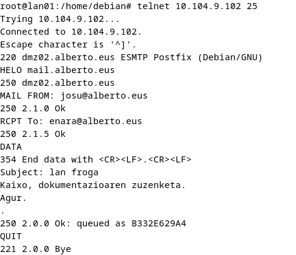
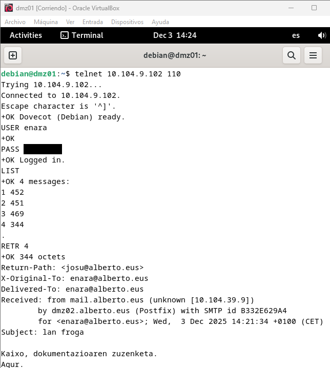

</details>

### Command checks

```bash
postconf -n | grep -E 'mydomain|myhostname|mydestination|size_limit'
doveconf -n | grep -E '^ssl|mail_location|disable_plaintext'
mailq
tail -n 20 /var/log/mail.log
```

---

## 🔧 Design Notes & Possible Improvements

The lab meets the functional requirements. I also loaded the Postfix settings and a Dovecot configuration with the same settings in a Linux test environment, signed a certificate with a throw-away CA, and tested POP3 login. These are the points I would change for anything beyond a lab.

| # | Observation | Why it matters | Improvement |
|---|---|---|---|
| 1 | SquirrelMail comes from the **Jessie archive** with `[trusted=yes]`. | The packages are unsigned, unmaintained, built for old PHP, and a mixed Debian 8 / Debian 12 package set can break dependencies. | Use **Roundcube** (`apt install roundcube`, in the Debian 12 repositories). If SquirrelMail is mandatory for the exercise, remove the Jessie lines after installing. |
| 2 | Plain-text authentication is enabled, and the webmail runs on plain HTTP. | Passwords travel in clear text on the network. | After the TLS step set `disable_plaintext_auth = yes`, publish the webmail over HTTPS with a certificate from the lab CA, and use ports 993/995 or STARTTLS. |
| 3 | `ssl = required` conflicts with the earlier `telnet` tests. | In my test the login over **127.0.0.1** still worked, because Dovecot treats loopback connections as secure. Remote plain-text logins are rejected by this setting, so the `telnet … 110` tests only work from other hosts **before** the TLS step. | After TLS, test with `openssl s_client -connect mail.alberto.eus:995` or `-starttls pop3`. |
| 4 | `smtpd_use_tls = yes` is a legacy parameter. | Postfix maps it to `smtpd_tls_security_level = may`: TLS is offered but optional. | Set `smtpd_tls_security_level = may` explicitly (or `encrypt` on a submission port 587 with SASL authentication). |
| 5 | The certificate has only a CN, no SAN, in the original signing command. | OpenSSL accepted it in my test through the CN fallback, but Firefox and Thunderbird (NSS) require a Subject Alternative Name. | Sign with `-extfile` and `subjectAltName=DNS:mail.alberto.eus` (done in this README). |
| 6 | Mailboxes use the **mbox** format. | One file per mailbox: file locking, slow access on large mailboxes, and a single corrupt file loses all mail. | Use **Maildir** (`home_mailbox = Maildir/` in Postfix, `mail_location = maildir:~/Maildir` in Dovecot). |
| 7 | The 2 GB limit is set only in Postfix. | `mailbox_size_limit` only applies to Postfix's own local delivery, not to what IMAP clients store in other folders. | Enable the Dovecot **quota** plugin for real per-user quotas. |
| 8 | Mail users are normal Linux accounts, including `adminweb` and `adminftp`. | Every mail account is also a system login (SSH, FTP) and shares its password. | Use **virtual users** (a `passwd-file` or SQL backend with a `vmail` account), or at least set `/usr/sbin/nologin` as shell. |
| 9 | `mynetworks` is left at the default and no relay policy is shown. | The default includes the local subnet; a wrong value turns the server into an open relay. | Set `mynetworks` explicitly and verify with `postconf -n smtpd_relay_restrictions`; test with an external relay attempt. |
| 10 | No sender authentication for outgoing mail. | Other mail servers reject or junk messages without SPF/DKIM/DMARC. | Add SPF and DKIM (OpenDKIM) records to the zone if the server must send to the Internet. |
| 11 | Ports 110 and 143 stay open. | Clear-text services remain reachable. | Once TLS works, disable `pop3`/`imap` plain listeners or filter them at the router, and add *fail2ban* for Dovecot and Postfix. |

---

## 📚 References

- **Postfix.** *Postfix documentation* (`postconf(5)`, `TLS_README`). <https://www.postfix.org/documentation.html>
- **Dovecot.** *Dovecot Wiki: mailbox formats, SSL configuration, authentication.* <https://doc.dovecot.org/>
- **OpenSSL Software Foundation.** (2024). *OpenSSL command-line tools.* <https://www.openssl.org/docs/manmaster/man1/>
- **Roundcube.** *Roundcube Webmail.* <https://roundcube.net/>
