# Router Firewall with iptables: Packet Filtering, NAT and Published DMZ Services on Debian 12

## 📌 Objective / Overview

This lab turns the Debian 12 router of the project into a **network firewall** with `iptables`. The router joins three networks (the classroom/WAN uplink, the LAN and the DMZ), so every packet between them crosses it. The firewall decides which flows are allowed, publishes the DMZ services towards the classroom network with **DNAT**, hides the private networks behind **MASQUERADE**, and is loaded at every boot by an init script (**/etc/init.d/fw.sh**).

### Business requirement (lab scenario)

A small hosting company runs its public services in a DMZ. The network team must apply the following access policy on the router:

| # | Requirement | Implementation |
|---|---|---|
| R1 | The router forwards traffic between WAN, LAN and DMZ | `net.ipv4.ip_forward = 1` |
| R2 | LAN and DMZ hosts reach the Internet with the router's public address | `MASQUERADE` in the *nat* table |
| R3 | DNS, web, FTP, mail and webmail are published from the router's address | `DNAT` in `PREROUTING` |
| R4 | **FTP and mail** are reachable only from two trusted hosts (the administrator PC and the teacher PC) | `FORWARD` rules with `-s`, followed by a `DROP` for the rest of the network |
| R5 | The LAN can use the DMZ services | `FORWARD` rule LAN → DMZ |
| R6 | The router must not answer pings from the WAN | `INPUT` rule on echo-request |
| R7 | The rules survive a reboot | LSB init script + `update-rc.d` |

**Skills demonstrated:** Netfilter packet flow, `filter` and `nat` tables, chains and policies, DNAT/MASQUERADE, connection tracking (`conntrack`), FTP helper and passive port ranges, source-based access rules, init-script packaging, firewall testing (`ping`, `ftp`, `nmap`), and a critical review with a default-deny redesign.

---

## 🛠️ Environment & Tools

| Component | Details |
|---|---|
| Router / firewall | Debian 12, three NICs: *enp0s3* WAN (172.20.104.139/24), *enp0s8* and *enp0s9* for LAN and DMZ (see note below) |
| LAN | 10.104.39.0/24, client *admin01* (Debian + GNOME) |
| DMZ | 10.104.9.0/24: *dmz01* DNS 10.104.9.101, *dmz02* mail 10.104.9.102, *dmz03* web and FTP 10.104.9.103 |
| Classroom network | 172.20.104.0/24, administrator PC 172.20.104.109, teacher PC 172.20.104.130 |
| Tools | `iptables`, `modprobe`, `update-rc.d`, `nmap`, `ftp`, `ping`, Firefox |
| Hypervisor | Oracle VirtualBox |

> **Prerequisites:** the router, DHCP, DNS, FTP, HTTP and mail labs are working ([01](../01-router-lan-dmz-nat/README.md), [02](../02-dhcp-server-lan-dmz/README.md), [03](../03-dns-bind9-dmz-lan/README.md), [04](../04-ftp-server-vsftpd/README.md), [05](../05-http-server-apache/README.md), [06](../06-mail-server-postfix-dovecot/README.md)). Lab 01 already enables forwarding and NAT; this lab replaces that minimal script with the full policy.

<!-- REVIEW: interface names. The firewall script of this document (and the "iptables -L" screenshot) uses enp0s8 as LAN and enp0s9 as DMZ, while Lab 01 documents enp0s8 as DMZ and enp0s9 as LAN. The README keeps the script's values in the variables WAN / LAN / DMZ at the top of the script. Check with "ip -br addr" on the router and swap the two variables if your NIC order is the one from Lab 01. -->

---

## 🗺️ Network Topology / Architecture

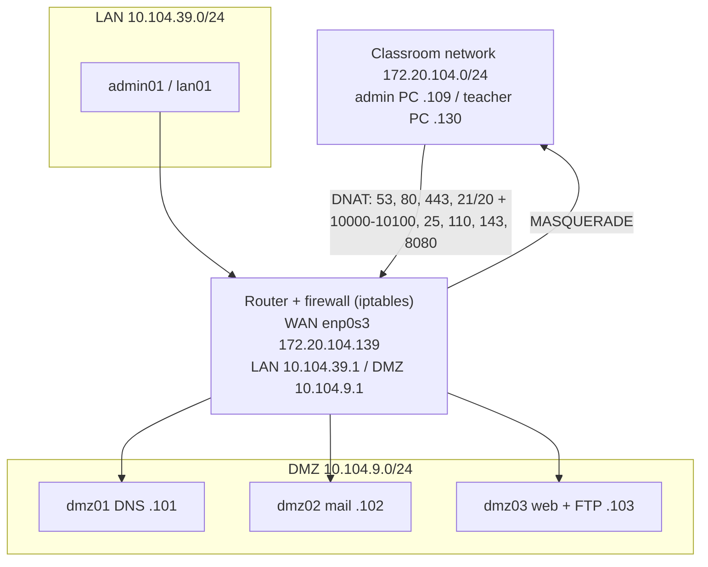

### How a packet crosses the firewall

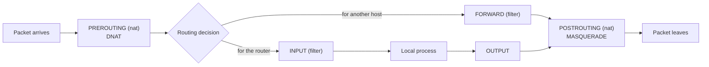

| Chain | When it is used | In this lab |
|---|---|---|
| `PREROUTING` (nat) | First, before routing | DNAT publishes DMZ servers on the router's address |
| `INPUT` | Packet addressed to the router | Drops pings from the WAN |
| `FORWARD` | Packet routed between networks | Most of the policy lives here |
| `OUTPUT` | Packet created by the router | Not restricted |
| `POSTROUTING` (nat) | Last, before leaving | MASQUERADE for LAN and DMZ |

NAT only rewrites addresses; it never decides whether traffic is allowed. The real filtering happens afterwards in the `filter` table.

### Quick reference

| Task | Syntax |
|---|---|
| General form | `iptables [-t table] <command> <chain> <conditions> -j <target>` |
| Append / list / flush | `-A CHAIN` / `-L -n -v` / `-F` |
| Default policy | `-P CHAIN ACCEPT\|DROP` |
| Conditions | `-s` `-d` `-i` `-o` `-p` `--sport` `--dport` `-m conntrack --ctstate` `-m multiport` `-m limit` |
| Targets | `ACCEPT`, `DROP` (silent), `REJECT` (notifies sender), `LOG`, `DNAT`, `SNAT`, `MASQUERADE`, `REDIRECT` |

---

## 🚀 Step-by-Step Configuration

### Step 1 – Update the system and install the tools

```bash
apt update && apt upgrade -y
apt install iptables -y
```

### Step 2 – Create the firewall script

Create **/etc/init.d/fw.sh** and paste the script below. The interface names, networks and hosts are defined once as variables at the top.

```bash
nano /etc/init.d/fw.sh
```

```bash
#!/bin/bash
### BEGIN INIT INFO
# Provides:          fw.sh
# Required-Start:    $local_fs $network $named $time $syslog
# Required-Stop:     $local_fs $network $named $time $syslog
# Default-Start:     2 3 4 5
# Default-Stop:      0 1 6
# Short-Description: Router firewall (iptables)
# Description:       Packet filtering and NAT for the router: WAN / LAN / DMZ
### END INIT INFO

WAN=enp0s3
LAN=enp0s8
DMZ=enp0s9
LAN_NET=10.104.39.0/24
DMZ_NET=10.104.9.0/24
WAN_NET=172.20.104.0/24
ADMIN_PC=172.20.104.109
TEACHER_PC=172.20.104.130
DNS_SRV=10.104.9.101
MAIL_SRV=10.104.9.102
WEB_SRV=10.104.9.103
PASV_RANGE=10000:10100

apply_rules() {
    modprobe nf_conntrack      2>/dev/null
    modprobe nf_conntrack_ftp  2>/dev/null
    echo 1 > /proc/sys/net/ipv4/ip_forward

    iptables -F; iptables -X
    iptables -t nat -F; iptables -t nat -X

    iptables -P INPUT ACCEPT
    iptables -P OUTPUT ACCEPT
    iptables -P FORWARD ACCEPT
    iptables -t nat -P PREROUTING ACCEPT
    iptables -t nat -P POSTROUTING ACCEPT
    iptables -t nat -P OUTPUT ACCEPT

    iptables -A INPUT -i lo -j ACCEPT
    iptables -A FORWARD -m conntrack --ctstate ESTABLISHED,RELATED -j ACCEPT

    # DNAT from WAN
    iptables -t nat -A PREROUTING -i $WAN -p udp --dport 53 -j DNAT --to-destination $DNS_SRV
    iptables -t nat -A PREROUTING -i $WAN -p tcp --dport 53 -j DNAT --to-destination $DNS_SRV
    for p in 80 443 21 20; do
        iptables -t nat -A PREROUTING -i $WAN -p tcp --dport $p -j DNAT --to-destination $WEB_SRV
    done
    iptables -t nat -A PREROUTING -i $WAN -p tcp --dport $PASV_RANGE -j DNAT --to-destination $WEB_SRV
    for p in 25 110 143; do
        iptables -t nat -A PREROUTING -i $WAN -p tcp --dport $p -j DNAT --to-destination $MAIL_SRV
    done
    iptables -t nat -A PREROUTING -i $WAN -p tcp --dport 8080 -j DNAT --to-destination $MAIL_SRV:80

    # FTP only from two hosts
    for src in $ADMIN_PC $TEACHER_PC; do
        iptables -A FORWARD -i $WAN -s $src -o $DMZ -p tcp --dport 21 -j ACCEPT
        iptables -A FORWARD -i $WAN -s $src -o $DMZ -p tcp --dport 20 -j ACCEPT
        iptables -A FORWARD -i $WAN -s $src -o $DMZ -p tcp --dport $PASV_RANGE -j ACCEPT
    done
    iptables -A FORWARD -i $WAN -s $WAN_NET -o $DMZ -p tcp --dport 21 -j DROP
    iptables -A FORWARD -i $WAN -s $WAN_NET -o $DMZ -p tcp --dport 20 -j DROP
    iptables -A FORWARD -i $WAN -s $WAN_NET -o $DMZ -p tcp --dport $PASV_RANGE -j DROP

    # Mail only from two hosts
    for src in $ADMIN_PC $TEACHER_PC; do
        for p in 25 110 143; do
            iptables -A FORWARD -i $WAN -s $src -o $DMZ -p tcp --dport $p -j ACCEPT
        done
    done
    for p in 25 110 143; do
        iptables -A FORWARD -i $WAN -o $DMZ -p tcp --dport $p -j DROP
    done

    # Public services
    iptables -A FORWARD -i $WAN -o $DMZ -p udp --dport 53 -j ACCEPT
    iptables -A FORWARD -i $WAN -o $DMZ -p tcp --dport 53 -j ACCEPT
    iptables -A FORWARD -i $WAN -o $DMZ -p tcp --dport 80 -j ACCEPT
    iptables -A FORWARD -i $WAN -o $DMZ -p tcp --dport 443 -j ACCEPT
    iptables -A FORWARD -i $WAN -o $DMZ -p tcp -d $MAIL_SRV --dport 80 -j ACCEPT

    # LAN -> DMZ everything
    iptables -A FORWARD -i $LAN -o $DMZ -j ACCEPT

    # Return traffic
    iptables -A FORWARD -i $DMZ -o $WAN -m conntrack --ctstate ESTABLISHED,RELATED -j ACCEPT
    iptables -A FORWARD -i $DMZ -o $LAN -m conntrack --ctstate ESTABLISHED,RELATED -j ACCEPT

    iptables -t nat -A POSTROUTING -s $LAN_NET -o $WAN -j MASQUERADE
    iptables -t nat -A POSTROUTING -s $DMZ_NET -o $WAN -j MASQUERADE

    iptables -A INPUT -i $WAN -p icmp --icmp-type echo-request -j DROP
}
case "$1" in
    start|restart|reload|force-reload|"") apply_rules ;;
    stop) : ;;
    status) iptables -L -n -v; iptables -t nat -L -n -v ;;
    *) echo "Usage: $0 {start|stop|restart|status}"; exit 1 ;;
esac
exit 0
```

<!-- REVIEW: deviations of this cleaned script from the one in the original document. (1) The ICMP rule is restricted to the WAN interface: the deployed script dropped echo-requests on every interface (the "iptables -L" screenshot shows "in: *"), which also blocks LAN pings to the router, while the text only asks to block pings from the WAN. (2) The FORWARD rule for the webmail now matches port 80 on 10.104.9.102, because DNAT has already rewritten 8080 to 80 when FORWARD is evaluated; the original rule for port 8080 could never match. (3) The administrator PC is 172.20.104.109, as in the script and screenshots; the text of section 4.7.1 says .102. (4) Network comments with typos (10.104.32.0/24, 10.104.2.0/24) were replaced by 10.104.39.0/24 and 10.104.9.0/24. (5) A start/stop/status dispatcher was added; the original script re-applied the rules on any argument, including the "stop" that systemd sends at shutdown. -->

### Step 3 – Make it executable and run it at boot

```bash
chmod +x /etc/init.d/fw.sh
update-rc.d fw.sh defaults
```

`update-rc.d ... defaults` creates the symbolic links in **/etc/rc*.d/** so the script runs in the normal runlevels (start in 2-5, stop in 0, 1 and 6).

### Step 4 – Apply, change and check the rules

```bash
/etc/init.d/fw.sh start         # apply now, without rebooting
nano /etc/init.d/fw.sh          # edit a rule, a variable or a policy
/etc/init.d/fw.sh restart       # apply the change

iptables -L -n -v               # filter table, numeric, with counters
iptables -t nat -L -n -v        # nat table
iptables -S                     # same rules in re-usable syntax
```

### What each block does

| Block | Rules | Purpose |
|---|---|---|
| **Forwarding** | `echo 1 > /proc/sys/net/ipv4/ip_forward` | Without it the kernel never routes between interfaces |
| **Flush** | `-F`, `-X`, `-t nat -F`, `-t nat -X` | Start from a clean state; avoids duplicated rules when the script runs twice |
| **Policies** | `-P ... ACCEPT` | Everything not matched by a rule is allowed (the assignment asks for a permissive base policy) |
| **Loopback / replies** | `-i lo`, `--ctstate ESTABLISHED,RELATED` | Local traffic and replies to connections that were already allowed |
| **DNAT** | `-t nat -A PREROUTING -i WAN ... -j DNAT` | Publishes DNS (53) and web (80/443) servers, FTP (21, 20 and 10000:10100) on *dmz03*, mail (25, 110, 143) and webmail (8080→80) on *dmz02* |
| **FTP restriction** | `ACCEPT` from two hosts, then `DROP` for the whole WAN subnet | Only the administrator PC and the teacher PC can use FTP |
| **Mail restriction** | `ACCEPT` from the same two hosts, then `DROP` for any WAN source | Same idea for SMTP, POP3 and IMAP |
| **Public services** | DNS, 80, 443, webmail | Open to the whole WAN |
| **LAN → DMZ** | `-i LAN -o DMZ -j ACCEPT` | The LAN may use every DMZ service |
| **Return traffic** | DMZ → WAN/LAN with `ESTABLISHED,RELATED` | Replies only |
| **MASQUERADE** | `-s LAN_NET` / `-s DMZ_NET` `-o WAN` | Internet access with the router's address |
| **ICMP** | `-A INPUT -i WAN -p icmp --icmp-type echo-request -j DROP` | The router is not discoverable by ping from the WAN |
| **FTP modules** | `modprobe nf_conntrack nf_conntrack_ftp` | Connection tracking and the FTP helper that follows data connections |

Rule order matters: `iptables` stops at the first match, so each `ACCEPT` for a trusted host must come **before** the `DROP` for the rest of the subnet.

---

## 🧪 Verification & Testing

### Rule loading

The script was syntax-checked (`bash -n`) and loaded in an isolated network namespace, where it produced 32 rules in the *filter* table and 17 in the *nat* table (including policies) with the intended order. Traffic could not be generated there (no virtual interfaces), so the behaviour below comes from the lab screenshots.

### Functional tests

| # | From | Test | Expected | Evidence |
|---|---|---|---|---|
| a | Router | Rules are loaded after a reboot (`iptables -L -n -v`) | The rules appear with the script's order | ✅ |
| b-II | LAN | `ping google.com` | Replies (NAT) | ✅ |
| b-III | LAN | Browse an Internet site | Page loads | ✅ |
| b-V | LAN | `ftp 10.104.9.103` (own FTP) | Banner and login | ✅ |
| b-VI | LAN | `nmap -sS -Pn` against the router | 999 ports closed; only 53/tcp (DNS) open | ✅ |
| c-II | DMZ | `ftp 10.104.9.103` | Banner and login | ✅ |
| d-I | Router | `ping` a LAN host | Replies | ✅ |
| d-II | Router | `ping 1.1.1.1` | Replies | ✅ |
| d-IV | Router | Browse an Internet site | Page loads | ✅ |
| d-V | Router | `ftp 10.104.9.103` | Banner | ✅ |
| e-I | Classroom PC | `ping alberto.eus` | Replies from 10.104.9.103 | ✅ |
| e-II | Classroom PC | Browse `https://www.alberto.eus` | Site loads | ✅ |
| e-III | Classroom PC | FTP as *adminweb* and *esperientziak*, download and upload | Login, list, `mkdir`, `get`, `put` | ✅ |
| e-IV/V/VI | Classroom PC | Mail by terminal, Thunderbird and webmail | Mail sent and read | ⚪ not captured |
| e-VII | Classroom PC | A blocked flow (for example FTP from another IP of the subnet) | Connection dropped | ⚪ not captured |
| b-I, b-IV, c-I, d-III, e-VIII | – | Ping to the router by name, teacher's FTP server, own site from the router, `nmap` from the classroom | – | ⚪ not captured |

<!-- REVIEW: the screenshots do not cover every test of the assignment (ping to the router by name, FTP to the teacher's server, mail/webmail from the classroom PC, a blocked connection, nmap from the classroom). Add them if you want the evidence to be complete; the blocked-FTP case is the most valuable one for a firewall lab. -->

<details>
<summary>📷 Screenshots – router</summary>

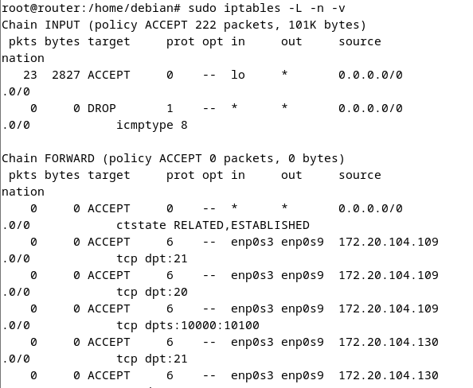
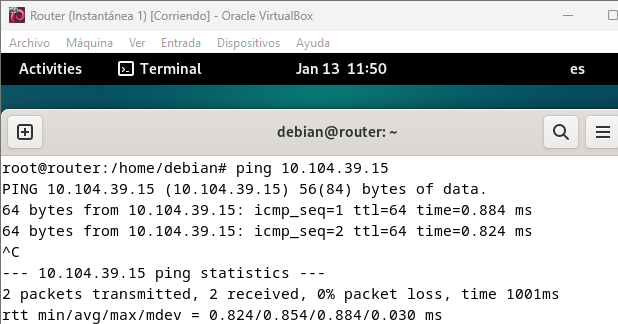
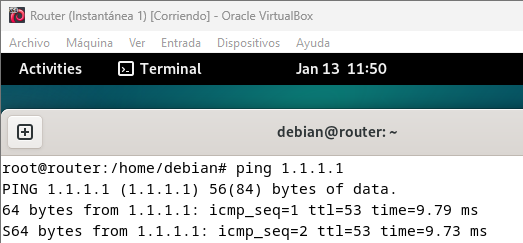
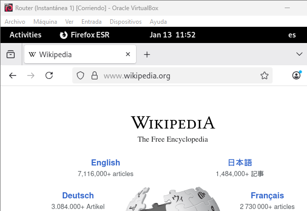
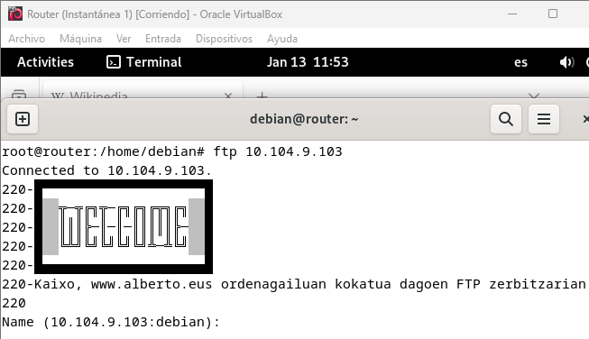

</details>

<details>
<summary>📷 Screenshots – LAN and DMZ</summary>

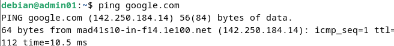

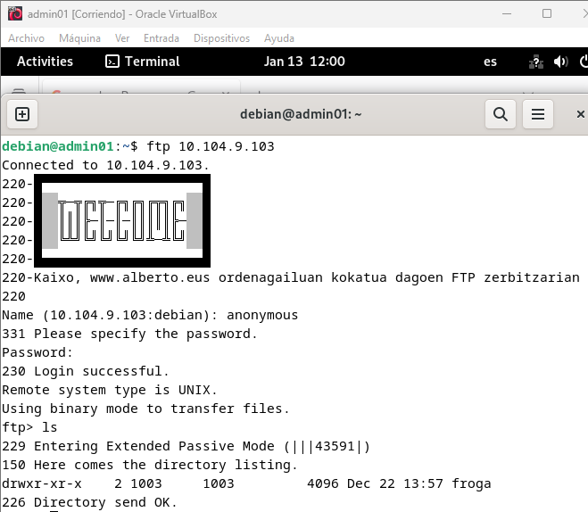
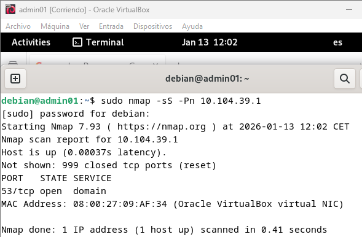
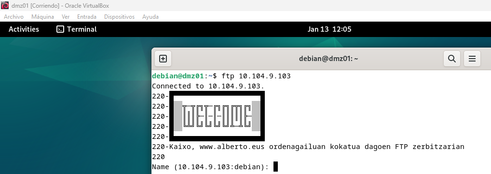

</details>

<details>
<summary>📷 Screenshots – classroom PC</summary>

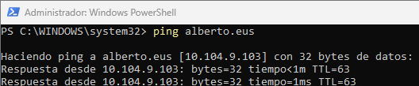

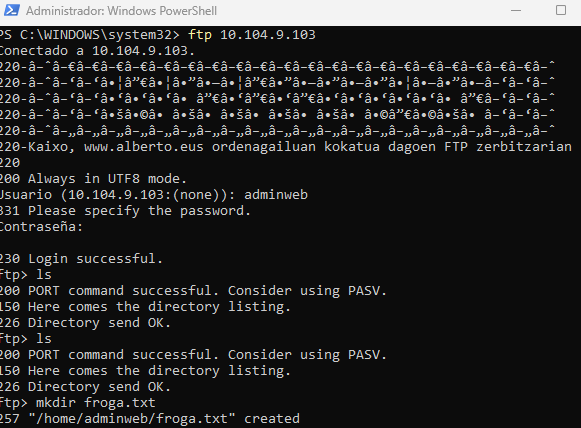
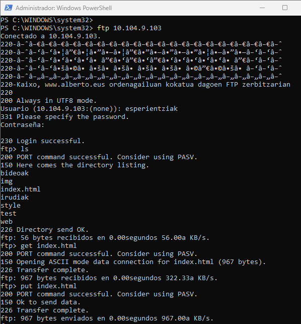
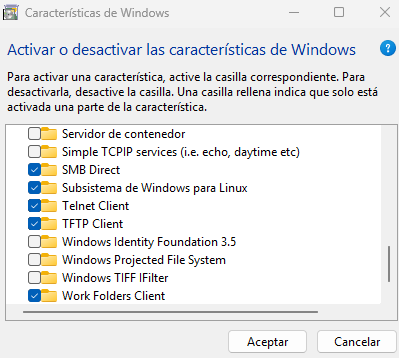

</details>

### Tests to prove the restrictions

```bash
# From the administrator PC (172.20.104.109): allowed
ftp 10.104.9.103
telnet 10.104.9.102 25

# From any other host of 172.20.104.0/24: FTP and mail must time out
ftp 10.104.9.103
telnet 10.104.9.102 25

# From the WAN: the router does not answer pings, the published web works
ping 172.20.104.139
curl -I http://172.20.104.139/

# On the router: watch the counters grow while testing
watch -n1 'iptables -L FORWARD -n -v --line-numbers'
```

---

## 🔧 Design Notes & Possible Improvements

The lab meets the assignment, whose base policy is deliberately permissive. These are the points I would change for a real router.

| # | Observation | Why it matters | Improvement |
|---|---|---|---|
| 1 | `INPUT`, `OUTPUT` and `FORWARD` default to `ACCEPT`. | Every flow not matched by a `DROP` passes. Classroom hosts that route to 10.104.9.0/24 directly (the screenshots show a PC pinging 10.104.9.103) bypass DNAT and can reach any DMZ port, and nothing blocks WAN → LAN. | Use **default-deny**: `-P INPUT DROP`, `-P FORWARD DROP`, and allow only the required flows (hardened script below). |
| 2 | `FTP` and mail restrictions are `DROP` rules after the `ACCEPT`s. | They only cover the listed ports and the 172.20.104.0/24 subnet. | With a default-deny policy, the `ACCEPT` rules for the two hosts are enough, and nothing else needs an explicit `DROP`. |
| 3 | LAN → DMZ is `ACCEPT` for all ports. | A LAN host can reach any service in the DMZ. The FTP screenshot from *admin01* uses passive port 43591, which only works because of this blanket rule. | Allow only the DMZ services in use, and give vsftpd a fixed passive range (next point). |
| 4 | The firewall allows passive FTP ports 10000:10100, but vsftpd in the [FTP lab](../04-ftp-server-vsftpd/README.md) does not set a passive range. | The server chooses random ports (for example 43591), so passive transfers from the WAN would be blocked as soon as the policy is not permissive. | Add `pasv_enable=YES`, `pasv_min_port=10000`, `pasv_max_port=10100` to **/etc/vsftpd.conf** (the FTP lab uses 40000–40100 in its hardened example; use one range in both). |
| 5 | The script has no `LOG` rule. | Dropped connection attempts leave no trace. | Log a rate-limited sample before the final drop (`-m limit --limit 5/min -j LOG`). |
| 6 | `INPUT` is open on every port from every network. | SSH or any service on the router is reachable from the classroom network. | Default-deny `INPUT`, and allow only ICMP, DHCP, DNS and SSH from the internal zones. |
| 7 | `modprobe nf_conntrack_ftp` alone may not track FTP on current kernels. | Since Linux 4.7 conntrack helpers are not attached automatically; active-mode FTP needs one. | Attach it explicitly with `iptables -t raw -A PREROUTING -p tcp --dport 21 -j CT --helper ftp`, or use passive mode only. |
| 8 | Plain FTP, POP3 and IMAP are published to the WAN. | Credentials cross the classroom network in clear text. | Publish only encrypted services (FTPS, IMAPS/POP3S, HTTPS), as described in the [FTP](../04-ftp-server-vsftpd/README.md) and [mail](../06-mail-server-postfix-dovecot/README.md) labs. |
| 9 | Rules live in a script and in the runtime. | Hard to review or roll back. | Keep the script in version control, or export with `iptables-save` and restore with `iptables-persistent`. On Debian 12 the native tool is *nftables*; migrate with `iptables-restore-translate`. |

### Default-deny version of the script

The script below implements points 1, 2, 4, 5 and 6: default-deny policies, allow-lists per zone, a fixed passive range, a rate-limited `LOG`, and a `start | stop | status` dispatcher. It was syntax-checked and its rules were loaded in an isolated network namespace; as in the main test, traffic could not be generated there, so test it on the VM before relying on it.

<!-- REVIEW: the default-deny script has not been run on your VMs. Before using it, confirm which services the router itself must offer (DNS and DHCP are assumed, as in Labs 02 and 03), and keep a console session open in case a rule locks you out. -->

```bash
#!/bin/bash
### BEGIN INIT INFO
# Provides:          fw.sh
# Required-Start:    $local_fs $network $named $time $syslog
# Required-Stop:     $local_fs $network $named $time $syslog
# Default-Start:     2 3 4 5
# Default-Stop:      0 1 6
# Short-Description: Router firewall (default-deny)
# Description:       Default-deny packet filtering and NAT for the WAN / LAN / DMZ router
### END INIT INFO

WAN=enp0s3
LAN=enp0s8
DMZ=enp0s9
LAN_NET=10.104.39.0/24
DMZ_NET=10.104.9.0/24
ADMIN_PC=172.20.104.109
TEACHER_PC=172.20.104.130
DNS_SRV=10.104.9.101
MAIL_SRV=10.104.9.102
WEB_SRV=10.104.9.103
PASV_RANGE=10000:10100

start() {
    sysctl -w net.ipv4.ip_forward=1 >/dev/null

    iptables -F; iptables -X
    iptables -t nat -F; iptables -t raw -F

    iptables -P INPUT DROP
    iptables -P FORWARD DROP
    iptables -P OUTPUT ACCEPT

    # --- INPUT: the router itself ---
    iptables -A INPUT -i lo -j ACCEPT
    iptables -A INPUT -m conntrack --ctstate ESTABLISHED,RELATED -j ACCEPT
    iptables -A INPUT -m conntrack --ctstate INVALID -j DROP
    for zone in $LAN $DMZ; do
        iptables -A INPUT -i $zone -p icmp --icmp-type echo-request -j ACCEPT
        iptables -A INPUT -i $zone -p udp --dport 67 -j ACCEPT            # DHCP
        iptables -A INPUT -i $zone -p udp --dport 53 -j ACCEPT            # DNS
        iptables -A INPUT -i $zone -p tcp --dport 53 -j ACCEPT
    done
    iptables -A INPUT -i $LAN -p tcp --dport 22 -j ACCEPT                 # SSH from the LAN only

    # --- FORWARD ---
    iptables -A FORWARD -m conntrack --ctstate ESTABLISHED,RELATED -j ACCEPT
    iptables -A FORWARD -m conntrack --ctstate INVALID -j DROP

    # Classroom network -> DMZ: public services
    iptables -A FORWARD -i $WAN -o $DMZ -d $DNS_SRV -p udp --dport 53 -j ACCEPT
    iptables -A FORWARD -i $WAN -o $DMZ -d $DNS_SRV -p tcp --dport 53 -j ACCEPT
    iptables -A FORWARD -i $WAN -o $DMZ -d $WEB_SRV -p tcp -m multiport --dports 80,443 -j ACCEPT
    iptables -A FORWARD -i $WAN -o $DMZ -d $MAIL_SRV -p tcp --dport 80 -j ACCEPT   # webmail (after DNAT of 8080)
    # Classroom network -> DMZ: FTP and mail only from two hosts
    for src in $ADMIN_PC $TEACHER_PC; do
        iptables -A FORWARD -i $WAN -s $src -o $DMZ -d $WEB_SRV  -p tcp --dport 21 -j ACCEPT
        iptables -A FORWARD -i $WAN -s $src -o $DMZ -d $WEB_SRV  -p tcp --dport $PASV_RANGE -j ACCEPT
        iptables -A FORWARD -i $WAN -s $src -o $DMZ -d $MAIL_SRV -p tcp -m multiport --dports 25,110,143 -j ACCEPT
    done

    # LAN -> DMZ: the services that exist there
    iptables -A FORWARD -i $LAN -o $DMZ -p udp --dport 53 -j ACCEPT
    iptables -A FORWARD -i $LAN -o $DMZ -p tcp -m multiport --dports 21,25,53,80,110,143,443 -j ACCEPT
    iptables -A FORWARD -i $LAN -o $DMZ -p tcp --dport $PASV_RANGE -j ACCEPT

    # LAN -> Internet; DMZ -> Internet (DNS, web, NTP)
    iptables -A FORWARD -i $LAN -o $WAN -j ACCEPT
    iptables -A FORWARD -i $DMZ -o $WAN -p udp -m multiport --dports 53,123 -j ACCEPT
    iptables -A FORWARD -i $DMZ -o $WAN -p tcp -m multiport --dports 53,80,443 -j ACCEPT

    # Log what is about to be dropped (rate-limited)
    iptables -A FORWARD -m limit --limit 5/min -j LOG --log-prefix "FW-FWD-DROP: "

    # --- NAT ---
    iptables -t nat -A PREROUTING -i $WAN -p udp --dport 53 -j DNAT --to-destination $DNS_SRV
    iptables -t nat -A PREROUTING -i $WAN -p tcp --dport 53 -j DNAT --to-destination $DNS_SRV
    iptables -t nat -A PREROUTING -i $WAN -p tcp -m multiport --dports 20,21,80,443 -j DNAT --to-destination $WEB_SRV
    iptables -t nat -A PREROUTING -i $WAN -p tcp --dport $PASV_RANGE -j DNAT --to-destination $WEB_SRV
    iptables -t nat -A PREROUTING -i $WAN -p tcp -m multiport --dports 25,110,143 -j DNAT --to-destination $MAIL_SRV
    iptables -t nat -A PREROUTING -i $WAN -p tcp --dport 8080 -j DNAT --to-destination $MAIL_SRV:80
    iptables -t nat -A POSTROUTING -s $LAN_NET -o $WAN -j MASQUERADE
    iptables -t nat -A POSTROUTING -s $DMZ_NET -o $WAN -j MASQUERADE
}

stop() {
    iptables -F; iptables -t nat -F; iptables -t raw -F
    iptables -P INPUT ACCEPT; iptables -P FORWARD ACCEPT; iptables -P OUTPUT ACCEPT
}

case "$1" in
    start|restart|reload|force-reload|"") start ;;
    stop)   stop ;;
    status) iptables -L -n -v; iptables -t nat -L -n -v ;;
    *) echo "Usage: $0 {start|stop|restart|status}" >&2; exit 1 ;;
esac
```

---

## 📚 References

- **"Sintaxis del comando iptables".** *Estréllate y Arde.* <https://www.estrellateyarde.org/equiv/seguridad/cortafuegos/sintaxis-del-comando-iptables>
- **Debian Wiki.** *DebianFirewall.* <https://wiki.debian.org/DebianFirewall>
- **Debian Handbook.** *Firewall and packet filtering.* <https://www.debian.org/doc/manuals/debian-handbook/sect.firewall-packet-filtering.es.html>
- **Wirth, H. M.** *iptables HowTo.* <https://harald.ist.org/howto/linux/network/iptables-firewall.html>
- **sospedia.** *Tutorial básico de IPTABLES.* <https://sospedia.net/tutorial-basico-de-iptables/>
- **elhacker.NET.** *IPtables: el firewall de Linux, ejemplos, funcionamiento y reglas.* <https://blog.elhacker.net/2022/07/iptables-el-firewall-de-linux-ejemplos-funcionamiento-reglas.html>
- **Hackeando el Genoma.** *Script: Iptables firewall.* <https://hackeandoelgenoma.com/2009/03/script-iptables-firewall/>
- **Proyecto Broadcast.** *Script de un firewall con iptables en Linux.* <https://sadokweb.wordpress.com/2016/07/13/script-de-un-firewall-con-iptables-en-linux/>
- **GARL2.** *Guía de Administración de Redes con Linux.* <https://ftp.surfnet.nl/pub/os/Linux/doc/LuCaS/Manuales-LuCAS/GARL2/garl-2.0.pdf>
- **FireHOL.** *Wikipedia.* <https://en.wikipedia.org/wiki/FireHOL>
