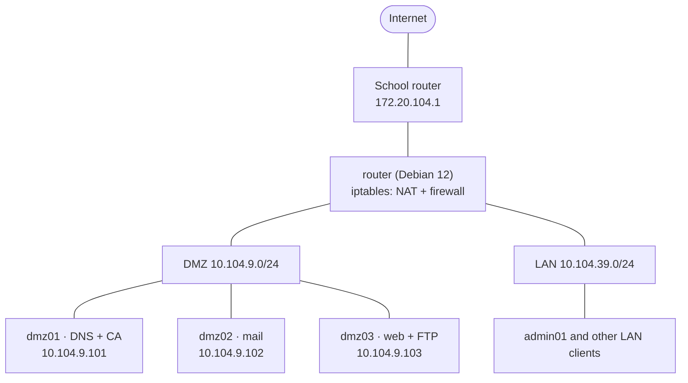

# Networking Labs: A Segmented Network with Linux Services (Debian 12)

One cumulative project, built as seven labs: a Debian 12 router that splits a network into **LAN** and **DMZ**, and the services running on top of it (DHCP, DNS, FTP, web with HTTPS, mail and an iptables firewall). Every lab has a step-by-step guide, the configuration files with an explanation of each directive, verification tests and screenshots of the real result.

> Originally written in Basque; the English version was translated with AI assistance. The lab work, configurations and screenshots are my own.
> Completed during second year of an Intermediate Vocational Degree in IT.

## The network

All machines are Debian 12 virtual machines in Oracle VirtualBox. The router connects the school (uplink) network, an isolated DMZ and an isolated LAN.



## Labs

The labs build on each other, so they are best read in order.

| # | Lab | What it builds | Software |
| --- | --- | --- | --- |
| 01 | [Router, LAN/DMZ and NAT](./01-router-lan-dmz-nat) | Three-interface Debian router, static addressing with `ifupdown`, IPv4 forwarding, source NAT, boot-time script, 15 connectivity tests | `iptables` |
| 02 | [DHCP server](./02-dhcp-server-lan-dmz) | Dynamic pools for LAN (180 addresses) and DMZ (20), MAC-based reservations, lease-time tuning, config backup and syntax check | `isc-dhcp-server` |
| 03 | [DNS](./03-dns-bind9-dmz-lan) | Two authoritative servers (`alberto.eus` in the DMZ, `alberto.lan` in the LAN) with forward and reverse zones, A/CNAME/MX/PTR records, forwarding, integration with DHCP | BIND9 |
| 04 | [FTP server](./04-ftp-server-vsftpd) | Per-customer chroot jails, read-only anonymous access to a public folder, an unjailed administrator account, connection limits, tests with CLI and FileZilla | vsftpd |
| 05 | [HTTP server](./05-http-server-apache) | Two name-based virtual hosts, access rules by IP and hostname, aliases, HTTPS with a private root CA and a SAN certificate, HTTP to HTTPS redirect | Apache2, OpenSSL |
| 06 | [Mail server](./06-mail-server-postfix-dovecot) | `user@alberto.eus` mailboxes, POP3/IMAP, webmail, size limits, TLS from the private CA, protocol tests with `telnet` and Thunderbird | Postfix, Dovecot, SquirrelMail |
| 07 | [Firewall](./07-firewall-iptables) | Full router policy: publishing DMZ services with DNAT, restricting FTP and mail to trusted hosts, blocking WAN pings, rules loaded at boot, plus a default-deny redesign as a proposal | `iptables` |

Dependencies: 01 → 02 → 03 → 04 and 05 → 06 → 07. Lab 06 reuses the certificate authority from lab 05, and lab 07 applies a policy over everything built before it.

## How each lab is organised

1. **Objective and scenario**, with the requirements as a table (R1, R2, …) and how each one is implemented
2. **Environment and prerequisites**
3. **Step-by-step configuration**, with each configuration directive explained
4. **Verification and testing**, with commands and screenshots
5. **Design notes and possible improvements**, where I list the weaknesses of my own setup and how to fix them (plain-text FTP, unencrypted mail authentication, an administrator account that can browse the whole file system, and so on)

There are 161 screenshots in total.

## Repository layout

```
01-router-lan-dmz-nat/        README.md + images/
02-dhcp-server-lan-dmz/
03-dns-bind9-dmz-lan/
04-ftp-server-vsftpd/
05-http-server-apache/
06-mail-server-postfix-dovecot/
07-firewall-iptables/
```

## Notes

- These are lab configurations in a virtual environment, not production setups. The design notes in each lab say what I would change before using any of it for real.
- Addresses belong to a private lab network. No credentials are included in the repository.
